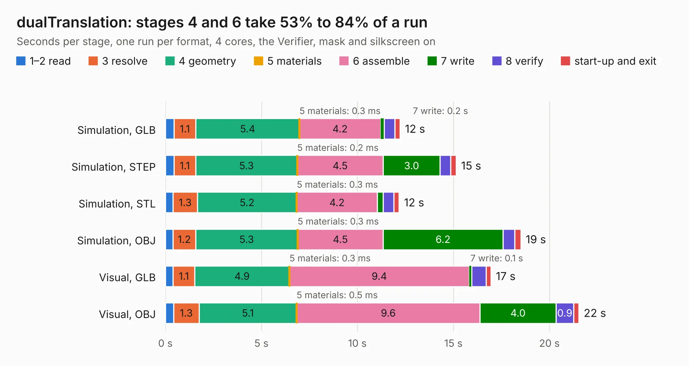

# 1242. dualTranslation

Board 1,242 of the 3,105 of [Corpus Testing](../Corpus-Testing.md), on [Corpus Page 12](../CorpusTestingPages/Corpus-Testing-12.md#1242-dualtranslation).

| Mode and format | 1–2 read | 3 resolve | 4 geometry | 5 materials | 6 assemble | 7 write | 8 verify | start-up and exit | Total |
|---|---:|---:|---:|---:|---:|---:|---:|---:|---:|
| Simulation, GLB | 0.4 | 1.1 | 5.4 | 0.3&nbsp;ms | 4.2 | 0.2 | 0.5 | 0.3 | 12.2 |
| Simulation, STEP | 0.4 | 1.1 | 5.3 | 0.2&nbsp;ms | 4.5 | 3.0 | 0.5 | 0.3 | 15.1 |
| Simulation, STL | 0.4 | 1.3 | 5.2 | 0.3&nbsp;ms | 4.2 | 0.3 | 0.6 | 0.3 | 12.2 |
| Simulation, OBJ | 0.4 | 1.2 | 5.3 | 0.3&nbsp;ms | 4.5 | 6.2 | 0.6 | 0.3 | 18.5 |
| Visual, GLB | 0.4 | 1.1 | 4.9 | 0.3&nbsp;ms | 9.4 | 0.1 | 0.8 | 0.2 | 17.0 |
| Visual, OBJ | 0.4 | 1.3 | 5.1 | 0.5&nbsp;ms | 9.6 | 4.0 | 0.9 | 0.3 | 21.5 |

<table align="center"><tr><td valign="top">

| Board | Repo: [intergalaktik/Extension_Boards_for_Olimex_GateMate](https://github.com/intergalaktik/Extension_Boards_for_Olimex_GateMate) Board: `dualTranslation.kicad_pcb` |
|---|---|
| Folder | dualTranslation |
| Complexity | 273&nbsp;/&nbsp;1000 (size&nbsp;188, features&nbsp;85) |
| KESE&nbsp;features | through vias, rounded, trapezoid or chamfered pads, filled zones, curved board outline, stack-up, dielectric εr and tanδ |
| Tested | 9th November 2026 |
| Copper&nbsp;layers | 4 |
| File&nbsp;format | KiCad 9 (20241229) |
| Parts,&nbsp;tracks,&nbsp;vias | 54, 521, 119 |
| Triangles,&nbsp;simulation | 941,732 in 56 parts |
| Verifier | PASS in all six runs |

</td><td valign="top">

<table>
<tr><th>File type</th><th>File size</th><th>Peak memory used</th></tr>
<tr><th colspan="3" align="left">Simulation</th></tr>
<tr><td>GLB</td><td align="right">33&nbsp;MB</td><td align="right">477&nbsp;MB</td></tr>
<tr><td>STEP</td><td align="right">153&nbsp;MB</td><td align="right">504&nbsp;MB</td></tr>
<tr><td>STL</td><td align="right">47&nbsp;MB</td><td align="right">443&nbsp;MB</td></tr>
<tr><td>OBJ</td><td align="right">97&nbsp;MB</td><td align="right">690&nbsp;MB</td></tr>
<tr><th colspan="3" align="left">Visual</th></tr>
<tr><td>GLB</td><td align="right">21&nbsp;MB</td><td align="right">537&nbsp;MB</td></tr>
<tr><td>OBJ</td><td align="right">64&nbsp;MB</td><td align="right">528&nbsp;MB</td></tr>
</table>

</td></tr></table>

| Previous | Next |
|:---|---:|
| [1241. camIO](b1241b_Extension-Boards-for-Olimex-GateMate_camIO.md) | [1243. dvi](b1243b_Extension-Boards-for-Olimex-GateMate_dvi.md) |
