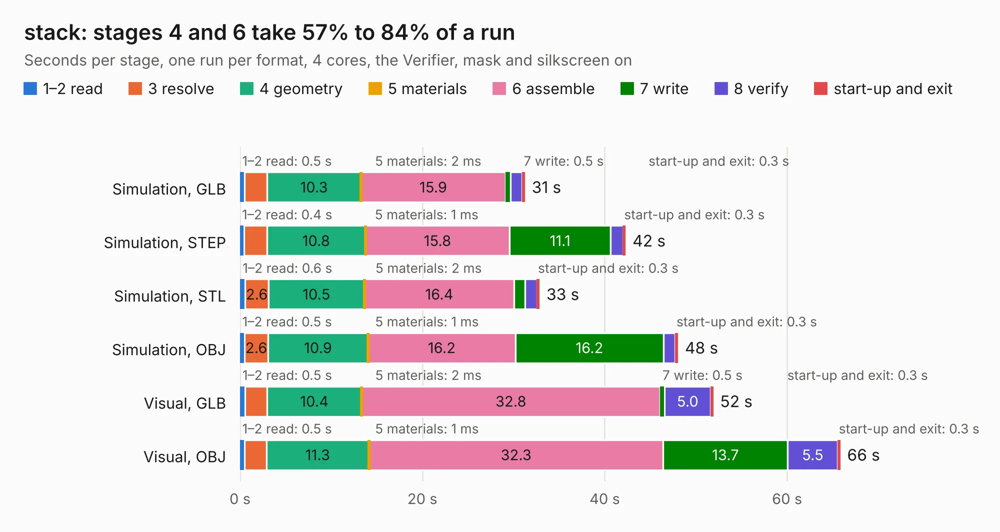

# 1243 stack

Board 1,243 of the 3,138 of [Corpus Testing](../Corpus-Testing.md), on [Corpus Page 12](../CorpusTestingPages/Corpus-Testing-12.md#1243-stack).

| Mode and format | 1–2 read | 3 resolve | 4 geometry | 5 materials | 6 assemble | 7 write | 8 verify | start-up and exit | Total |
|---|---:|---:|---:|---:|---:|---:|---:|---:|---:|
| Simulation, GLB | 0.5 | 2.5 | 10.3 | 2&nbsp;ms | 15.9 | 0.5 | 1.2 | 0.3 | 31.2 |
| Simulation, STEP | 0.4 | 2.5 | 10.8 | 1&nbsp;ms | 15.8 | 11.1 | 1.4 | 0.3 | 42.3 |
| Simulation, STL | 0.6 | 2.6 | 10.5 | 2&nbsp;ms | 16.4 | 1.2 | 1.3 | 0.3 | 32.8 |
| Simulation, OBJ | 0.5 | 2.6 | 10.9 | 1&nbsp;ms | 16.2 | 16.2 | 1.3 | 0.3 | 48.0 |
| Visual, GLB | 0.5 | 2.4 | 10.4 | 2&nbsp;ms | 32.8 | 0.5 | 5.0 | 0.3 | 51.9 |
| Visual, OBJ | 0.5 | 2.4 | 11.3 | 1&nbsp;ms | 32.3 | 13.7 | 5.5 | 0.3 | 65.8 |

<table align="center"><tr><td valign="top">

| Board | Repo: [imihajlow/ccpu](https://github.com/imihajlow/ccpu) Board: `stack.kicad_pcb` |
|---|---|
| Folder | boards / stack |
| Complexity | 293&nbsp;/&nbsp;1000 (size&nbsp;238, features&nbsp;55) |
| KESE&nbsp;features | through vias, rounded, trapezoid or chamfered pads, filled zones, copper text |
| Tested | 9th November 2026 |
| Copper&nbsp;layers | 2 |
| File&nbsp;format | KiCad 5 (20171130) |
| Parts,&nbsp;tracks,&nbsp;vias | 75, 2,008, 574 |
| Triangles,&nbsp;simulation | 3,306,378 in 155 parts |
| Verifier | PASS in all six runs |

</td><td valign="top">

<table>
<tr><th>File type</th><th>File size</th><th>Peak memory used</th></tr>
<tr><th colspan="3" align="left">Simulation</th></tr>
<tr><td>GLB</td><td align="right">110&nbsp;MB</td><td align="right">1.2&nbsp;GB</td></tr>
<tr><td>STEP</td><td align="right">477&nbsp;MB</td><td align="right">1.4&nbsp;GB</td></tr>
<tr><td>STL</td><td align="right">165&nbsp;MB</td><td align="right">1.2&nbsp;GB</td></tr>
<tr><td>OBJ</td><td align="right">343&nbsp;MB</td><td align="right">2.1&nbsp;GB</td></tr>
<tr><th colspan="3" align="left">Visual</th></tr>
<tr><td>GLB</td><td align="right">94&nbsp;MB</td><td align="right">1.5&nbsp;GB</td></tr>
<tr><td>OBJ</td><td align="right">297&nbsp;MB</td><td align="right">1.9&nbsp;GB</td></tr>
</table>

</td></tr></table>

| Previous | Next |
|:---|---:|
| [1242 registers](b1242b_ccpu_registers.md) | [1244 vario](b1244b_ccpu_vario.md) |
