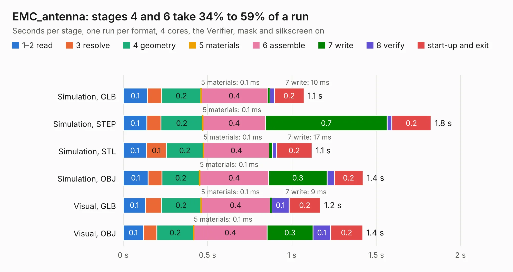

# 1246. EMC_antenna

Board 1,246 of the 3,116 of [Corpus Testing](../Corpus-Testing.md), on [Corpus Page 12](../CorpusTestingPages/Corpus-Testing-12.md#1246-emc_antenna).

| Mode and format | 1–2 read | 3 resolve | 4 geometry | 5 materials | 6 assemble | 7 write | 8 verify | start-up and exit | Total |
|---|---:|---:|---:|---:|---:|---:|---:|---:|---:|
| Simulation, GLB | 0.1 | 85&nbsp;ms | 0.2 | 0.1&nbsp;ms | 0.4 | 10&nbsp;ms | 28&nbsp;ms | 0.2 | 1.1 |
| Simulation, STEP | 0.1 | 84&nbsp;ms | 0.2 | 0.1&nbsp;ms | 0.4 | 0.7 | 27&nbsp;ms | 0.2 | 1.8 |
| Simulation, STL | 0.1 | 0.1 | 0.2 | 0.1&nbsp;ms | 0.4 | 17&nbsp;ms | 25&nbsp;ms | 0.2 | 1.1 |
| Simulation, OBJ | 0.1 | 83&nbsp;ms | 0.2 | 0.1&nbsp;ms | 0.4 | 0.3 | 42&nbsp;ms | 0.2 | 1.4 |
| Visual, GLB | 0.1 | 93&nbsp;ms | 0.2 | 0.1&nbsp;ms | 0.4 | 9&nbsp;ms | 0.1 | 0.2 | 1.2 |
| Visual, OBJ | 0.1 | 79&nbsp;ms | 0.2 | 0.1&nbsp;ms | 0.4 | 0.3 | 0.1 | 0.2 | 1.4 |

<table align="center"><tr><td valign="top">

| Board | Repo: [intergalaktik/EMC-experiments](https://github.com/intergalaktik/EMC-experiments) Board: `EMC_antenna.kicad_pcb` |
|---|---|
| Folder | EMC_antenna |
| Complexity | 69&nbsp;/&nbsp;1000 (size&nbsp;24, features&nbsp;45) |
| KESE&nbsp;features | arc tracks, stack-up, dielectric εr and tanδ |
| Tested | 9th November 2026 |
| Copper&nbsp;layers | 2 |
| File&nbsp;format | KiCad 8 (20240108) |
| Parts,&nbsp;tracks,&nbsp;vias | 1, 0, 0 |
| Triangles,&nbsp;simulation | 75,346 in 9 parts |
| Verifier | PASS in all six runs |

</td><td valign="top">

<table>
<tr><th>File type</th><th>File size</th><th>Peak memory used</th></tr>
<tr><th colspan="3" align="left">Simulation</th></tr>
<tr><td>GLB</td><td align="right">2.8&nbsp;MB</td><td align="right">79&nbsp;MB</td></tr>
<tr><td>STEP</td><td align="right">19&nbsp;MB</td><td align="right">193&nbsp;MB</td></tr>
<tr><td>STL</td><td align="right">3.8&nbsp;MB</td><td align="right">76&nbsp;MB</td></tr>
<tr><td>OBJ</td><td align="right">7.6&nbsp;MB</td><td align="right">107&nbsp;MB</td></tr>
<tr><th colspan="3" align="left">Visual</th></tr>
<tr><td>GLB</td><td align="right">2.1&nbsp;MB</td><td align="right">115&nbsp;MB</td></tr>
<tr><td>OBJ</td><td align="right">5.7&nbsp;MB</td><td align="right">142&nbsp;MB</td></tr>
</table>

</td></tr></table>

| Previous | Next |
|:---|---:|
| [1245. Intergalaktik_proto](b1245b_business-card-smd-proto_Intergalaktik-proto.md) | [1247. adcIO](b1247b_Extension-Boards-for-Olimex-GateMate_adcIO.md) |
