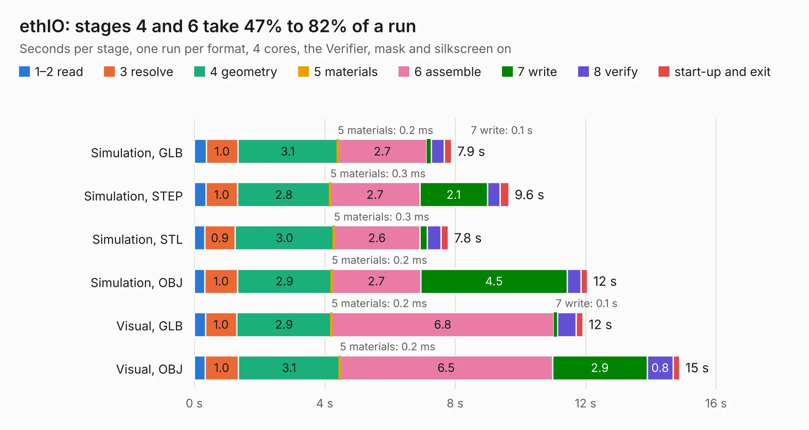

# 1246. ethIO

Board 1,246 of the 3,109 of [Corpus Testing](../Corpus-Testing.md), on [Corpus Page 12](../CorpusTestingPages/Corpus-Testing-12.md#1246-ethio).

| Mode and format | 1–2 read | 3 resolve | 4 geometry | 5 materials | 6 assemble | 7 write | 8 verify | start-up and exit | Total |
|---|---:|---:|---:|---:|---:|---:|---:|---:|---:|
| Simulation, GLB | 0.4 | 1.0 | 3.1 | 0.2&nbsp;ms | 2.7 | 0.1 | 0.4 | 0.2 | 7.9 |
| Simulation, STEP | 0.4 | 1.0 | 2.8 | 0.3&nbsp;ms | 2.7 | 2.1 | 0.4 | 0.3 | 9.6 |
| Simulation, STL | 0.3 | 0.9 | 3.0 | 0.3&nbsp;ms | 2.6 | 0.2 | 0.4 | 0.2 | 7.8 |
| Simulation, OBJ | 0.3 | 1.0 | 2.9 | 0.2&nbsp;ms | 2.7 | 4.5 | 0.4 | 0.2 | 12.1 |
| Visual, GLB | 0.3 | 1.0 | 2.9 | 0.2&nbsp;ms | 6.8 | 0.1 | 0.6 | 0.2 | 11.9 |
| Visual, OBJ | 0.3 | 1.0 | 3.1 | 0.2&nbsp;ms | 6.5 | 2.9 | 0.8 | 0.2 | 14.9 |

<table align="center"><tr><td valign="top">

| Board | Repo: [intergalaktik/Extension_Boards_for_Olimex_GateMate](https://github.com/intergalaktik/Extension_Boards_for_Olimex_GateMate) Board: `ethIO.kicad_pcb` |
|---|---|
| Folder | ethIO |
| Complexity | 320&nbsp;/&nbsp;1000 (size&nbsp;190, features&nbsp;130) |
| KESE&nbsp;features | through vias, rounded, trapezoid or chamfered pads, filled zones, curved board outline, knockout text, TrueType text, stack-up, dielectric εr and tanδ, copper finish |
| Tested | 9th November 2026 |
| Copper&nbsp;layers | 4 |
| File&nbsp;format | KiCad 8 (20240108) |
| Parts,&nbsp;tracks,&nbsp;vias | 46, 708, 122 |
| Triangles,&nbsp;simulation | 860,620 in 62 parts |
| Verifier | PASS in all six runs |

</td><td valign="top">

<table>
<tr><th>File type</th><th>File size</th><th>Peak memory used</th></tr>
<tr><th colspan="3" align="left">Simulation</th></tr>
<tr><td>GLB</td><td align="right">30&nbsp;MB</td><td align="right">379&nbsp;MB</td></tr>
<tr><td>STEP</td><td align="right">141&nbsp;MB</td><td align="right">457&nbsp;MB</td></tr>
<tr><td>STL</td><td align="right">43&nbsp;MB</td><td align="right">379&nbsp;MB</td></tr>
<tr><td>OBJ</td><td align="right">89&nbsp;MB</td><td align="right">626&nbsp;MB</td></tr>
<tr><th colspan="3" align="left">Visual</th></tr>
<tr><td>GLB</td><td align="right">20&nbsp;MB</td><td align="right">466&nbsp;MB</td></tr>
<tr><td>OBJ</td><td align="right">61&nbsp;MB</td><td align="right">489&nbsp;MB</td></tr>
</table>

</td></tr></table>

| Previous | Next |
|:---|---:|
| [1245. eduIO](b1245b_Extension-Boards-for-Olimex-GateMate_eduIO.md) | [1247. extension_template](b1247b_Extension-Boards-for-Olimex-GateMate_extension-template.md) |
