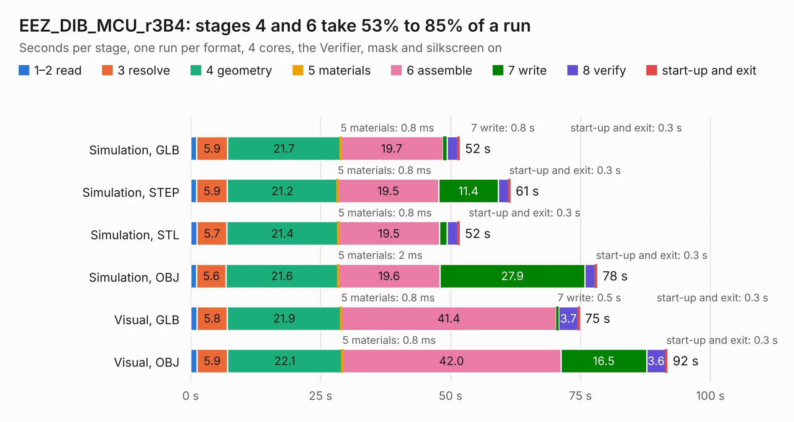

# 1247. EEZ_DIB_MCU_r3B4

Board 1,247 of the 3,125 of [Corpus Testing](../Corpus-Testing.md), on [Corpus Page 12](../CorpusTestingPages/Corpus-Testing-12.md#1247-eez_dib_mcu_r3b4).

| Mode and format | 1–2 read | 3 resolve | 4 geometry | 5 materials | 6 assemble | 7 write | 8 verify | start-up and exit | Total |
|---|---:|---:|---:|---:|---:|---:|---:|---:|---:|
| Simulation, GLB | 1.2 | 5.9 | 21.7 | 0.8&nbsp;ms | 19.7 | 0.8 | 2.0 | 0.3 | 51.7 |
| Simulation, STEP | 1.2 | 5.9 | 21.2 | 0.8&nbsp;ms | 19.5 | 11.4 | 2.0 | 0.3 | 61.4 |
| Simulation, STL | 1.2 | 5.7 | 21.4 | 0.8&nbsp;ms | 19.5 | 1.4 | 2.0 | 0.3 | 51.7 |
| Simulation, OBJ | 1.2 | 5.6 | 21.6 | 2&nbsp;ms | 19.6 | 27.9 | 2.0 | 0.3 | 78.2 |
| Visual, GLB | 1.2 | 5.8 | 21.9 | 0.8&nbsp;ms | 41.4 | 0.5 | 3.7 | 0.3 | 74.8 |
| Visual, OBJ | 1.2 | 5.9 | 22.1 | 0.8&nbsp;ms | 42.0 | 16.5 | 3.6 | 0.3 | 91.6 |

<table align="center"><tr><td valign="top">

| Board | Repo: [intergalaktik/bb3-cm4](https://github.com/intergalaktik/bb3-cm4) Board: `EEZ_DIB_MCU_r3B4.kicad_pcb` |
|---|---|
| Folder | EEZ_BB3_CM4_R1B0 |
| Complexity | 371&nbsp;/&nbsp;1000 (size&nbsp;276, features&nbsp;95) |
| KESE&nbsp;features | through vias, rounded, trapezoid or chamfered pads, filled zones, copper text, curved board outline, stack-up, dielectric εr and tanδ |
| Tested | 9th November 2026 |
| Copper&nbsp;layers | 4 |
| File&nbsp;format | KiCad 6 (20211014) |
| Parts,&nbsp;tracks,&nbsp;vias | 185, 5,012, 755 |
| Triangles,&nbsp;simulation | 5,098,868 in 274 parts |
| Verifier | PASS in all six runs |

</td><td valign="top">

<table>
<tr><th>File type</th><th>File size</th><th>Peak memory used</th></tr>
<tr><th colspan="3" align="left">Simulation</th></tr>
<tr><td>GLB</td><td align="right">174&nbsp;MB</td><td align="right">1.4&nbsp;GB</td></tr>
<tr><td>STEP</td><td align="right">787&nbsp;MB</td><td align="right">1.9&nbsp;GB</td></tr>
<tr><td>STL</td><td align="right">255&nbsp;MB</td><td align="right">1.5&nbsp;GB</td></tr>
<tr><td>OBJ</td><td align="right">549&nbsp;MB</td><td align="right">3.3&nbsp;GB</td></tr>
<tr><th colspan="3" align="left">Visual</th></tr>
<tr><td>GLB</td><td align="right">106&nbsp;MB</td><td align="right">1.8&nbsp;GB</td></tr>
<tr><td>OBJ</td><td align="right">342&nbsp;MB</td><td align="right">2.4&nbsp;GB</td></tr>
</table>

</td></tr></table>

| Previous | Next |
|:---|---:|
| [1246. EEZ_DIB_BP3C_r3B3](b1246b_bb3-cm4_EEZ-BB3-CM4-R1B0_EEZ-DIB-BP3C-r3B3.md) | [1248. EEZ_BB3_CM4_SoM](b1248b_bb3-cm4_EEZ-BB3-CM4-SoM.md) |
