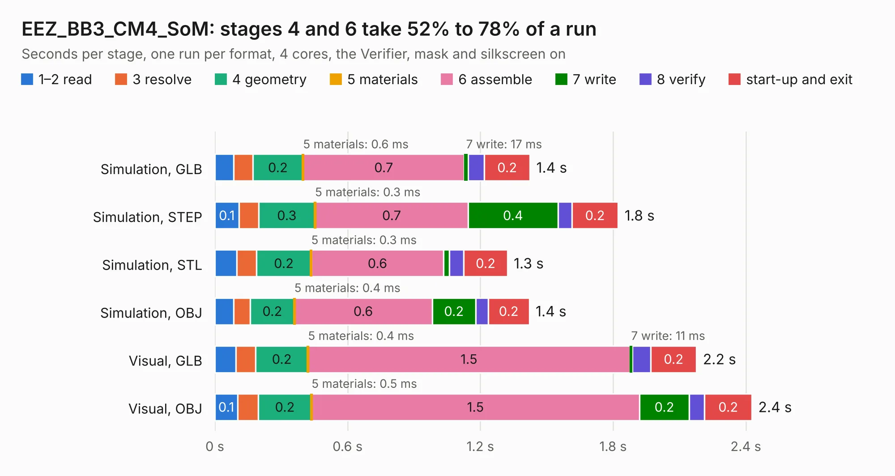

# 1248. EEZ_BB3_CM4_SoM

Board 1,248 of the 3,124 of [Corpus Testing](../Corpus-Testing.md), on [Corpus Page 12](../CorpusTestingPages/Corpus-Testing-12.md#1248-eez_bb3_cm4_som).

| Mode and format | 1–2 read | 3 resolve | 4 geometry | 5 materials | 6 assemble | 7 write | 8 verify | start-up and exit | Total |
|---|---:|---:|---:|---:|---:|---:|---:|---:|---:|
| Simulation, GLB | 84&nbsp;ms | 87&nbsp;ms | 0.2 | 0.6&nbsp;ms | 0.7 | 17&nbsp;ms | 74&nbsp;ms | 0.2 | 1.4 |
| Simulation, STEP | 0.1 | 90&nbsp;ms | 0.3 | 0.3&nbsp;ms | 0.7 | 0.4 | 63&nbsp;ms | 0.2 | 1.8 |
| Simulation, STL | 99&nbsp;ms | 89&nbsp;ms | 0.2 | 0.3&nbsp;ms | 0.6 | 26&nbsp;ms | 66&nbsp;ms | 0.2 | 1.3 |
| Simulation, OBJ | 85&nbsp;ms | 75&nbsp;ms | 0.2 | 0.4&nbsp;ms | 0.6 | 0.2 | 56&nbsp;ms | 0.2 | 1.4 |
| Visual, GLB | 95&nbsp;ms | 89&nbsp;ms | 0.2 | 0.4&nbsp;ms | 1.5 | 11&nbsp;ms | 83&nbsp;ms | 0.2 | 2.2 |
| Visual, OBJ | 0.1 | 93&nbsp;ms | 0.2 | 0.5&nbsp;ms | 1.5 | 0.2 | 69&nbsp;ms | 0.2 | 2.4 |

<table align="center"><tr><td valign="top">

| Board | Repo: [intergalaktik/bb3-cm4](https://github.com/intergalaktik/bb3-cm4) Board: `EEZ_BB3_CM4_SoM.kicad_pcb` |
|---|---|
| Folder | EEZ_BB3_CM4_SoM |
| Complexity | 75&nbsp;/&nbsp;1000 (size&nbsp;45, features&nbsp;30) |
| KESE&nbsp;features | stack-up, dielectric εr and tanδ |
| Tested | 9th November 2026 |
| Copper&nbsp;layers | 4 |
| File&nbsp;format | KiCad 7 (20221018) |
| Parts,&nbsp;tracks,&nbsp;vias | 2, 0, 0 |
| Triangles,&nbsp;simulation | 32,988 in 181 parts |
| Verifier | PASS in all six runs |

</td><td valign="top">

<table>
<tr><th>File type</th><th>File size</th><th>Peak memory used</th></tr>
<tr><th colspan="3" align="left">Simulation</th></tr>
<tr><td>GLB</td><td align="right">1.3&nbsp;MB</td><td align="right">75&nbsp;MB</td></tr>
<tr><td>STEP</td><td align="right">6.6&nbsp;MB</td><td align="right">78&nbsp;MB</td></tr>
<tr><td>STL</td><td align="right">1.7&nbsp;MB</td><td align="right">74&nbsp;MB</td></tr>
<tr><td>OBJ</td><td align="right">3.8&nbsp;MB</td><td align="right">81&nbsp;MB</td></tr>
<tr><th colspan="3" align="left">Visual</th></tr>
<tr><td>GLB</td><td align="right">1.8&nbsp;MB</td><td align="right">118&nbsp;MB</td></tr>
<tr><td>OBJ</td><td align="right">5.0&nbsp;MB</td><td align="right">115&nbsp;MB</td></tr>
</table>

</td></tr></table>

| Previous | Next |
|:---|---:|
| [1247. EEZ_DIB_MCU_r3B4](b1247b_bb3-cm4_EEZ-BB3-CM4-R1B0_EEZ-DIB-MCU-r3B4.md) | [1249. EEZ_DIB_BP3C_r3B3](b1249b_bb3-cm4_EEZ-DIB-BP3C-R3B3_EEZ-DIB-BP3C-r3B3.md) |
