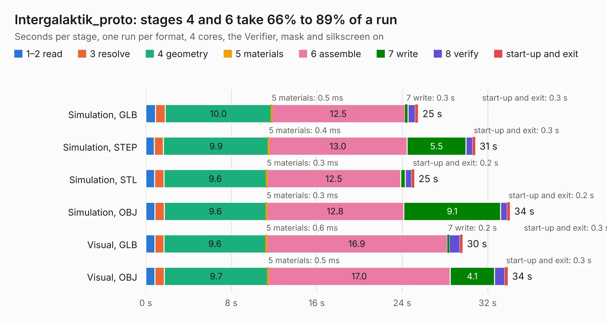

# 1249. Intergalaktik_proto

Board 1,249 of the 3,120 of [Corpus Testing](../Corpus-Testing.md), on [Corpus Page 12](../CorpusTestingPages/Corpus-Testing-12.md#1249-intergalaktik_proto).

| Mode and format | 1–2 read | 3 resolve | 4 geometry | 5 materials | 6 assemble | 7 write | 8 verify | start-up and exit | Total |
|---|---:|---:|---:|---:|---:|---:|---:|---:|---:|
| Simulation, GLB | 0.9 | 0.9 | 10.0 | 0.5&nbsp;ms | 12.5 | 0.3 | 0.7 | 0.3 | 25.5 |
| Simulation, STEP | 0.8 | 0.9 | 9.9 | 0.4&nbsp;ms | 13.0 | 5.5 | 0.6 | 0.3 | 30.8 |
| Simulation, STL | 0.8 | 0.9 | 9.6 | 0.3&nbsp;ms | 12.5 | 0.4 | 0.6 | 0.2 | 25.1 |
| Simulation, OBJ | 0.8 | 0.9 | 9.6 | 0.3&nbsp;ms | 12.8 | 9.1 | 0.6 | 0.2 | 34.1 |
| Visual, GLB | 0.8 | 0.9 | 9.6 | 0.6&nbsp;ms | 16.9 | 0.2 | 1.0 | 0.3 | 29.7 |
| Visual, OBJ | 0.9 | 0.9 | 9.7 | 0.5&nbsp;ms | 17.0 | 4.1 | 1.0 | 0.3 | 33.9 |

<table align="center"><tr><td valign="top">

| Board | Repo: [intergalaktik/business-card-smd-proto](https://github.com/intergalaktik/business-card-smd-proto) Board: `Intergalaktik_proto.kicad_pcb` |
|---|---|
| Folder | KiCad / Intergalaktik_proto |
| Complexity | 183&nbsp;/&nbsp;1000 (size&nbsp;98, features&nbsp;85) |
| KESE&nbsp;features | through vias, rounded, trapezoid or chamfered pads, filled zones, copper drawings, stack-up, dielectric εr and tanδ |
| Tested | 9th November 2026 |
| Copper&nbsp;layers | 2 |
| File&nbsp;format | KiCad 8 (20240108) |
| Parts,&nbsp;tracks,&nbsp;vias | 0, 119, 8 |
| Triangles,&nbsp;simulation | 1,533,816 in 24 parts |
| Note | no components |
| Verifier | PASS in all six runs |

</td><td valign="top">

<table>
<tr><th>File type</th><th>File size</th><th>Peak memory used</th></tr>
<tr><th colspan="3" align="left">Simulation</th></tr>
<tr><td>GLB</td><td align="right">53&nbsp;MB</td><td align="right">649&nbsp;MB</td></tr>
<tr><td>STEP</td><td align="right">319&nbsp;MB</td><td align="right">826&nbsp;MB</td></tr>
<tr><td>STL</td><td align="right">77&nbsp;MB</td><td align="right">683&nbsp;MB</td></tr>
<tr><td>OBJ</td><td align="right">161&nbsp;MB</td><td align="right">1.1&nbsp;GB</td></tr>
<tr><th colspan="3" align="left">Visual</th></tr>
<tr><td>GLB</td><td align="right">24&nbsp;MB</td><td align="right">675&nbsp;MB</td></tr>
<tr><td>OBJ</td><td align="right">74&nbsp;MB</td><td align="right">652&nbsp;MB</td></tr>
</table>

</td></tr></table>

| Previous | Next |
|:---|---:|
| [1248. EEZ_DIB_MCU_r3B4](b1248b_bb3-cm4_EEZ-DIB-MCU-r3B4_EEZ-DIB-MCU-r3B4.md) | [1250. EMC_antenna](b1250b_EMC-experiments_EMC-antenna.md) |
