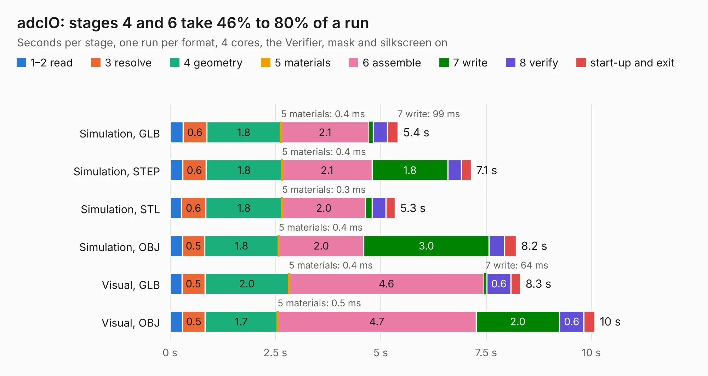

# 1253. adcIO

Board 1,253 of the 3,125 of [Corpus Testing](../Corpus-Testing.md), on [Corpus Page 12](../CorpusTestingPages/Corpus-Testing-12.md#1253-adcio).

| Mode and format | 1–2 read | 3 resolve | 4 geometry | 5 materials | 6 assemble | 7 write | 8 verify | start-up and exit | Total |
|---|---:|---:|---:|---:|---:|---:|---:|---:|---:|
| Simulation, GLB | 0.3 | 0.6 | 1.8 | 0.4&nbsp;ms | 2.1 | 99&nbsp;ms | 0.3 | 0.3 | 5.4 |
| Simulation, STEP | 0.3 | 0.6 | 1.8 | 0.4&nbsp;ms | 2.1 | 1.8 | 0.3 | 0.2 | 7.1 |
| Simulation, STL | 0.3 | 0.6 | 1.8 | 0.3&nbsp;ms | 2.0 | 0.2 | 0.3 | 0.2 | 5.3 |
| Simulation, OBJ | 0.3 | 0.5 | 1.8 | 0.4&nbsp;ms | 2.0 | 3.0 | 0.4 | 0.3 | 8.2 |
| Visual, GLB | 0.3 | 0.5 | 2.0 | 0.4&nbsp;ms | 4.6 | 64&nbsp;ms | 0.6 | 0.2 | 8.3 |
| Visual, OBJ | 0.3 | 0.5 | 1.7 | 0.5&nbsp;ms | 4.7 | 2.0 | 0.6 | 0.3 | 10.1 |

<table align="center"><tr><td valign="top">

| Board | Repo: [intergalaktik/Extension_Boards_for_Olimex_GateMate](https://github.com/intergalaktik/Extension_Boards_for_Olimex_GateMate) Board: `adcIO.kicad_pcb` |
|---|---|
| Folder | adcIO |
| Complexity | 286&nbsp;/&nbsp;1000 (size&nbsp;171, features&nbsp;115) |
| KESE&nbsp;features | through vias, rounded, trapezoid or chamfered pads, filled zones, curved board outline, knockout text, stack-up, dielectric εr and tanδ, copper finish |
| Tested | 9th November 2026 |
| Copper&nbsp;layers | 4 |
| File&nbsp;format | KiCad 8 (20240108) |
| Parts,&nbsp;tracks,&nbsp;vias | 36, 212, 66 |
| Triangles,&nbsp;simulation | 640,134 in 52 parts |
| Verifier | PASS in all six runs |

</td><td valign="top">

<table>
<tr><th>File type</th><th>File size</th><th>Peak memory used</th></tr>
<tr><th colspan="3" align="left">Simulation</th></tr>
<tr><td>GLB</td><td align="right">22&nbsp;MB</td><td align="right">355&nbsp;MB</td></tr>
<tr><td>STEP</td><td align="right">96&nbsp;MB</td><td align="right">393&nbsp;MB</td></tr>
<tr><td>STL</td><td align="right">32&nbsp;MB</td><td align="right">390&nbsp;MB</td></tr>
<tr><td>OBJ</td><td align="right">65&nbsp;MB</td><td align="right">469&nbsp;MB</td></tr>
<tr><th colspan="3" align="left">Visual</th></tr>
<tr><td>GLB</td><td align="right">15&nbsp;MB</td><td align="right">392&nbsp;MB</td></tr>
<tr><td>OBJ</td><td align="right">43&nbsp;MB</td><td align="right">383&nbsp;MB</td></tr>
</table>

</td></tr></table>

| Previous | Next |
|:---|---:|
| [1252. EMC_antenna](b1252b_EMC-experiments_EMC-antenna.md) | [1254. camIO](b1254b_Extension-Boards-for-Olimex-GateMate_camIO.md) |
