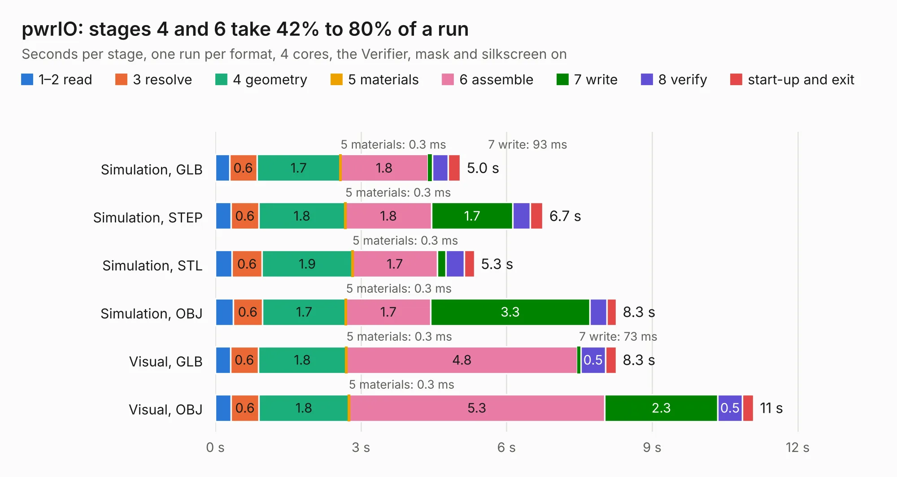

# 1257. pwrIO

Board 1,257 of the 3,116 of [Corpus Testing](../Corpus-Testing.md), on [Corpus Page 12](../CorpusTestingPages/Corpus-Testing-12.md#1257-pwrio).

| Mode and format | 1–2 read | 3 resolve | 4 geometry | 5 materials | 6 assemble | 7 write | 8 verify | start-up and exit | Total |
|---|---:|---:|---:|---:|---:|---:|---:|---:|---:|
| Simulation, GLB | 0.3 | 0.6 | 1.7 | 0.3&nbsp;ms | 1.8 | 93&nbsp;ms | 0.3 | 0.2 | 5.0 |
| Simulation, STEP | 0.3 | 0.6 | 1.8 | 0.3&nbsp;ms | 1.8 | 1.7 | 0.4 | 0.3 | 6.7 |
| Simulation, STL | 0.3 | 0.6 | 1.9 | 0.3&nbsp;ms | 1.7 | 0.2 | 0.4 | 0.2 | 5.3 |
| Simulation, OBJ | 0.4 | 0.6 | 1.7 | 0.3&nbsp;ms | 1.7 | 3.3 | 0.4 | 0.2 | 8.3 |
| Visual, GLB | 0.3 | 0.6 | 1.8 | 0.3&nbsp;ms | 4.8 | 73&nbsp;ms | 0.5 | 0.2 | 8.3 |
| Visual, OBJ | 0.3 | 0.6 | 1.8 | 0.3&nbsp;ms | 5.3 | 2.3 | 0.5 | 0.2 | 11.1 |

<table align="center"><tr><td valign="top">

| Board | Repo: [intergalaktik/Extension_Boards_for_Olimex_GateMate](https://github.com/intergalaktik/Extension_Boards_for_Olimex_GateMate) Board: `pwrIO.kicad_pcb` |
|---|---|
| Folder | pwrIO |
| Complexity | 255&nbsp;/&nbsp;1000 (size&nbsp;180, features&nbsp;75) |
| KESE&nbsp;features | through vias, rounded, trapezoid or chamfered pads, filled zones, stack-up, dielectric εr and tanδ |
| Tested | 9th November 2026 |
| Copper&nbsp;layers | 4 |
| File&nbsp;format | KiCad 8 (20240108) |
| Parts,&nbsp;tracks,&nbsp;vias | 45, 441, 59 |
| Triangles,&nbsp;simulation | 577,794 in 60 parts |
| Verifier | PASS in all six runs |

</td><td valign="top">

<table>
<tr><th>File type</th><th>File size</th><th>Peak memory used</th></tr>
<tr><th colspan="3" align="left">Simulation</th></tr>
<tr><td>GLB</td><td align="right">20&nbsp;MB</td><td align="right">329&nbsp;MB</td></tr>
<tr><td>STEP</td><td align="right">94&nbsp;MB</td><td align="right">370&nbsp;MB</td></tr>
<tr><td>STL</td><td align="right">29&nbsp;MB</td><td align="right">324&nbsp;MB</td></tr>
<tr><td>OBJ</td><td align="right">59&nbsp;MB</td><td align="right">434&nbsp;MB</td></tr>
<tr><th colspan="3" align="left">Visual</th></tr>
<tr><td>GLB</td><td align="right">15&nbsp;MB</td><td align="right">394&nbsp;MB</td></tr>
<tr><td>OBJ</td><td align="right">44&nbsp;MB</td><td align="right">409&nbsp;MB</td></tr>
</table>

</td></tr></table>

| Previous | Next |
|:---|---:|
| [1256. MikroBusIO](b1256b_Extension-Boards-for-Olimex-GateMate_MikroBusIO.md) | [1258. simpleIO](b1258b_Extension-Boards-for-Olimex-GateMate_simpleIO.md) |
