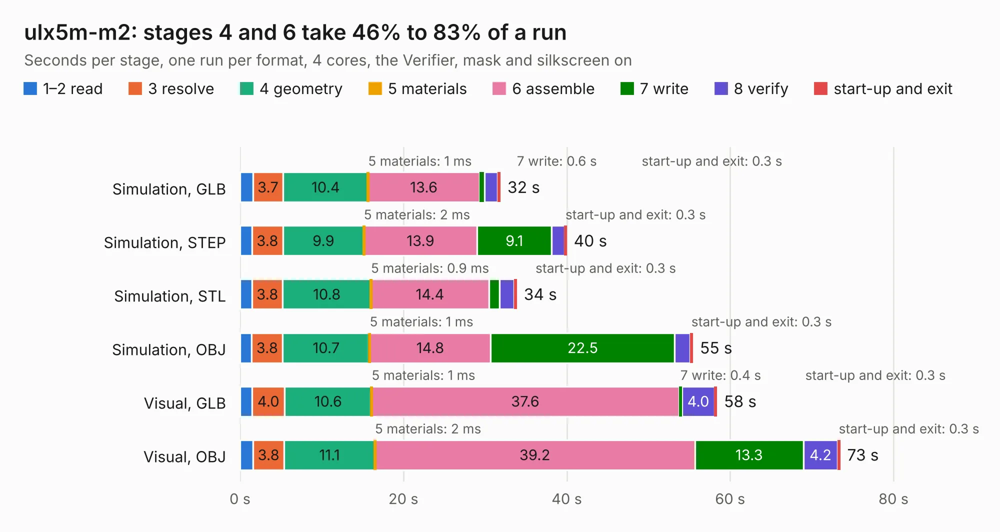

# 1258. ulx5m-m2

Board 1,258 of the 3,100 of [Corpus Testing](../Corpus-Testing.md), on [Corpus Page 12](../CorpusTestingPages/Corpus-Testing-12.md#1258-ulx5m-m2).

| Mode and format | 1–2 read | 3 resolve | 4 geometry | 5 materials | 6 assemble | 7 write | 8 verify | start-up and exit | Total |
|---|---:|---:|---:|---:|---:|---:|---:|---:|---:|
| Simulation, GLB | 1.6 | 3.7 | 10.4 | 1&nbsp;ms | 13.6 | 0.6 | 1.6 | 0.3 | 31.9 |
| Simulation, STEP | 1.4 | 3.8 | 9.9 | 2&nbsp;ms | 13.9 | 9.1 | 1.6 | 0.3 | 40.0 |
| Simulation, STL | 1.5 | 3.8 | 10.8 | 0.9&nbsp;ms | 14.4 | 1.3 | 1.8 | 0.3 | 33.9 |
| Simulation, OBJ | 1.4 | 3.8 | 10.7 | 1&nbsp;ms | 14.8 | 22.5 | 1.9 | 0.3 | 55.4 |
| Visual, GLB | 1.5 | 4.0 | 10.6 | 1&nbsp;ms | 37.6 | 0.4 | 4.0 | 0.3 | 58.4 |
| Visual, OBJ | 1.6 | 3.8 | 11.1 | 2&nbsp;ms | 39.2 | 13.3 | 4.2 | 0.3 | 73.4 |

<table align="center"><tr><td valign="top">

| Board | Repo: [intergalaktik/ulx5m-m2](https://github.com/intergalaktik/ulx5m-m2) Board: `ulx5m-m2.kicad_pcb` |
|---|---|
| Complexity | 405&nbsp;/&nbsp;1000 (size&nbsp;295, features&nbsp;110) |
| KESE&nbsp;features | through vias, slotted holes, custom pads, rounded, trapezoid or chamfered pads, filled zones, copper drawings, stack-up, dielectric εr and tanδ |
| Tested | 9th November 2026 |
| Copper&nbsp;layers | 6 |
| File&nbsp;format | KiCad 10 (20260206) |
| Parts,&nbsp;tracks,&nbsp;vias | 208, 4,044, 559 |
| Triangles,&nbsp;simulation | 3,982,396 in 294 parts |
| Verifier | PASS in all six runs |

</td><td valign="top">

<table>
<tr><th>File type</th><th>File size</th><th>Peak memory used</th></tr>
<tr><th colspan="3" align="left">Simulation</th></tr>
<tr><td>GLB</td><td align="right">134&nbsp;MB</td><td align="right">1.2&nbsp;GB</td></tr>
<tr><td>STEP</td><td align="right">534&nbsp;MB</td><td align="right">1.5&nbsp;GB</td></tr>
<tr><td>STL</td><td align="right">199&nbsp;MB</td><td align="right">1.1&nbsp;GB</td></tr>
<tr><td>OBJ</td><td align="right">429&nbsp;MB</td><td align="right">2.6&nbsp;GB</td></tr>
<tr><th colspan="3" align="left">Visual</th></tr>
<tr><td>GLB</td><td align="right">77&nbsp;MB</td><td align="right">1.5&nbsp;GB</td></tr>
<tr><td>OBJ</td><td align="right">249&nbsp;MB</td><td align="right">1.7&nbsp;GB</td></tr>
</table>

</td></tr></table>

| Previous | Next |
|:---|---:|
| [1257. ulx5m-gs](b1257b_ulx5m-gs_ulx5m-gs.md) | [1259. arena_10_of_10_v1r1](b1259b_led-display-g6-hardware-arena_arena-10-10-arena-10-10-v1_arena-10-of-10-v1r1.md) |
