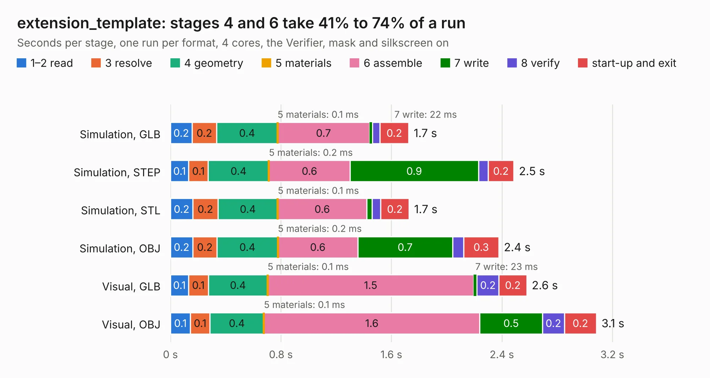

# 1259. extension_template

Board 1,259 of the 3,128 of [Corpus Testing](../Corpus-Testing.md), on [Corpus Page 12](../CorpusTestingPages/Corpus-Testing-12.md#1259-extension_template).

| Mode and format | 1–2 read | 3 resolve | 4 geometry | 5 materials | 6 assemble | 7 write | 8 verify | start-up and exit | Total |
|---|---:|---:|---:|---:|---:|---:|---:|---:|---:|
| Simulation, GLB | 0.2 | 0.2 | 0.4 | 0.1&nbsp;ms | 0.7 | 22&nbsp;ms | 55&nbsp;ms | 0.2 | 1.7 |
| Simulation, STEP | 0.1 | 0.1 | 0.4 | 0.2&nbsp;ms | 0.6 | 0.9 | 69&nbsp;ms | 0.2 | 2.5 |
| Simulation, STL | 0.2 | 0.2 | 0.4 | 0.1&nbsp;ms | 0.6 | 40&nbsp;ms | 61&nbsp;ms | 0.2 | 1.7 |
| Simulation, OBJ | 0.2 | 0.2 | 0.4 | 0.2&nbsp;ms | 0.6 | 0.7 | 80&nbsp;ms | 0.3 | 2.4 |
| Visual, GLB | 0.1 | 0.1 | 0.4 | 0.1&nbsp;ms | 1.5 | 23&nbsp;ms | 0.2 | 0.2 | 2.6 |
| Visual, OBJ | 0.1 | 0.1 | 0.4 | 0.1&nbsp;ms | 1.6 | 0.5 | 0.2 | 0.2 | 3.1 |

<table align="center"><tr><td valign="top">

| Board | Repo: [intergalaktik/Extension_Boards_for_Olimex_GateMate](https://github.com/intergalaktik/Extension_Boards_for_Olimex_GateMate) Board: `extension_template.kicad_pcb` |
|---|---|
| Folder | extension_template |
| Complexity | 241&nbsp;/&nbsp;1000 (size&nbsp;126, features&nbsp;115) |
| KESE&nbsp;features | through vias, rounded, trapezoid or chamfered pads, filled zones, curved board outline, knockout text, stack-up, dielectric εr and tanδ, copper finish |
| Tested | 9th November 2026 |
| Copper&nbsp;layers | 4 |
| File&nbsp;format | KiCad 8 (20240108) |
| Parts,&nbsp;tracks,&nbsp;vias | 7, 51, 6 |
| Triangles,&nbsp;simulation | 139,358 in 36 parts |
| Verifier | PASS in all six runs |

</td><td valign="top">

<table>
<tr><th>File type</th><th>File size</th><th>Peak memory used</th></tr>
<tr><th colspan="3" align="left">Simulation</th></tr>
<tr><td>GLB</td><td align="right">5.0&nbsp;MB</td><td align="right">213&nbsp;MB</td></tr>
<tr><td>STEP</td><td align="right">28&nbsp;MB</td><td align="right">220&nbsp;MB</td></tr>
<tr><td>STL</td><td align="right">7.0&nbsp;MB</td><td align="right">211&nbsp;MB</td></tr>
<tr><td>OBJ</td><td align="right">14&nbsp;MB</td><td align="right">205&nbsp;MB</td></tr>
<tr><th colspan="3" align="left">Visual</th></tr>
<tr><td>GLB</td><td align="right">4.4&nbsp;MB</td><td align="right">170&nbsp;MB</td></tr>
<tr><td>OBJ</td><td align="right">12&nbsp;MB</td><td align="right">179&nbsp;MB</td></tr>
</table>

</td></tr></table>

| Previous | Next |
|:---|---:|
| [1258. ethIO](b1258b_Extension-Boards-for-Olimex-GateMate_ethIO.md) | [1260. GamePad_I2S_audio](b1260b_Extension-Boards-for-Olimex-GateMate_GamePad-I2S-audio-KiCad_GamePad-I2S-audio.md) |
