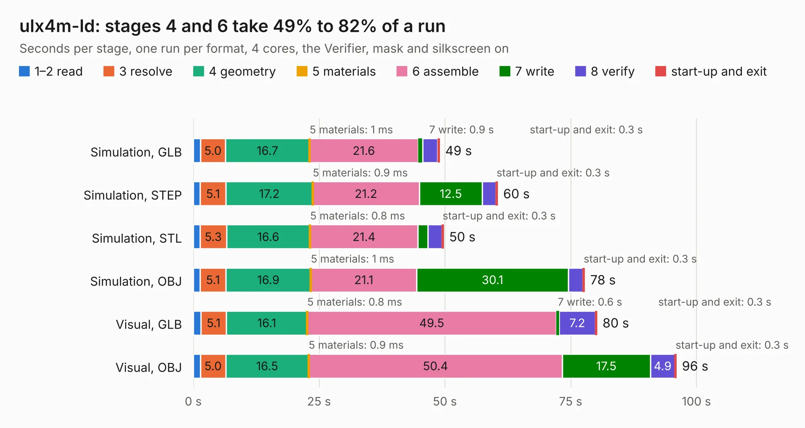

# 1260. ulx4m-ld

Board 1,260 of the 3,106 of [Corpus Testing](../Corpus-Testing.md), on [Corpus Page 12](../CorpusTestingPages/Corpus-Testing-12.md#1260-ulx4m-ld).

| Mode and format | 1–2 read | 3 resolve | 4 geometry | 5 materials | 6 assemble | 7 write | 8 verify | start-up and exit | Total |
|---|---:|---:|---:|---:|---:|---:|---:|---:|---:|
| Simulation, GLB | 1.4 | 5.0 | 16.7 | 1&nbsp;ms | 21.6 | 0.9 | 3.0 | 0.3 | 48.9 |
| Simulation, STEP | 1.4 | 5.1 | 17.2 | 0.9&nbsp;ms | 21.2 | 12.5 | 2.7 | 0.3 | 60.5 |
| Simulation, STL | 1.3 | 5.3 | 16.6 | 0.8&nbsp;ms | 21.4 | 2.0 | 2.7 | 0.3 | 49.7 |
| Simulation, OBJ | 1.3 | 5.1 | 16.9 | 1&nbsp;ms | 21.1 | 30.1 | 2.9 | 0.3 | 77.7 |
| Visual, GLB | 1.5 | 5.1 | 16.1 | 0.8&nbsp;ms | 49.5 | 0.6 | 7.2 | 0.3 | 80.2 |
| Visual, OBJ | 1.4 | 5.0 | 16.5 | 0.9&nbsp;ms | 50.4 | 17.5 | 4.9 | 0.3 | 96.0 |

<table align="center"><tr><td valign="top">

| Board | Repo: [intergalaktik/ULX4M-LD](https://github.com/intergalaktik/ULX4M-LD) Board: `ulx4m-ld.kicad_pcb` |
|---|---|
| Complexity | 409&nbsp;/&nbsp;1000 (size&nbsp;324, features&nbsp;85) |
| KESE&nbsp;features | through vias, rounded, trapezoid or chamfered pads, filled zones, curved board outline, stack-up, dielectric εr and tanδ |
| Tested | 9th November 2026 |
| Copper&nbsp;layers | 6 |
| File&nbsp;format | KiCad 8 (20240108) |
| Parts,&nbsp;tracks,&nbsp;vias | 253, 15,844, 801 |
| Triangles,&nbsp;simulation | 6,595,260 in 384 parts |
| Verifier | PASS in all six runs |

</td><td valign="top">

<table>
<tr><th>File type</th><th>File size</th><th>Peak memory used</th></tr>
<tr><th colspan="3" align="left">Simulation</th></tr>
<tr><td>GLB</td><td align="right">221&nbsp;MB</td><td align="right">1.8&nbsp;GB</td></tr>
<tr><td>STEP</td><td align="right">945&nbsp;MB</td><td align="right">2.2&nbsp;GB</td></tr>
<tr><td>STL</td><td align="right">330&nbsp;MB</td><td align="right">1.7&nbsp;GB</td></tr>
<tr><td>OBJ</td><td align="right">707&nbsp;MB</td><td align="right">4.2&nbsp;GB</td></tr>
<tr><th colspan="3" align="left">Visual</th></tr>
<tr><td>GLB</td><td align="right">135&nbsp;MB</td><td align="right">2.3&nbsp;GB</td></tr>
<tr><td>OBJ</td><td align="right">440&nbsp;MB</td><td align="right">3.0&nbsp;GB</td></tr>
</table>

</td></tr></table>

| Previous | Next |
|:---|---:|
| [1259. ulx4m-cm4-hat](b1259b_ULX4M-CM4-HAT_ulx4m-cm4-hat.md) | [1261. ULX4M-PCIe-IO_x4_half](b1261b_ULX4M-PCIe-IO_ULX4M-PCIe-IO-x4-half.md) |
