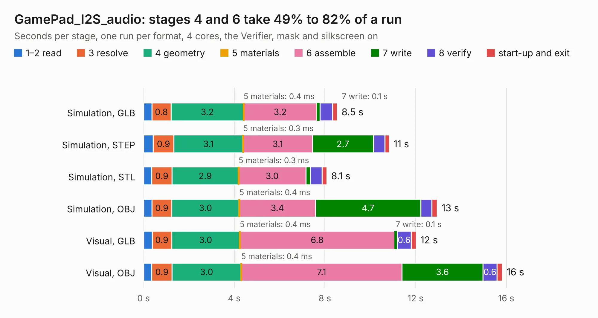

# 1261. GamePad_I2S_audio

Board 1,261 of the 3,128 of [Corpus Testing](../Corpus-Testing.md), on [Corpus Page 12](../CorpusTestingPages/Corpus-Testing-12.md#1261-gamepad_i2s_audio).

| Mode and format | 1–2 read | 3 resolve | 4 geometry | 5 materials | 6 assemble | 7 write | 8 verify | start-up and exit | Total |
|---|---:|---:|---:|---:|---:|---:|---:|---:|---:|
| Simulation, GLB | 0.4 | 0.8 | 3.2 | 0.4&nbsp;ms | 3.2 | 0.1 | 0.6 | 0.2 | 8.5 |
| Simulation, STEP | 0.4 | 0.9 | 3.1 | 0.3&nbsp;ms | 3.1 | 2.7 | 0.5 | 0.2 | 10.8 |
| Simulation, STL | 0.4 | 0.9 | 2.9 | 0.3&nbsp;ms | 3.0 | 0.2 | 0.5 | 0.2 | 8.1 |
| Simulation, OBJ | 0.4 | 0.9 | 3.0 | 0.4&nbsp;ms | 3.4 | 4.7 | 0.5 | 0.2 | 13.0 |
| Visual, GLB | 0.4 | 0.9 | 3.0 | 0.4&nbsp;ms | 6.8 | 0.1 | 0.6 | 0.2 | 12.0 |
| Visual, OBJ | 0.4 | 0.9 | 3.0 | 0.4&nbsp;ms | 7.1 | 3.6 | 0.6 | 0.2 | 15.8 |

<table align="center"><tr><td valign="top">

| Board | Repo: [intergalaktik/Extension_Boards_for_Olimex_GateMate](https://github.com/intergalaktik/Extension_Boards_for_Olimex_GateMate) Board: `GamePad_I2S_audio.kicad_pcb` |
|---|---|
| Folder | GamePad_I2S_audio_Buttons / KiCad |
| Complexity | 280&nbsp;/&nbsp;1000 (size&nbsp;195, features&nbsp;85) |
| KESE&nbsp;features | through vias, rounded, trapezoid or chamfered pads, filled zones, curved board outline, stack-up, dielectric εr and tanδ |
| Tested | 9th November 2026 |
| Copper&nbsp;layers | 4 |
| File&nbsp;format | KiCad 8 (20240108) |
| Parts,&nbsp;tracks,&nbsp;vias | 77, 713, 127 |
| Triangles,&nbsp;simulation | 866,552 in 91 parts |
| Verifier | PASS in all six runs |

</td><td valign="top">

<table>
<tr><th>File type</th><th>File size</th><th>Peak memory used</th></tr>
<tr><th colspan="3" align="left">Simulation</th></tr>
<tr><td>GLB</td><td align="right">30&nbsp;MB</td><td align="right">404&nbsp;MB</td></tr>
<tr><td>STEP</td><td align="right">135&nbsp;MB</td><td align="right">500&nbsp;MB</td></tr>
<tr><td>STL</td><td align="right">43&nbsp;MB</td><td align="right">405&nbsp;MB</td></tr>
<tr><td>OBJ</td><td align="right">88&nbsp;MB</td><td align="right">619&nbsp;MB</td></tr>
<tr><th colspan="3" align="left">Visual</th></tr>
<tr><td>GLB</td><td align="right">23&nbsp;MB</td><td align="right">579&nbsp;MB</td></tr>
<tr><td>OBJ</td><td align="right">69&nbsp;MB</td><td align="right">516&nbsp;MB</td></tr>
</table>

</td></tr></table>

| Previous | Next |
|:---|---:|
| [1260. GamePad_I2S_audio](b1260b_Extension-Boards-for-Olimex-GateMate_GamePad-I2S-audio-KiCad_GamePad-I2S-audio.md) | [1262. MikroBusIO](b1262b_Extension-Boards-for-Olimex-GateMate_MikroBusIO.md) |
