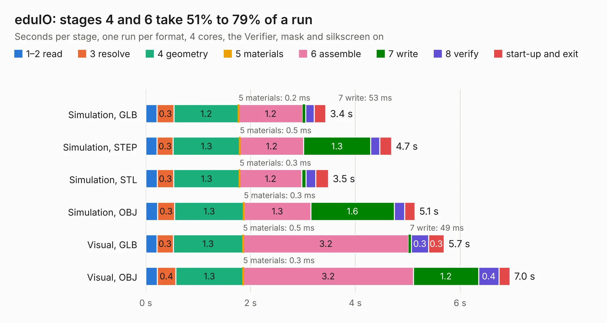

# 1261. eduIO

Board 1,261 of the 3,139 of [Corpus Testing](../Corpus-Testing.md), on [Corpus Page 12](../CorpusTestingPages/Corpus-Testing-12.md#1261-eduio).

| Mode and format | 1–2 read | 3 resolve | 4 geometry | 5 materials | 6 assemble | 7 write | 8 verify | start-up and exit | Total |
|---|---:|---:|---:|---:|---:|---:|---:|---:|---:|
| Simulation, GLB | 0.2 | 0.3 | 1.2 | 0.2&nbsp;ms | 1.2 | 53&nbsp;ms | 0.2 | 0.2 | 3.4 |
| Simulation, STEP | 0.2 | 0.3 | 1.3 | 0.5&nbsp;ms | 1.2 | 1.3 | 0.2 | 0.2 | 4.7 |
| Simulation, STL | 0.2 | 0.3 | 1.3 | 0.3&nbsp;ms | 1.2 | 85&nbsp;ms | 0.2 | 0.2 | 3.5 |
| Simulation, OBJ | 0.2 | 0.3 | 1.3 | 0.3&nbsp;ms | 1.3 | 1.6 | 0.2 | 0.2 | 5.1 |
| Visual, GLB | 0.2 | 0.3 | 1.3 | 0.5&nbsp;ms | 3.2 | 49&nbsp;ms | 0.3 | 0.3 | 5.7 |
| Visual, OBJ | 0.2 | 0.4 | 1.3 | 0.3&nbsp;ms | 3.2 | 1.2 | 0.4 | 0.2 | 7.0 |

<table align="center"><tr><td valign="top">

| Board | Repo: [intergalaktik/Extension_Boards_for_Olimex_GateMate](https://github.com/intergalaktik/Extension_Boards_for_Olimex_GateMate) Board: `eduIO.kicad_pcb` |
|---|---|
| Folder | eduIO |
| Complexity | 257&nbsp;/&nbsp;1000 (size&nbsp;142, features&nbsp;115) |
| KESE&nbsp;features | through vias, rounded, trapezoid or chamfered pads, filled zones, curved board outline, knockout text, stack-up, dielectric εr and tanδ, copper finish |
| Tested | 9th November 2026 |
| Copper&nbsp;layers | 2 |
| File&nbsp;format | KiCad 8 (20240108) |
| Parts,&nbsp;tracks,&nbsp;vias | 22, 180, 25 |
| Triangles,&nbsp;simulation | 305,672 in 65 parts |
| Verifier | PASS in all six runs |

</td><td valign="top">

<table>
<tr><th>File type</th><th>File size</th><th>Peak memory used</th></tr>
<tr><th colspan="3" align="left">Simulation</th></tr>
<tr><td>GLB</td><td align="right">11&nbsp;MB</td><td align="right">246&nbsp;MB</td></tr>
<tr><td>STEP</td><td align="right">52&nbsp;MB</td><td align="right">279&nbsp;MB</td></tr>
<tr><td>STL</td><td align="right">15&nbsp;MB</td><td align="right">245&nbsp;MB</td></tr>
<tr><td>OBJ</td><td align="right">31&nbsp;MB</td><td align="right">270&nbsp;MB</td></tr>
<tr><th colspan="3" align="left">Visual</th></tr>
<tr><td>GLB</td><td align="right">8.7&nbsp;MB</td><td align="right">272&nbsp;MB</td></tr>
<tr><td>OBJ</td><td align="right">25&nbsp;MB</td><td align="right">271&nbsp;MB</td></tr>
</table>

</td></tr></table>

| Previous | Next |
|:---|---:|
| [1260. dvi](b1260b_Extension-Boards-for-Olimex-GateMate_dvi.md) | [1262. ethIO](b1262b_Extension-Boards-for-Olimex-GateMate_ethIO.md) |
