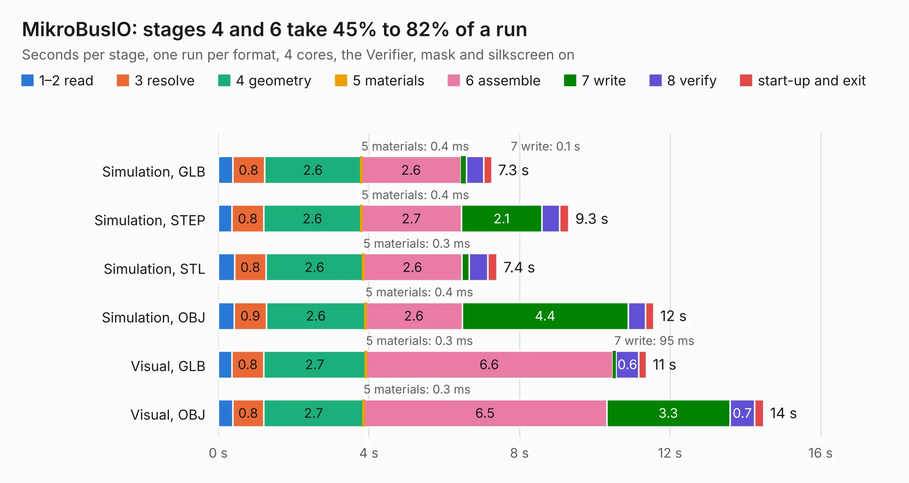

# 1262. MikroBusIO

Board 1,262 of the 3,124 of [Corpus Testing](../Corpus-Testing.md), on [Corpus Page 12](../CorpusTestingPages/Corpus-Testing-12.md#1262-mikrobusio).

| Mode and format | 1–2 read | 3 resolve | 4 geometry | 5 materials | 6 assemble | 7 write | 8 verify | start-up and exit | Total |
|---|---:|---:|---:|---:|---:|---:|---:|---:|---:|
| Simulation, GLB | 0.4 | 0.8 | 2.6 | 0.4&nbsp;ms | 2.6 | 0.1 | 0.5 | 0.2 | 7.3 |
| Simulation, STEP | 0.4 | 0.8 | 2.6 | 0.4&nbsp;ms | 2.7 | 2.1 | 0.5 | 0.2 | 9.3 |
| Simulation, STL | 0.4 | 0.8 | 2.6 | 0.3&nbsp;ms | 2.6 | 0.2 | 0.5 | 0.2 | 7.4 |
| Simulation, OBJ | 0.4 | 0.9 | 2.6 | 0.4&nbsp;ms | 2.6 | 4.4 | 0.5 | 0.2 | 11.6 |
| Visual, GLB | 0.4 | 0.8 | 2.7 | 0.3&nbsp;ms | 6.6 | 95&nbsp;ms | 0.6 | 0.2 | 11.4 |
| Visual, OBJ | 0.4 | 0.8 | 2.7 | 0.3&nbsp;ms | 6.5 | 3.3 | 0.7 | 0.2 | 14.5 |

<table align="center"><tr><td valign="top">

| Board | Repo: [intergalaktik/Extension_Boards_for_Olimex_GateMate](https://github.com/intergalaktik/Extension_Boards_for_Olimex_GateMate) Board: `MikroBusIO.kicad_pcb` |
|---|---|
| Folder | MikroBusIO |
| Complexity | 300&nbsp;/&nbsp;1000 (size&nbsp;185, features&nbsp;115) |
| KESE&nbsp;features | through vias, rounded, trapezoid or chamfered pads, filled zones, curved board outline, knockout text, stack-up, dielectric εr and tanδ, copper finish |
| Tested | 9th November 2026 |
| Copper&nbsp;layers | 4 |
| File&nbsp;format | KiCad 8 (20240108) |
| Parts,&nbsp;tracks,&nbsp;vias | 55, 388, 109 |
| Triangles,&nbsp;simulation | 755,740 in 59 parts |
| Verifier | PASS in all six runs |

</td><td valign="top">

<table>
<tr><th>File type</th><th>File size</th><th>Peak memory used</th></tr>
<tr><th colspan="3" align="left">Simulation</th></tr>
<tr><td>GLB</td><td align="right">26&nbsp;MB</td><td align="right">382&nbsp;MB</td></tr>
<tr><td>STEP</td><td align="right">111&nbsp;MB</td><td align="right">432&nbsp;MB</td></tr>
<tr><td>STL</td><td align="right">38&nbsp;MB</td><td align="right">396&nbsp;MB</td></tr>
<tr><td>OBJ</td><td align="right">77&nbsp;MB</td><td align="right">537&nbsp;MB</td></tr>
<tr><th colspan="3" align="left">Visual</th></tr>
<tr><td>GLB</td><td align="right">19&nbsp;MB</td><td align="right">473&nbsp;MB</td></tr>
<tr><td>OBJ</td><td align="right">58&nbsp;MB</td><td align="right">479&nbsp;MB</td></tr>
</table>

</td></tr></table>

| Previous | Next |
|:---|---:|
| [1261. GamePad_I2S_audio](b1261b_Extension-Boards-for-Olimex-GateMate_GamePad-I2S-audio-Buttons-KiCad_GamePad-I2S-audio.md) | [1263. pwrIO](b1263b_Extension-Boards-for-Olimex-GateMate_pwrIO.md) |
