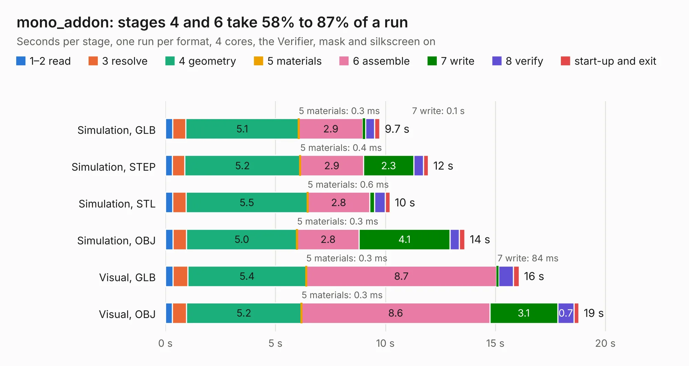

# 1263. mono_addon

Board 1,263 of the 3,117 of [Corpus Testing](../Corpus-Testing.md), on [Corpus Page 12](../CorpusTestingPages/Corpus-Testing-12.md#1263-mono_addon).

| Mode and format | 1–2 read | 3 resolve | 4 geometry | 5 materials | 6 assemble | 7 write | 8 verify | start-up and exit | Total |
|---|---:|---:|---:|---:|---:|---:|---:|---:|---:|
| Simulation, GLB | 0.3 | 0.6 | 5.1 | 0.3&nbsp;ms | 2.9 | 0.1 | 0.4 | 0.2 | 9.7 |
| Simulation, STEP | 0.3 | 0.6 | 5.2 | 0.4&nbsp;ms | 2.9 | 2.3 | 0.4 | 0.2 | 12.0 |
| Simulation, STL | 0.3 | 0.6 | 5.5 | 0.6&nbsp;ms | 2.8 | 0.2 | 0.5 | 0.2 | 10.2 |
| Simulation, OBJ | 0.3 | 0.6 | 5.0 | 0.3&nbsp;ms | 2.8 | 4.1 | 0.4 | 0.2 | 13.6 |
| Visual, GLB | 0.3 | 0.7 | 5.4 | 0.3&nbsp;ms | 8.7 | 84&nbsp;ms | 0.7 | 0.3 | 16.1 |
| Visual, OBJ | 0.3 | 0.6 | 5.2 | 0.3&nbsp;ms | 8.6 | 3.1 | 0.7 | 0.2 | 18.8 |

<table align="center"><tr><td valign="top">

| Board | Repo: [intergalaktik/mono_addon](https://github.com/intergalaktik/mono_addon) Board: `mono_addon.kicad_pcb` |
|---|---|
| Folder | KiCad / mono_addon |
| Complexity | 271&nbsp;/&nbsp;1000 (size&nbsp;161, features&nbsp;110) |
| KESE&nbsp;features | through vias, custom pads, rounded, trapezoid or chamfered pads, filled zones, copper drawings, curved board outline, stack-up, dielectric εr and tanδ |
| Tested | 9th November 2026 |
| Copper&nbsp;layers | 2 |
| File&nbsp;format | KiCad 8 (20240108) |
| Parts,&nbsp;tracks,&nbsp;vias | 44, 238, 95 |
| Triangles,&nbsp;simulation | 764,454 in 59 parts |
| Verifier | PASS in all six runs |

</td><td valign="top">

<table>
<tr><th>File type</th><th>File size</th><th>Peak memory used</th></tr>
<tr><th colspan="3" align="left">Simulation</th></tr>
<tr><td>GLB</td><td align="right">27&nbsp;MB</td><td align="right">399&nbsp;MB</td></tr>
<tr><td>STEP</td><td align="right">163&nbsp;MB</td><td align="right">475&nbsp;MB</td></tr>
<tr><td>STL</td><td align="right">38&nbsp;MB</td><td align="right">402&nbsp;MB</td></tr>
<tr><td>OBJ</td><td align="right">81&nbsp;MB</td><td align="right">579&nbsp;MB</td></tr>
<tr><th colspan="3" align="left">Visual</th></tr>
<tr><td>GLB</td><td align="right">20&nbsp;MB</td><td align="right">498&nbsp;MB</td></tr>
<tr><td>OBJ</td><td align="right">58&nbsp;MB</td><td align="right">509&nbsp;MB</td></tr>
</table>

</td></tr></table>

| Previous | Next |
|:---|---:|
| [1262. intergalaktik](b1262b_KiCad-PCB_intergalaktik.md) | [1264. ulx4m-panel](b1264b_ULX4M_ulx4m-panel.md) |
