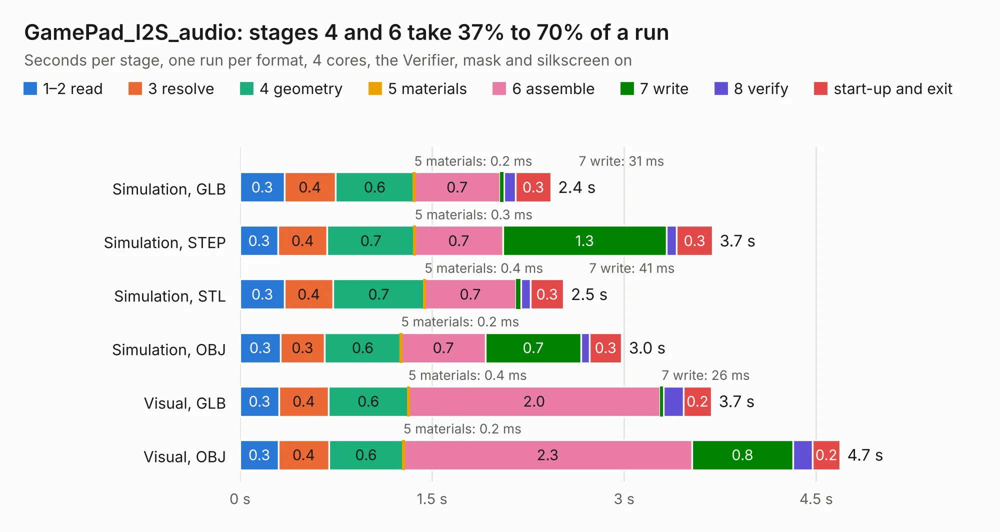

# 1264. GamePad_I2S_audio

Board 1,264 of the 3,138 of [Corpus Testing](../Corpus-Testing.md), on [Corpus Page 12](../CorpusTestingPages/Corpus-Testing-12.md#1264-gamepad_i2s_audio).

| Mode and format | 1–2 read | 3 resolve | 4 geometry | 5 materials | 6 assemble | 7 write | 8 verify | start-up and exit | Total |
|---|---:|---:|---:|---:|---:|---:|---:|---:|---:|
| Simulation, GLB | 0.3 | 0.4 | 0.6 | 0.2&nbsp;ms | 0.7 | 31&nbsp;ms | 91&nbsp;ms | 0.3 | 2.4 |
| Simulation, STEP | 0.3 | 0.4 | 0.7 | 0.3&nbsp;ms | 0.7 | 1.3 | 80&nbsp;ms | 0.3 | 3.7 |
| Simulation, STL | 0.3 | 0.4 | 0.7 | 0.4&nbsp;ms | 0.7 | 41&nbsp;ms | 73&nbsp;ms | 0.3 | 2.5 |
| Simulation, OBJ | 0.3 | 0.3 | 0.6 | 0.2&nbsp;ms | 0.7 | 0.7 | 67&nbsp;ms | 0.3 | 3.0 |
| Visual, GLB | 0.3 | 0.4 | 0.6 | 0.4&nbsp;ms | 2.0 | 26&nbsp;ms | 0.2 | 0.2 | 3.7 |
| Visual, OBJ | 0.3 | 0.4 | 0.6 | 0.2&nbsp;ms | 2.3 | 0.8 | 0.2 | 0.2 | 4.7 |

<table align="center"><tr><td valign="top">

| Board | Repo: [intergalaktik/Extension_Boards_for_Olimex_GateMate](https://github.com/intergalaktik/Extension_Boards_for_Olimex_GateMate) Board: `GamePad_I2S_audio.kicad_pcb` |
|---|---|
| Folder | GamePad_I2S_audio / KiCad |
| Complexity | 265&nbsp;/&nbsp;1000 (size&nbsp;180, features&nbsp;85) |
| KESE&nbsp;features | through vias, rounded, trapezoid or chamfered pads, filled zones, curved board outline, stack-up, dielectric εr and tanδ |
| Tested | 9th November 2026 |
| Copper&nbsp;layers | 4 |
| File&nbsp;format | KiCad 8 (20240108) |
| Parts,&nbsp;tracks,&nbsp;vias | 81, 268, 51 |
| Triangles,&nbsp;simulation | 131,540 in 65 parts |
| Verifier | PASS in all six runs |

</td><td valign="top">

<table>
<tr><th>File type</th><th>File size</th><th>Peak memory used</th></tr>
<tr><th colspan="3" align="left">Simulation</th></tr>
<tr><td>GLB</td><td align="right">4.8&nbsp;MB</td><td align="right">213&nbsp;MB</td></tr>
<tr><td>STEP</td><td align="right">21&nbsp;MB</td><td align="right">215&nbsp;MB</td></tr>
<tr><td>STL</td><td align="right">6.6&nbsp;MB</td><td align="right">212&nbsp;MB</td></tr>
<tr><td>OBJ</td><td align="right">14&nbsp;MB</td><td align="right">207&nbsp;MB</td></tr>
<tr><th colspan="3" align="left">Visual</th></tr>
<tr><td>GLB</td><td align="right">4.7&nbsp;MB</td><td align="right">197&nbsp;MB</td></tr>
<tr><td>OBJ</td><td align="right">13&nbsp;MB</td><td align="right">200&nbsp;MB</td></tr>
</table>

</td></tr></table>

| Previous | Next |
|:---|---:|
| [1263. extension_template](b1263b_Extension-Boards-for-Olimex-GateMate_extension-template.md) | [1265. GamePad_I2S_audio](b1265b_Extension-Boards-for-Olimex-GateMate_GamePad-I2S-audio-Buttons-KiCad_GamePad-I2S-audio.md) |
