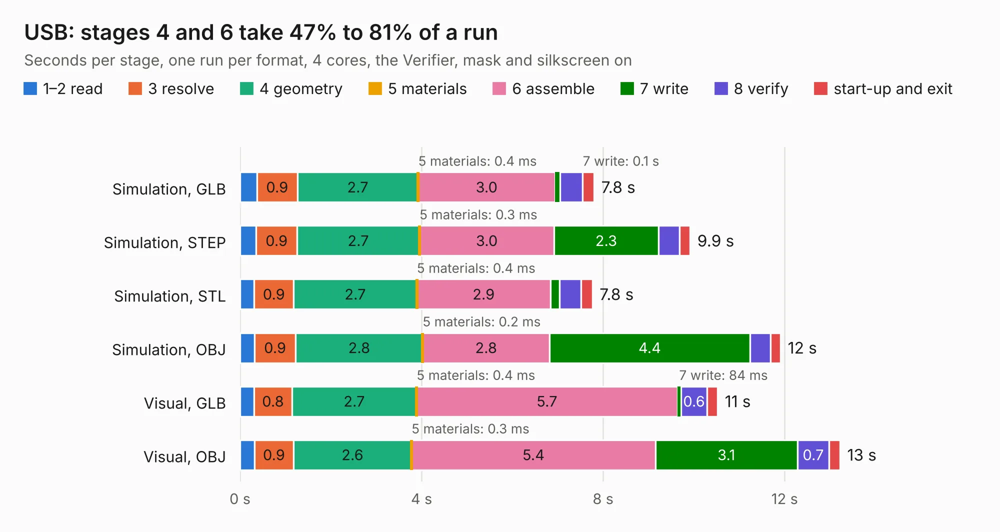

# 1264. USB

Board 1,264 of the 3,120 of [Corpus Testing](../Corpus-Testing.md), on [Corpus Page 12](../CorpusTestingPages/Corpus-Testing-12.md#1264-usb).

| Mode and format | 1–2 read | 3 resolve | 4 geometry | 5 materials | 6 assemble | 7 write | 8 verify | start-up and exit | Total |
|---|---:|---:|---:|---:|---:|---:|---:|---:|---:|
| Simulation, GLB | 0.4 | 0.9 | 2.7 | 0.4&nbsp;ms | 3.0 | 0.1 | 0.5 | 0.3 | 7.8 |
| Simulation, STEP | 0.4 | 0.9 | 2.7 | 0.3&nbsp;ms | 3.0 | 2.3 | 0.5 | 0.2 | 9.9 |
| Simulation, STL | 0.3 | 0.9 | 2.7 | 0.4&nbsp;ms | 2.9 | 0.2 | 0.5 | 0.2 | 7.8 |
| Simulation, OBJ | 0.3 | 0.9 | 2.8 | 0.2&nbsp;ms | 2.8 | 4.4 | 0.5 | 0.2 | 11.9 |
| Visual, GLB | 0.3 | 0.8 | 2.7 | 0.4&nbsp;ms | 5.7 | 84&nbsp;ms | 0.6 | 0.2 | 10.5 |
| Visual, OBJ | 0.3 | 0.9 | 2.6 | 0.3&nbsp;ms | 5.4 | 3.1 | 0.7 | 0.2 | 13.2 |

<table align="center"><tr><td valign="top">

| Board | Repo: [intergalaktik/Extension_Boards_for_Olimex_GateMate](https://github.com/intergalaktik/Extension_Boards_for_Olimex_GateMate) Board: `USB.kicad_pcb` |
|---|---|
| Folder | USB |
| Complexity | 285&nbsp;/&nbsp;1000 (size&nbsp;185, features&nbsp;100) |
| KESE&nbsp;features | through vias, rounded, trapezoid or chamfered pads, filled zones, curved board outline, stack-up, dielectric εr and tanδ, copper finish |
| Tested | 9th November 2026 |
| Copper&nbsp;layers | 4 |
| File&nbsp;format | KiCad 9 (20241229) |
| Parts,&nbsp;tracks,&nbsp;vias | 38, 364, 189 |
| Triangles,&nbsp;simulation | 760,970 in 51 parts |
| Verifier | PASS in all six runs |

</td><td valign="top">

<table>
<tr><th>File type</th><th>File size</th><th>Peak memory used</th></tr>
<tr><th colspan="3" align="left">Simulation</th></tr>
<tr><td>GLB</td><td align="right">26&nbsp;MB</td><td align="right">402&nbsp;MB</td></tr>
<tr><td>STEP</td><td align="right">102&nbsp;MB</td><td align="right">458&nbsp;MB</td></tr>
<tr><td>STL</td><td align="right">38&nbsp;MB</td><td align="right">421&nbsp;MB</td></tr>
<tr><td>OBJ</td><td align="right">77&nbsp;MB</td><td align="right">553&nbsp;MB</td></tr>
<tr><th colspan="3" align="left">Visual</th></tr>
<tr><td>GLB</td><td align="right">18&nbsp;MB</td><td align="right">482&nbsp;MB</td></tr>
<tr><td>OBJ</td><td align="right">55&nbsp;MB</td><td align="right">448&nbsp;MB</td></tr>
</table>

</td></tr></table>

| Previous | Next |
|:---|---:|
| [1263. tmrIO](b1263b_Extension-Boards-for-Olimex-GateMate_tmrIO.md) | [1265. intergalaktik](b1265b_KiCad-PCB_intergalaktik.md) |
