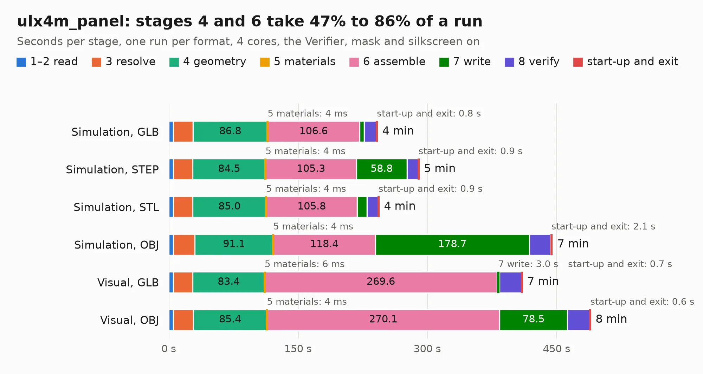

# 1265. ulx4m_panel

Board 1,265 of the 3,112 of [Corpus Testing](../Corpus-Testing.md), on [Corpus Page 12](../CorpusTestingPages/Corpus-Testing-12.md#1265-ulx4m_panel).

| Mode and format | 1–2 read | 3 resolve | 4 geometry | 5 materials | 6 assemble | 7 write | 8 verify | start-up and exit | Total |
|---|---:|---:|---:|---:|---:|---:|---:|---:|---:|
| Simulation, GLB | 5.2 | 22.8 | 86.8 | 4&nbsp;ms | 106.6 | 5.5 | 14.2 | 0.8 | 241.9 |
| Simulation, STEP | 5.1 | 22.7 | 84.5 | 4&nbsp;ms | 105.3 | 58.8 | 13.0 | 0.9 | 290.3 |
| Simulation, STL | 5.5 | 22.5 | 85.0 | 4&nbsp;ms | 105.8 | 11.2 | 13.0 | 0.9 | 243.9 |
| Simulation, OBJ | 5.5 | 24.7 | 91.1 | 4&nbsp;ms | 118.4 | 178.7 | 24.5 | 2.1 | 445.0 |
| Visual, GLB | 5.2 | 22.7 | 83.4 | 6&nbsp;ms | 269.6 | 3.0 | 25.6 | 0.7 | 410.2 |
| Visual, OBJ | 5.2 | 23.3 | 85.4 | 4&nbsp;ms | 270.1 | 78.5 | 26.3 | 0.6 | 489.4 |

<table align="center"><tr><td valign="top">

| Board | Repo: [intergalaktik/ULX4M-LS](https://github.com/intergalaktik/ULX4M-LS) Board: `ulx4m_panel.kicad_pcb` |
|---|---|
| Folder | panel |
| Complexity | 432&nbsp;/&nbsp;1000 (size&nbsp;357, features&nbsp;75) |
| KESE&nbsp;features | through vias, rounded, trapezoid or chamfered pads, filled zones, stack-up, dielectric εr and tanδ |
| Tested | 9th November 2026 to 11th November 2026 |
| Copper&nbsp;layers | 6 |
| File&nbsp;format | KiCad 8 (20240108) |
| Parts,&nbsp;tracks,&nbsp;vias | 872, 34,240, 2,800 |
| Triangles,&nbsp;simulation | 23,074,944 in 1440 parts |
| Note | panel |
| Verifier | PASS in all six runs |
| Run&nbsp;again | Simulation, OBJ: failed in the corpus run, run again with no memory cap and no time limit (swap added to a 16 GB machine), and passed |

</td><td valign="top">

<table>
<tr><th>File type</th><th>File size</th><th>Peak memory used</th></tr>
<tr><th colspan="3" align="left">Simulation</th></tr>
<tr><td>GLB</td><td align="right">746&nbsp;MB</td><td align="right">4.8&nbsp;GB</td></tr>
<tr><td>STEP</td><td align="right">3.5&nbsp;GB</td><td align="right">6.8&nbsp;GB</td></tr>
<tr><td>STL</td><td align="right">1.2&nbsp;GB</td><td align="right">4.8&nbsp;GB</td></tr>
<tr><td>OBJ</td><td align="right">2.6&nbsp;GB</td><td align="right">15&nbsp;GB</td></tr>
<tr><th colspan="3" align="left">Visual</th></tr>
<tr><td>GLB</td><td align="right">451&nbsp;MB</td><td align="right">7.2&nbsp;GB</td></tr>
<tr><td>OBJ</td><td align="right">1.5&nbsp;GB</td><td align="right">9.5&nbsp;GB</td></tr>
</table>

</td></tr></table>

| Previous | Next |
|:---|---:|
| [1264. ulx4m-ld](b1264b_ULX4M-LD_ulx4m-ld.md) | [1266. ULX4M-PCIe-IO_x4_half](b1266b_ULX4M-PCIe-IO_ULX4M-PCIe-IO-x4-half.md) |
