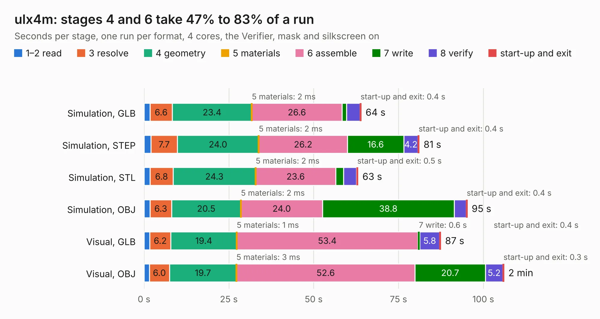

# 1267. ulx4m

Board 1,267 of the 3,118 of [Corpus Testing](../Corpus-Testing.md), on [Corpus Page 12](../CorpusTestingPages/Corpus-Testing-12.md#1267-ulx4m).

| Mode and format | 1–2 read | 3 resolve | 4 geometry | 5 materials | 6 assemble | 7 write | 8 verify | start-up and exit | Total |
|---|---:|---:|---:|---:|---:|---:|---:|---:|---:|
| Simulation, GLB | 1.8 | 6.6 | 23.4 | 2&nbsp;ms | 26.6 | 1.3 | 3.9 | 0.4 | 64.0 |
| Simulation, STEP | 2.1 | 7.7 | 24.0 | 2&nbsp;ms | 26.2 | 16.6 | 4.2 | 0.4 | 81.1 |
| Simulation, STL | 1.8 | 6.8 | 24.3 | 2&nbsp;ms | 23.6 | 2.3 | 3.8 | 0.5 | 63.1 |
| Simulation, OBJ | 1.8 | 6.3 | 20.5 | 2&nbsp;ms | 24.0 | 38.8 | 3.5 | 0.4 | 95.3 |
| Visual, GLB | 1.7 | 6.2 | 19.4 | 1&nbsp;ms | 53.4 | 0.6 | 5.8 | 0.4 | 87.5 |
| Visual, OBJ | 1.6 | 6.0 | 19.7 | 3&nbsp;ms | 52.6 | 20.7 | 5.2 | 0.3 | 106.1 |

<table align="center"><tr><td valign="top">

| Board | Repo: [intergalaktik/ULX4M](https://github.com/intergalaktik/ULX4M) Board: `ulx4m.kicad_pcb` |
|---|---|
| Complexity | 390&nbsp;/&nbsp;1000 (size&nbsp;305, features&nbsp;85) |
| KESE&nbsp;features | through vias, rounded, trapezoid or chamfered pads, filled zones, curved board outline, stack-up, dielectric εr and tanδ |
| Tested | 9th November 2026 |
| Copper&nbsp;layers | 6 |
| File&nbsp;format | KiCad 8 (20240108) |
| Parts,&nbsp;tracks,&nbsp;vias | 218, 8,560, 700 |
| Triangles,&nbsp;simulation | 5,597,444 in 372 parts |
| Verifier | PASS in all six runs |

</td><td valign="top">

<table>
<tr><th>File type</th><th>File size</th><th>Peak memory used</th></tr>
<tr><th colspan="3" align="left">Simulation</th></tr>
<tr><td>GLB</td><td align="right">187&nbsp;MB</td><td align="right">1.6&nbsp;GB</td></tr>
<tr><td>STEP</td><td align="right">777&nbsp;MB</td><td align="right">1.9&nbsp;GB</td></tr>
<tr><td>STL</td><td align="right">280&nbsp;MB</td><td align="right">1.6&nbsp;GB</td></tr>
<tr><td>OBJ</td><td align="right">598&nbsp;MB</td><td align="right">3.6&nbsp;GB</td></tr>
<tr><th colspan="3" align="left">Visual</th></tr>
<tr><td>GLB</td><td align="right">111&nbsp;MB</td><td align="right">1.9&nbsp;GB</td></tr>
<tr><td>OBJ</td><td align="right">361&nbsp;MB</td><td align="right">2.4&nbsp;GB</td></tr>
</table>

</td></tr></table>

| Previous | Next |
|:---|---:|
| [1266. ulx4m](b1266b_ULX4M_plot-panel_ulx4m.md) | [1268. ulx4m-cm4-hat](b1268b_ULX4M-CM4-HAT_ulx4m-cm4-hat.md) |
