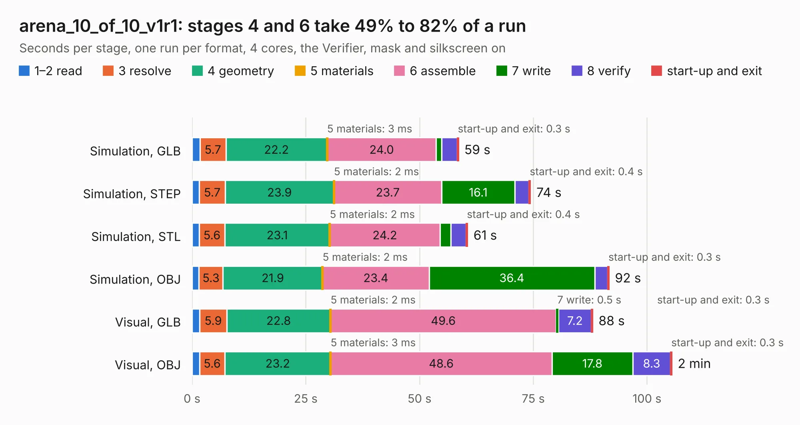

# 1267. arena_10_of_10_v1r1

Board 1,267 of the 3,104 of [Corpus Testing](../Corpus-Testing.md), on [Corpus Page 12](../CorpusTestingPages/Corpus-Testing-12.md#1267-arena_10_of_10_v1r1).

| Mode and format | 1–2 read | 3 resolve | 4 geometry | 5 materials | 6 assemble | 7 write | 8 verify | start-up and exit | Total |
|---|---:|---:|---:|---:|---:|---:|---:|---:|---:|
| Simulation, GLB | 1.7 | 5.7 | 22.2 | 3&nbsp;ms | 24.0 | 1.2 | 3.4 | 0.3 | 58.6 |
| Simulation, STEP | 1.6 | 5.7 | 23.9 | 2&nbsp;ms | 23.7 | 16.1 | 3.1 | 0.4 | 74.4 |
| Simulation, STL | 1.6 | 5.6 | 23.1 | 2&nbsp;ms | 24.2 | 2.4 | 3.4 | 0.4 | 60.6 |
| Simulation, OBJ | 1.5 | 5.3 | 21.9 | 2&nbsp;ms | 23.4 | 36.4 | 2.9 | 0.3 | 91.7 |
| Visual, GLB | 1.7 | 5.9 | 22.8 | 2&nbsp;ms | 49.6 | 0.5 | 7.2 | 0.3 | 88.1 |
| Visual, OBJ | 1.7 | 5.6 | 23.2 | 3&nbsp;ms | 48.6 | 17.8 | 8.3 | 0.3 | 105.5 |

<table align="center"><tr><td valign="top">

| Board | Repo: [iorodeo/led-display_g6_hardware_arena](https://github.com/iorodeo/led-display_g6_hardware_arena) Board: `arena_10_of_10_v1r1.kicad_pcb` |
|---|---|
| Folder | arena_10-10 / arena_10-10_v1 / manual_route / v1 / routed |
| Complexity | 364&nbsp;/&nbsp;1000 (size&nbsp;254, features&nbsp;110) |
| KESE&nbsp;features | through vias, slotted holes, rounded, trapezoid or chamfered pads, filled zones, curved board outline, tracks bare of mask, stack-up, dielectric εr and tanδ |
| Tested | 9th November 2026 |
| Copper&nbsp;layers | 6 |
| File&nbsp;format | KiCad 9 (20241229) |
| Parts,&nbsp;tracks,&nbsp;vias | 505, 4,090, 677 |
| Triangles,&nbsp;simulation | 7,459,160 in 516 parts |
| Verifier | PASS in all six runs |

</td><td valign="top">

<table>
<tr><th>File type</th><th>File size</th><th>Peak memory used</th></tr>
<tr><th colspan="3" align="left">Simulation</th></tr>
<tr><td>GLB</td><td align="right">248&nbsp;MB</td><td align="right">1.9&nbsp;GB</td></tr>
<tr><td>STEP</td><td align="right">815&nbsp;MB</td><td align="right">2.4&nbsp;GB</td></tr>
<tr><td>STL</td><td align="right">373&nbsp;MB</td><td align="right">1.9&nbsp;GB</td></tr>
<tr><td>OBJ</td><td align="right">787&nbsp;MB</td><td align="right">4.7&nbsp;GB</td></tr>
<tr><th colspan="3" align="left">Visual</th></tr>
<tr><td>GLB</td><td align="right">128&nbsp;MB</td><td align="right">2.3&nbsp;GB</td></tr>
<tr><td>OBJ</td><td align="right">413&nbsp;MB</td><td align="right">2.7&nbsp;GB</td></tr>
</table>

</td></tr></table>

| Previous | Next |
|:---|---:|
| [1266. arena_10_of_10_v1r1](b1266b_led-display-g6-hardware-arena_arena-10-10-arena-10-10-v1-manual-route-v1_arena-10-of-10-v1r1.md) | [1268. arena_10_of_10_v1r1](b1268b_led-display-g6-hardware-arena_arena-10-10-arena-10-10-v1-manual-route-v2_arena-10-of-10-v1r1.md) |
