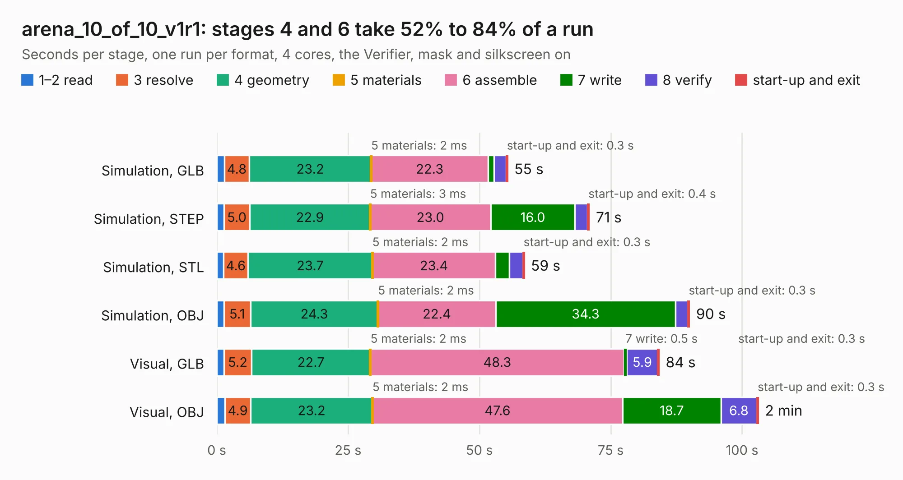

# 1267. arena_10_of_10_v1r1

Board 1,267 of the 3,105 of [Corpus Testing](../Corpus-Testing.md), on [Corpus Page 12](../CorpusTestingPages/Corpus-Testing-12.md#1267-arena_10_of_10_v1r1).

| Mode and format | 1–2 read | 3 resolve | 4 geometry | 5 materials | 6 assemble | 7 write | 8 verify | start-up and exit | Total |
|---|---:|---:|---:|---:|---:|---:|---:|---:|---:|
| Simulation, GLB | 1.4 | 4.8 | 23.2 | 2&nbsp;ms | 22.3 | 1.1 | 2.3 | 0.3 | 55.4 |
| Simulation, STEP | 1.3 | 5.0 | 22.9 | 3&nbsp;ms | 23.0 | 16.0 | 2.4 | 0.4 | 71.0 |
| Simulation, STL | 1.3 | 4.6 | 23.7 | 2&nbsp;ms | 23.4 | 2.6 | 2.5 | 0.3 | 58.6 |
| Simulation, OBJ | 1.3 | 5.1 | 24.3 | 2&nbsp;ms | 22.4 | 34.3 | 2.3 | 0.3 | 90.0 |
| Visual, GLB | 1.4 | 5.2 | 22.7 | 2&nbsp;ms | 48.3 | 0.5 | 5.9 | 0.3 | 84.2 |
| Visual, OBJ | 1.5 | 4.9 | 23.2 | 2&nbsp;ms | 47.6 | 18.7 | 6.8 | 0.3 | 103.1 |

<table align="center"><tr><td valign="top">

| Board | Repo: [iorodeo/led-display_g6_hardware_arena](https://github.com/iorodeo/led-display_g6_hardware_arena) Board: `arena_10_of_10_v1r1.kicad_pcb` |
|---|---|
| Folder | arena_10-10 / arena_10-10_v1 / manual_route / v1 |
| Complexity | 387&nbsp;/&nbsp;1000 (size&nbsp;242, features&nbsp;145) |
| KESE&nbsp;features | through vias, blind and buried vias, slotted holes, rounded, trapezoid or chamfered pads, arc tracks, curved board outline, tracks bare of mask, stack-up, dielectric εr and tanδ |
| Tested | 9th November 2026 |
| Copper&nbsp;layers | 6 |
| File&nbsp;format | KiCad 9 (20241229) |
| Parts,&nbsp;tracks,&nbsp;vias | 505, 1,743, 403 |
| Triangles,&nbsp;simulation | 5,647,298 in 516 parts |
| Verifier | PASS in all six runs |

</td><td valign="top">

<table>
<tr><th>File type</th><th>File size</th><th>Peak memory used</th></tr>
<tr><th colspan="3" align="left">Simulation</th></tr>
<tr><td>GLB</td><td align="right">186&nbsp;MB</td><td align="right">1.5&nbsp;GB</td></tr>
<tr><td>STEP</td><td align="right">659&nbsp;MB</td><td align="right">2.0&nbsp;GB</td></tr>
<tr><td>STL</td><td align="right">282&nbsp;MB</td><td align="right">1.5&nbsp;GB</td></tr>
<tr><td>OBJ</td><td align="right">591&nbsp;MB</td><td align="right">3.5&nbsp;GB</td></tr>
<tr><th colspan="3" align="left">Visual</th></tr>
<tr><td>GLB</td><td align="right">103&nbsp;MB</td><td align="right">2.0&nbsp;GB</td></tr>
<tr><td>OBJ</td><td align="right">327&nbsp;MB</td><td align="right">2.2&nbsp;GB</td></tr>
</table>

</td></tr></table>

| Previous | Next |
|:---|---:|
| [1266. modified_arena_10_of_10_v1r1](b1266b_led-display-g6-hardware-arena_arena-10-10-arena-10-10-v1-layout-tool_modified-arena-10-of-10-v1r1.md) | [1268. arena_10_of_10_v1r1](b1268b_led-display-g6-hardware-arena_arena-10-10-arena-10-10-v1-manual-route-v1-routed_arena-10-of-10-v1r1.md) |
