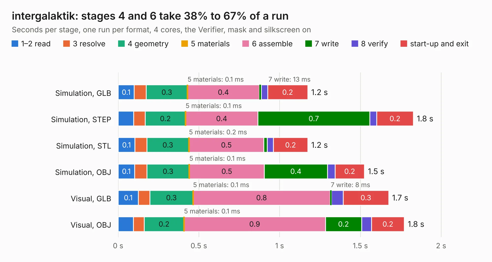

# 1268. intergalaktik

Board 1,268 of the 3,131 of [Corpus Testing](../Corpus-Testing.md), on [Corpus Page 12](../CorpusTestingPages/Corpus-Testing-12.md#1268-intergalaktik).

| Mode and format | 1–2 read | 3 resolve | 4 geometry | 5 materials | 6 assemble | 7 write | 8 verify | start-up and exit | Total |
|---|---:|---:|---:|---:|---:|---:|---:|---:|---:|
| Simulation, GLB | 0.1 | 74&nbsp;ms | 0.3 | 0.1&nbsp;ms | 0.4 | 13&nbsp;ms | 39&nbsp;ms | 0.2 | 1.2 |
| Simulation, STEP | 97&nbsp;ms | 71&nbsp;ms | 0.2 | 0.1&nbsp;ms | 0.4 | 0.7 | 43&nbsp;ms | 0.2 | 1.8 |
| Simulation, STL | 0.1 | 73&nbsp;ms | 0.3 | 0.2&nbsp;ms | 0.5 | 21&nbsp;ms | 39&nbsp;ms | 0.2 | 1.2 |
| Simulation, OBJ | 0.1 | 76&nbsp;ms | 0.3 | 0.1&nbsp;ms | 0.5 | 0.4 | 47&nbsp;ms | 0.2 | 1.5 |
| Visual, GLB | 0.1 | 71&nbsp;ms | 0.3 | 0.1&nbsp;ms | 0.8 | 8&nbsp;ms | 73&nbsp;ms | 0.3 | 1.7 |
| Visual, OBJ | 94&nbsp;ms | 67&nbsp;ms | 0.2 | 0.1&nbsp;ms | 0.9 | 0.2 | 61&nbsp;ms | 0.2 | 1.8 |

<table align="center"><tr><td valign="top">

| Board | Repo: [intergalaktik/KiCad-PCB](https://github.com/intergalaktik/KiCad-PCB) Board: `intergalaktik.kicad_pcb` |
|---|---|
| Folder | hardware |
| Complexity | 160&nbsp;/&nbsp;1000 (size&nbsp;80, features&nbsp;80) |
| KESE&nbsp;features | rounded, trapezoid or chamfered pads, filled zones, stack-up, dielectric εr and tanδ, copper finish, mask and silkscreen colours |
| Tested | 9th November 2026 |
| Copper&nbsp;layers | 4 |
| File&nbsp;format | KiCad 9 (20241229) |
| Parts,&nbsp;tracks,&nbsp;vias | 3, 6, 0 |
| Triangles,&nbsp;simulation | 68,008 in 16 parts |
| Verifier | PASS in all six runs |

</td><td valign="top">

<table>
<tr><th>File type</th><th>File size</th><th>Peak memory used</th></tr>
<tr><th colspan="3" align="left">Simulation</th></tr>
<tr><td>GLB</td><td align="right">2.4&nbsp;MB</td><td align="right">169&nbsp;MB</td></tr>
<tr><td>STEP</td><td align="right">9.1&nbsp;MB</td><td align="right">176&nbsp;MB</td></tr>
<tr><td>STL</td><td align="right">3.4&nbsp;MB</td><td align="right">167&nbsp;MB</td></tr>
<tr><td>OBJ</td><td align="right">6.6&nbsp;MB</td><td align="right">171&nbsp;MB</td></tr>
<tr><th colspan="3" align="left">Visual</th></tr>
<tr><td>GLB</td><td align="right">1.4&nbsp;MB</td><td align="right">152&nbsp;MB</td></tr>
<tr><td>OBJ</td><td align="right">4.0&nbsp;MB</td><td align="right">151&nbsp;MB</td></tr>
</table>

</td></tr></table>

| Previous | Next |
|:---|---:|
| [1267. USB](b1267b_Extension-Boards-for-Olimex-GateMate_USB.md) | [1269. mono_addon](b1269b_mono-addon_mono-addon.md) |
