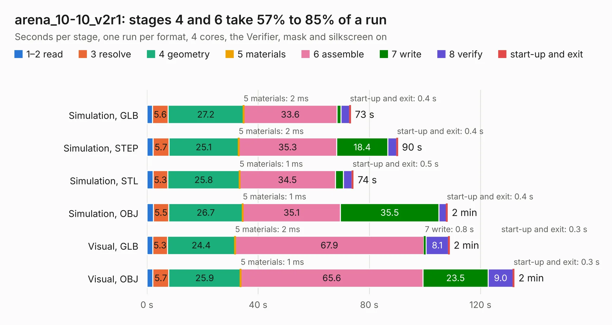

# 1268. arena_10-10_v2r1

Board 1,268 of the 3,101 of [Corpus Testing](../Corpus-Testing.md), on [Corpus Page 12](../CorpusTestingPages/Corpus-Testing-12.md#1268-arena_10-10_v2r1).

| Mode and format | 1–2 read | 3 resolve | 4 geometry | 5 materials | 6 assemble | 7 write | 8 verify | start-up and exit | Total |
|---|---:|---:|---:|---:|---:|---:|---:|---:|---:|
| Simulation, GLB | 2.0 | 5.6 | 27.2 | 2&nbsp;ms | 33.6 | 1.4 | 3.1 | 0.4 | 73.3 |
| Simulation, STEP | 2.2 | 5.7 | 25.1 | 2&nbsp;ms | 35.3 | 18.4 | 3.2 | 0.4 | 90.2 |
| Simulation, STL | 2.2 | 5.3 | 25.8 | 1&nbsp;ms | 34.5 | 2.8 | 3.1 | 0.5 | 74.2 |
| Simulation, OBJ | 2.3 | 5.5 | 26.7 | 1&nbsp;ms | 35.1 | 35.5 | 2.7 | 0.4 | 108.1 |
| Visual, GLB | 2.1 | 5.3 | 24.4 | 2&nbsp;ms | 67.9 | 0.8 | 8.1 | 0.3 | 108.8 |
| Visual, OBJ | 2.1 | 5.7 | 25.9 | 1&nbsp;ms | 65.6 | 23.5 | 9.0 | 0.3 | 132.1 |

<table align="center"><tr><td valign="top">

| Board | Repo: [iorodeo/led-display_g6_hardware_arena](https://github.com/iorodeo/led-display_g6_hardware_arena) Board: `arena_10-10_v2r1.kicad_pcb` |
|---|---|
| Folder | arena_10-10 / develop / with_reg / arena_10-10_v2r1 |
| Complexity | 403&nbsp;/&nbsp;1000 (size&nbsp;263, features&nbsp;140) |
| KESE&nbsp;features | through vias, slotted holes, rounded, trapezoid or chamfered pads, arc tracks, filled zones, curved board outline, tracks bare of mask, stack-up, dielectric εr and tanδ, copper finish |
| Tested | 9th November 2026 |
| Copper&nbsp;layers | 6 |
| File&nbsp;format | KiCad 10 (20260206) |
| Parts,&nbsp;tracks,&nbsp;vias | 521, 8,209, 732 |
| Triangles,&nbsp;simulation | 7,924,200 in 530 parts |
| Verifier | PASS in all six runs |

</td><td valign="top">

<table>
<tr><th>File type</th><th>File size</th><th>Peak memory used</th></tr>
<tr><th colspan="3" align="left">Simulation</th></tr>
<tr><td>GLB</td><td align="right">261&nbsp;MB</td><td align="right">2.2&nbsp;GB</td></tr>
<tr><td>STEP</td><td align="right">1.1&nbsp;GB</td><td align="right">2.8&nbsp;GB</td></tr>
<tr><td>STL</td><td align="right">396&nbsp;MB</td><td align="right">2.2&nbsp;GB</td></tr>
<tr><td>OBJ</td><td align="right">829&nbsp;MB</td><td align="right">4.9&nbsp;GB</td></tr>
<tr><th colspan="3" align="left">Visual</th></tr>
<tr><td>GLB</td><td align="right">174&nbsp;MB</td><td align="right">2.8&nbsp;GB</td></tr>
<tr><td>OBJ</td><td align="right">559&nbsp;MB</td><td align="right">3.5&nbsp;GB</td></tr>
</table>

</td></tr></table>

| Previous | Next |
|:---|---:|
| [1267. arena_top_10-10](b1267b_led-display-g6-hardware-arena_arena-top-10-10.md) | [1269. arena_10-10_v2r1](b1269b_led-display-g6-hardware-arena_arena-10-10-develop-without-reg-arena-10-10-v2r1_arena-10-10-v2r1.md) |
