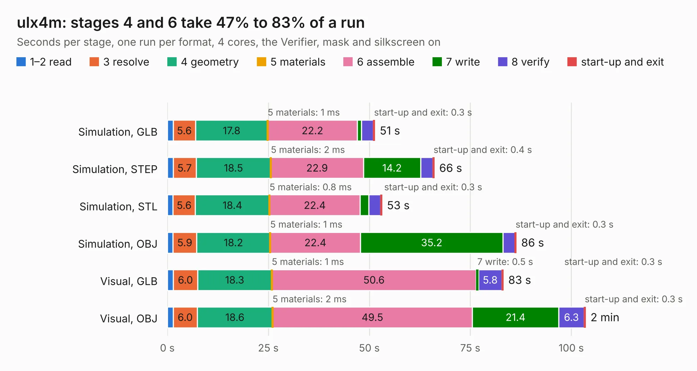

# 1270. ulx4m

Board 1,270 of the 3,123 of [Corpus Testing](../Corpus-Testing.md), on [Corpus Page 12](../CorpusTestingPages/Corpus-Testing-12.md#1270-ulx4m).

| Mode and format | 1–2 read | 3 resolve | 4 geometry | 5 materials | 6 assemble | 7 write | 8 verify | start-up and exit | Total |
|---|---:|---:|---:|---:|---:|---:|---:|---:|---:|
| Simulation, GLB | 1.4 | 5.6 | 17.8 | 1&nbsp;ms | 22.2 | 1.0 | 2.9 | 0.3 | 51.4 |
| Simulation, STEP | 1.4 | 5.7 | 18.5 | 2&nbsp;ms | 22.9 | 14.2 | 3.0 | 0.4 | 66.1 |
| Simulation, STL | 1.4 | 5.6 | 18.4 | 0.8&nbsp;ms | 22.4 | 2.1 | 3.0 | 0.3 | 53.1 |
| Simulation, OBJ | 1.4 | 5.9 | 18.2 | 1&nbsp;ms | 22.4 | 35.2 | 3.0 | 0.3 | 86.4 |
| Visual, GLB | 1.5 | 6.0 | 18.3 | 1&nbsp;ms | 50.6 | 0.5 | 5.8 | 0.3 | 83.2 |
| Visual, OBJ | 1.4 | 6.0 | 18.6 | 2&nbsp;ms | 49.5 | 21.4 | 6.3 | 0.3 | 103.5 |

<table align="center"><tr><td valign="top">

| Board | Repo: [intergalaktik/ULX4M](https://github.com/intergalaktik/ULX4M) Board: `ulx4m.kicad_pcb` |
|---|---|
| Folder | plot / panel |
| Complexity | 361&nbsp;/&nbsp;1000 (size&nbsp;306, features&nbsp;55) |
| KESE&nbsp;features | through vias, rounded, trapezoid or chamfered pads, filled zones, curved board outline |
| Tested | 9th November 2026 |
| Copper&nbsp;layers | 6 |
| File&nbsp;format | KiCad 5 (20171130) |
| Parts,&nbsp;tracks,&nbsp;vias | 215, 8,961, 714 |
| Triangles,&nbsp;simulation | 5,933,356 in 312 parts |
| Note | panel |
| Verifier | PASS in all six runs |

</td><td valign="top">

<table>
<tr><th>File type</th><th>File size</th><th>Peak memory used</th></tr>
<tr><th colspan="3" align="left">Simulation</th></tr>
<tr><td>GLB</td><td align="right">203&nbsp;MB</td><td align="right">1.5&nbsp;GB</td></tr>
<tr><td>STEP</td><td align="right">778&nbsp;MB</td><td align="right">2.0&nbsp;GB</td></tr>
<tr><td>STL</td><td align="right">297&nbsp;MB</td><td align="right">1.5&nbsp;GB</td></tr>
<tr><td>OBJ</td><td align="right">635&nbsp;MB</td><td align="right">3.8&nbsp;GB</td></tr>
<tr><th colspan="3" align="left">Visual</th></tr>
<tr><td>GLB</td><td align="right">112&nbsp;MB</td><td align="right">2.2&nbsp;GB</td></tr>
<tr><td>OBJ</td><td align="right">367&nbsp;MB</td><td align="right">2.4&nbsp;GB</td></tr>
</table>

</td></tr></table>

| Previous | Next |
|:---|---:|
| [1269. ulx4m-panel](b1269b_ULX4M_ulx4m-panel.md) | [1271. ulx4m](b1271b_ULX4M_ulx4m.md) |
