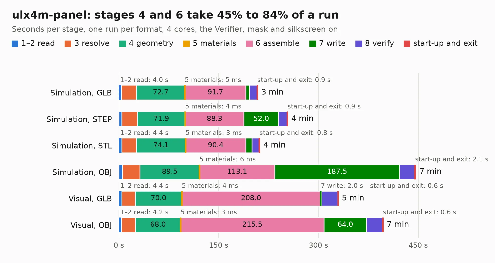

# 1270. ulx4m-panel

Board 1,270 of the 3,131 of [Corpus Testing](../Corpus-Testing.md), on [Corpus Page 12](../CorpusTestingPages/Corpus-Testing-12.md#1270-ulx4m-panel).

| Mode and format | 1–2 read | 3 resolve | 4 geometry | 5 materials | 6 assemble | 7 write | 8 verify | start-up and exit | Total |
|---|---:|---:|---:|---:|---:|---:|---:|---:|---:|
| Simulation, GLB | 4.0 | 22.4 | 72.7 | 5&nbsp;ms | 91.7 | 5.1 | 11.8 | 0.9 | 208.7 |
| Simulation, STEP | 4.5 | 23.2 | 71.9 | 4&nbsp;ms | 88.3 | 52.0 | 13.1 | 0.9 | 254.0 |
| Simulation, STL | 4.4 | 21.9 | 74.1 | 3&nbsp;ms | 90.4 | 9.4 | 11.0 | 0.8 | 211.9 |
| Simulation, OBJ | 5.1 | 26.6 | 89.5 | 6&nbsp;ms | 113.1 | 187.5 | 22.5 | 2.1 | 446.4 |
| Visual, GLB | 4.4 | 20.3 | 70.0 | 4&nbsp;ms | 208.0 | 2.0 | 24.5 | 0.6 | 329.9 |
| Visual, OBJ | 4.2 | 20.6 | 68.0 | 3&nbsp;ms | 215.5 | 64.0 | 24.3 | 0.6 | 397.4 |

<table align="center"><tr><td valign="top">

| Board | Repo: [intergalaktik/ULX4M](https://github.com/intergalaktik/ULX4M) Board: `ulx4m-panel.kicad_pcb` |
|---|---|
| Folder | plot / panel |
| Complexity | 402&nbsp;/&nbsp;1000 (size&nbsp;357, features&nbsp;45) |
| KESE&nbsp;features | through vias, rounded, trapezoid or chamfered pads, filled zones |
| Tested | 9th November 2026 to 11th November 2026 |
| Copper&nbsp;layers | 6 |
| File&nbsp;format | KiCad 5 (20171130) |
| Parts,&nbsp;tracks,&nbsp;vias | 860, 35,844, 2,856 |
| Triangles,&nbsp;simulation | 23,814,454 in 1200 parts |
| Note | panel |
| Verifier | PASS in all six runs |
| Run&nbsp;again | Simulation, OBJ: failed in the corpus run, run again with no memory cap and no time limit (swap added to a 16 GB machine), and passed |

</td><td valign="top">

<table>
<tr><th>File type</th><th>File size</th><th>Peak memory used</th></tr>
<tr><th colspan="3" align="left">Simulation</th></tr>
<tr><td>GLB</td><td align="right">788&nbsp;MB</td><td align="right">5.3&nbsp;GB</td></tr>
<tr><td>STEP</td><td align="right">3.2&nbsp;GB</td><td align="right">6.4&nbsp;GB</td></tr>
<tr><td>STL</td><td align="right">1.2&nbsp;GB</td><td align="right">5.2&nbsp;GB</td></tr>
<tr><td>OBJ</td><td align="right">2.6&nbsp;GB</td><td align="right">15&nbsp;GB</td></tr>
<tr><th colspan="3" align="left">Visual</th></tr>
<tr><td>GLB</td><td align="right">446&nbsp;MB</td><td align="right">7.2&nbsp;GB</td></tr>
<tr><td>OBJ</td><td align="right">1.5&nbsp;GB</td><td align="right">9.5&nbsp;GB</td></tr>
</table>

</td></tr></table>

| Previous | Next |
|:---|---:|
| [1269. mono_addon](b1269b_mono-addon_mono-addon.md) | [1271. ulx4m](b1271b_ULX4M_plot-panel_ulx4m.md) |
