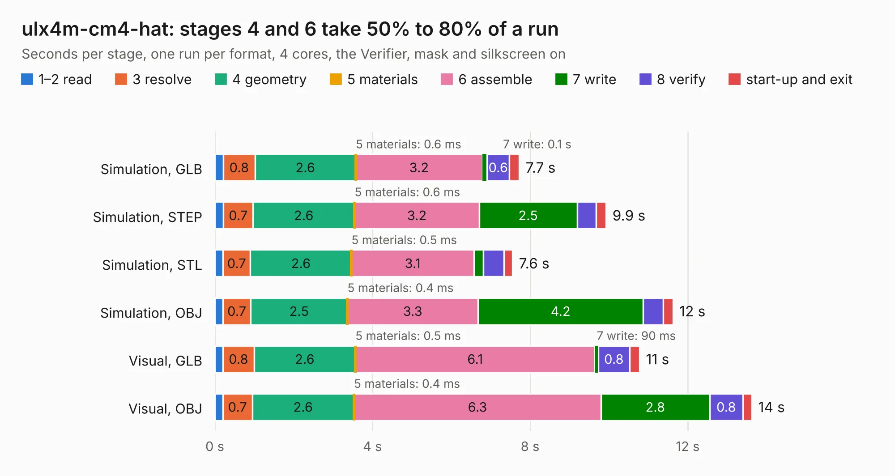

# 1273. ulx4m-cm4-hat

Board 1,273 of the 3,131 of [Corpus Testing](../Corpus-Testing.md), on [Corpus Page 12](../CorpusTestingPages/Corpus-Testing-12.md#1273-ulx4m-cm4-hat).

| Mode and format | 1–2 read | 3 resolve | 4 geometry | 5 materials | 6 assemble | 7 write | 8 verify | start-up and exit | Total |
|---|---:|---:|---:|---:|---:|---:|---:|---:|---:|
| Simulation, GLB | 0.2 | 0.8 | 2.6 | 0.6&nbsp;ms | 3.2 | 0.1 | 0.6 | 0.2 | 7.7 |
| Simulation, STEP | 0.2 | 0.7 | 2.6 | 0.6&nbsp;ms | 3.2 | 2.5 | 0.5 | 0.3 | 9.9 |
| Simulation, STL | 0.2 | 0.7 | 2.6 | 0.5&nbsp;ms | 3.1 | 0.2 | 0.5 | 0.2 | 7.6 |
| Simulation, OBJ | 0.2 | 0.7 | 2.5 | 0.4&nbsp;ms | 3.3 | 4.2 | 0.5 | 0.2 | 11.6 |
| Visual, GLB | 0.2 | 0.8 | 2.6 | 0.5&nbsp;ms | 6.1 | 90&nbsp;ms | 0.8 | 0.3 | 10.8 |
| Visual, OBJ | 0.2 | 0.7 | 2.6 | 0.4&nbsp;ms | 6.3 | 2.8 | 0.8 | 0.2 | 13.6 |

<table align="center"><tr><td valign="top">

| Board | Repo: [intergalaktik/ULX4M-CM4-HAT](https://github.com/intergalaktik/ULX4M-CM4-HAT) Board: `ulx4m-cm4-hat.kicad_pcb` |
|---|---|
| Complexity | 241&nbsp;/&nbsp;1000 (size&nbsp;186, features&nbsp;55) |
| KESE&nbsp;features | through vias, rounded, trapezoid or chamfered pads, filled zones, curved board outline |
| Tested | 9th November 2026 |
| Copper&nbsp;layers | 4 |
| File&nbsp;format | KiCad 5 (20171130) |
| Parts,&nbsp;tracks,&nbsp;vias | 37, 708, 95 |
| Triangles,&nbsp;simulation | 860,812 in 59 parts |
| Verifier | PASS in all six runs |

</td><td valign="top">

<table>
<tr><th>File type</th><th>File size</th><th>Peak memory used</th></tr>
<tr><th colspan="3" align="left">Simulation</th></tr>
<tr><td>GLB</td><td align="right">28&nbsp;MB</td><td align="right">374&nbsp;MB</td></tr>
<tr><td>STEP</td><td align="right">112&nbsp;MB</td><td align="right">460&nbsp;MB</td></tr>
<tr><td>STL</td><td align="right">43&nbsp;MB</td><td align="right">373&nbsp;MB</td></tr>
<tr><td>OBJ</td><td align="right">86&nbsp;MB</td><td align="right">622&nbsp;MB</td></tr>
<tr><th colspan="3" align="left">Visual</th></tr>
<tr><td>GLB</td><td align="right">19&nbsp;MB</td><td align="right">463&nbsp;MB</td></tr>
<tr><td>OBJ</td><td align="right">57&nbsp;MB</td><td align="right">509&nbsp;MB</td></tr>
</table>

</td></tr></table>

| Previous | Next |
|:---|---:|
| [1272. ulx4m](b1272b_ULX4M_ulx4m.md) | [1274. ulx4m-ld](b1274b_ULX4M-LD_ulx4m-ld.md) |
