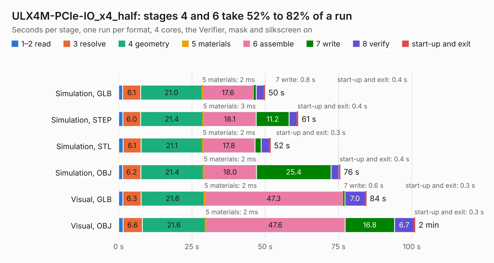

# 1273. ULX4M-PCIe-IO_x4_half

Board 1,273 of the 3,120 of [Corpus Testing](../Corpus-Testing.md), on [Corpus Page 12](../CorpusTestingPages/Corpus-Testing-12.md#1273-ulx4m-pcie-io_x4_half).

| Mode and format | 1–2 read | 3 resolve | 4 geometry | 5 materials | 6 assemble | 7 write | 8 verify | start-up and exit | Total |
|---|---:|---:|---:|---:|---:|---:|---:|---:|---:|
| Simulation, GLB | 1.4 | 6.1 | 21.0 | 2&nbsp;ms | 17.6 | 0.8 | 2.6 | 0.4 | 49.9 |
| Simulation, STEP | 1.5 | 6.0 | 21.4 | 3&nbsp;ms | 18.1 | 11.2 | 2.7 | 0.4 | 61.2 |
| Simulation, STL | 1.5 | 6.1 | 21.1 | 2&nbsp;ms | 17.8 | 2.1 | 2.8 | 0.3 | 51.8 |
| Simulation, OBJ | 1.4 | 6.2 | 21.4 | 2&nbsp;ms | 18.0 | 25.4 | 2.7 | 0.4 | 75.6 |
| Visual, GLB | 1.4 | 6.3 | 21.6 | 2&nbsp;ms | 47.3 | 0.6 | 7.0 | 0.3 | 84.5 |
| Visual, OBJ | 1.5 | 6.6 | 21.6 | 2&nbsp;ms | 47.6 | 16.8 | 6.7 | 0.3 | 101.1 |

<table align="center"><tr><td valign="top">

| Board | Repo: [intergalaktik/ULX4M-PCIe-IO](https://github.com/intergalaktik/ULX4M-PCIe-IO) Board: `ULX4M-PCIe-IO_x4_half.kicad_pcb` |
|---|---|
| Folder | kicad |
| Complexity | 341&nbsp;/&nbsp;1000 (size&nbsp;231, features&nbsp;110) |
| KESE&nbsp;features | through vias, slotted holes, rounded, trapezoid or chamfered pads, arc tracks, filled zones, curved board outline, stack-up, dielectric εr and tanδ |
| Tested | 9th November 2026 |
| Copper&nbsp;layers | 4 |
| File&nbsp;format | KiCad 8 (20240108) |
| Parts,&nbsp;tracks,&nbsp;vias | 118, 6,055, 477 |
| Triangles,&nbsp;simulation | 4,666,562 in 233 parts |
| Verifier | PASS in all six runs |

</td><td valign="top">

<table>
<tr><th>File type</th><th>File size</th><th>Peak memory used</th></tr>
<tr><th colspan="3" align="left">Simulation</th></tr>
<tr><td>GLB</td><td align="right">160&nbsp;MB</td><td align="right">1.6&nbsp;GB</td></tr>
<tr><td>STEP</td><td align="right">718&nbsp;MB</td><td align="right">1.7&nbsp;GB</td></tr>
<tr><td>STL</td><td align="right">233&nbsp;MB</td><td align="right">1.5&nbsp;GB</td></tr>
<tr><td>OBJ</td><td align="right">503&nbsp;MB</td><td align="right">3.1&nbsp;GB</td></tr>
<tr><th colspan="3" align="left">Visual</th></tr>
<tr><td>GLB</td><td align="right">112&nbsp;MB</td><td align="right">2.0&nbsp;GB</td></tr>
<tr><td>OBJ</td><td align="right">357&nbsp;MB</td><td align="right">2.4&nbsp;GB</td></tr>
</table>

</td></tr></table>

| Previous | Next |
|:---|---:|
| [1272. ulx4m_panel](b1272b_ULX4M-LS_ulx4m-panel.md) | [1274. ULX4M_GPDI](b1274b_ULX4M-documents_ULX4M-GPDI.md) |
