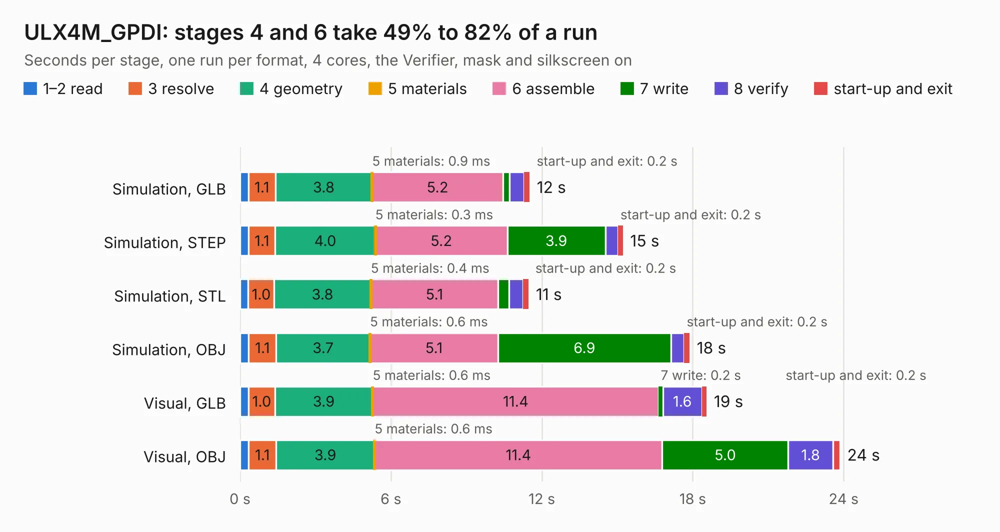

# 1276. ULX4M_GPDI

Board 1,276 of the 3,128 of [Corpus Testing](../Corpus-Testing.md), on [Corpus Page 12](../CorpusTestingPages/Corpus-Testing-12.md#1276-ulx4m_gpdi).

| Mode and format | 1–2 read | 3 resolve | 4 geometry | 5 materials | 6 assemble | 7 write | 8 verify | start-up and exit | Total |
|---|---:|---:|---:|---:|---:|---:|---:|---:|---:|
| Simulation, GLB | 0.3 | 1.1 | 3.8 | 0.9&nbsp;ms | 5.2 | 0.3 | 0.6 | 0.2 | 11.5 |
| Simulation, STEP | 0.3 | 1.1 | 4.0 | 0.3&nbsp;ms | 5.2 | 3.9 | 0.5 | 0.2 | 15.2 |
| Simulation, STL | 0.3 | 1.0 | 3.8 | 0.4&nbsp;ms | 5.1 | 0.4 | 0.6 | 0.2 | 11.5 |
| Simulation, OBJ | 0.3 | 1.1 | 3.7 | 0.6&nbsp;ms | 5.1 | 6.9 | 0.5 | 0.2 | 17.9 |
| Visual, GLB | 0.3 | 1.0 | 3.9 | 0.6&nbsp;ms | 11.4 | 0.2 | 1.6 | 0.2 | 18.6 |
| Visual, OBJ | 0.3 | 1.1 | 3.9 | 0.6&nbsp;ms | 11.4 | 5.0 | 1.8 | 0.3 | 23.9 |

<table align="center"><tr><td valign="top">

| Board | Repo: [intergalaktik/ULX4M_documents](https://github.com/intergalaktik/ULX4M_documents) Board: `ULX4M_GPDI.kicad_pcb` |
|---|---|
| Folder | ULX4M_test |
| Complexity | 240&nbsp;/&nbsp;1000 (size&nbsp;185, features&nbsp;55) |
| KESE&nbsp;features | through vias, slotted holes, filled zones, curved board outline |
| Tested | 9th November 2026 |
| Copper&nbsp;layers | 4 |
| File&nbsp;format | KiCad 5 (20171130) |
| Parts,&nbsp;tracks,&nbsp;vias | 27, 690, 156 |
| Triangles,&nbsp;simulation | 1,632,014 in 83 parts |
| Verifier | PASS in all six runs |

</td><td valign="top">

<table>
<tr><th>File type</th><th>File size</th><th>Peak memory used</th></tr>
<tr><th colspan="3" align="left">Simulation</th></tr>
<tr><td>GLB</td><td align="right">57&nbsp;MB</td><td align="right">675&nbsp;MB</td></tr>
<tr><td>STEP</td><td align="right">260&nbsp;MB</td><td align="right">849&nbsp;MB</td></tr>
<tr><td>STL</td><td align="right">82&nbsp;MB</td><td align="right">704&nbsp;MB</td></tr>
<tr><td>OBJ</td><td align="right">172&nbsp;MB</td><td align="right">1.2&nbsp;GB</td></tr>
<tr><th colspan="3" align="left">Visual</th></tr>
<tr><td>GLB</td><td align="right">41&nbsp;MB</td><td align="right">864&nbsp;MB</td></tr>
<tr><td>OBJ</td><td align="right">126&nbsp;MB</td><td align="right">929&nbsp;MB</td></tr>
</table>

</td></tr></table>

| Previous | Next |
|:---|---:|
| [1275. ULX4M-PCIe-IO_x4_half](b1275b_ULX4M-PCIe-IO_ULX4M-PCIe-IO-x4-half.md) | [1277. ulx5m-gs_panel_checked_v002](b1277b_ulx5m-gs_ulx5m-gs-panel-checked-v002.md) |
