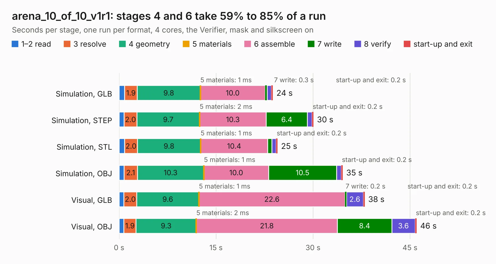

# 1276. arena_10_of_10_v1r1

Board 1,276 of the 3,117 of [Corpus Testing](../Corpus-Testing.md), on [Corpus Page 12](../CorpusTestingPages/Corpus-Testing-12.md#1276-arena_10_of_10_v1r1).

| Mode and format | 1–2 read | 3 resolve | 4 geometry | 5 materials | 6 assemble | 7 write | 8 verify | start-up and exit | Total |
|---|---:|---:|---:|---:|---:|---:|---:|---:|---:|
| Simulation, GLB | 0.9 | 1.9 | 9.8 | 1&nbsp;ms | 10.0 | 0.3 | 0.6 | 0.2 | 23.8 |
| Simulation, STEP | 0.8 | 2.0 | 9.7 | 2&nbsp;ms | 10.3 | 6.4 | 0.7 | 0.2 | 30.1 |
| Simulation, STL | 0.9 | 2.0 | 9.8 | 1&nbsp;ms | 10.4 | 0.6 | 0.7 | 0.2 | 24.5 |
| Simulation, OBJ | 0.8 | 2.1 | 10.3 | 1&nbsp;ms | 10.0 | 10.5 | 0.7 | 0.2 | 34.6 |
| Visual, GLB | 0.7 | 2.0 | 9.6 | 1&nbsp;ms | 22.6 | 0.2 | 2.6 | 0.2 | 38.0 |
| Visual, OBJ | 0.7 | 1.9 | 9.3 | 2&nbsp;ms | 21.8 | 8.4 | 3.6 | 0.2 | 46.0 |

<table align="center"><tr><td valign="top">

| Board | Repo: [iorodeo/led-display_g6_hardware_arena](https://github.com/iorodeo/led-display_g6_hardware_arena) Board: `arena_10_of_10_v1r1.kicad_pcb` |
|---|---|
| Folder | arena_10-10 / arena_10-10_v1 / layout_tool |
| Complexity | 94&nbsp;/&nbsp;1000 (size&nbsp;84, features&nbsp;10) |
| KESE&nbsp;features | rounded, trapezoid or chamfered pads |
| Tested | 9th November 2026 |
| Copper&nbsp;layers | 2 |
| File&nbsp;format | KiCad 9 (20241229) |
| Parts,&nbsp;tracks,&nbsp;vias | 495, 0, 0 |
| Triangles,&nbsp;simulation | 2,474,306 in 511 parts |
| Note | mostly unrouted |
| Verifier | PASS in all six runs |

</td><td valign="top">

<table>
<tr><th>File type</th><th>File size</th><th>Peak memory used</th></tr>
<tr><th colspan="3" align="left">Simulation</th></tr>
<tr><td>GLB</td><td align="right">83&nbsp;MB</td><td align="right">922&nbsp;MB</td></tr>
<tr><td>STEP</td><td align="right">344&nbsp;MB</td><td align="right">1.2&nbsp;GB</td></tr>
<tr><td>STL</td><td align="right">124&nbsp;MB</td><td align="right">931&nbsp;MB</td></tr>
<tr><td>OBJ</td><td align="right">264&nbsp;MB</td><td align="right">1.7&nbsp;GB</td></tr>
<tr><th colspan="3" align="left">Visual</th></tr>
<tr><td>GLB</td><td align="right">67&nbsp;MB</td><td align="right">1.3&nbsp;GB</td></tr>
<tr><td>OBJ</td><td align="right">208&nbsp;MB</td><td align="right">1.5&nbsp;GB</td></tr>
</table>

</td></tr></table>

| Previous | Next |
|:---|---:|
| [1275. arena_10_of_10_v1r1](b1275b_led-display-g6-hardware-arena_arena-10-10-arena-10-10-v1_arena-10-of-10-v1r1.md) | [1277. modified_arena_10_of_10_v1r1](b1277b_led-display-g6-hardware-arena_arena-10-10-arena-10-10-v1-layout-tool_modified-arena-10-of-10-v1r1.md) |
