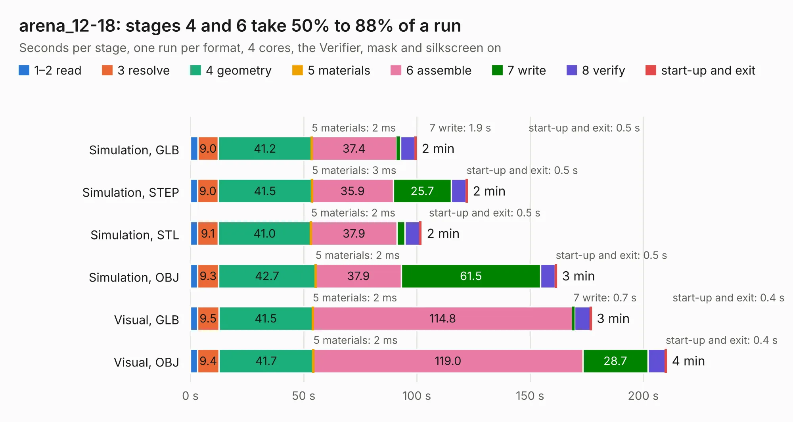

# 1277. arena_12-18

Board 1,277 of the 3,108 of [Corpus Testing](../Corpus-Testing.md), on [Corpus Page 12](../CorpusTestingPages/Corpus-Testing-12.md#1277-arena_12-18).

| Mode and format | 1–2 read | 3 resolve | 4 geometry | 5 materials | 6 assemble | 7 write | 8 verify | start-up and exit | Total |
|---|---:|---:|---:|---:|---:|---:|---:|---:|---:|
| Simulation, GLB | 3.3 | 9.0 | 41.2 | 2&nbsp;ms | 37.4 | 1.9 | 6.3 | 0.5 | 99.6 |
| Simulation, STEP | 3.2 | 9.0 | 41.5 | 3&nbsp;ms | 35.9 | 25.7 | 6.4 | 0.5 | 122.2 |
| Simulation, STL | 3.2 | 9.1 | 41.0 | 2&nbsp;ms | 37.9 | 3.6 | 6.6 | 0.5 | 101.9 |
| Simulation, OBJ | 3.2 | 9.3 | 42.7 | 2&nbsp;ms | 37.9 | 61.5 | 6.4 | 0.5 | 161.6 |
| Visual, GLB | 3.1 | 9.5 | 41.5 | 2&nbsp;ms | 114.8 | 0.7 | 7.0 | 0.4 | 176.9 |
| Visual, OBJ | 3.2 | 9.4 | 41.7 | 2&nbsp;ms | 119.0 | 28.7 | 7.7 | 0.4 | 210.1 |

<table align="center"><tr><td valign="top">

| Board | Repo: [iorodeo/led-display_g6_hardware_arena](https://github.com/iorodeo/led-display_g6_hardware_arena) Board: `arena_12-18.kicad_pcb` |
|---|---|
| Folder | arena_12-18 |
| Complexity | 381&nbsp;/&nbsp;1000 (size&nbsp;256, features&nbsp;125) |
| KESE&nbsp;features | through vias, slotted holes, rounded, trapezoid or chamfered pads, filled zones, curved board outline, knockout text, stack-up, dielectric εr and tanδ, copper finish |
| Tested | 9th November 2026 |
| Copper&nbsp;layers | 6 |
| File&nbsp;format | KiCad 10 (20260206) |
| Parts,&nbsp;tracks,&nbsp;vias | 604, 3,679, 855 |
| Triangles,&nbsp;simulation | 9,784,698 in 604 parts |
| Verifier | PASS in all six runs |

</td><td valign="top">

<table>
<tr><th>File type</th><th>File size</th><th>Peak memory used</th></tr>
<tr><th colspan="3" align="left">Simulation</th></tr>
<tr><td>GLB</td><td align="right">333&nbsp;MB</td><td align="right">2.3&nbsp;GB</td></tr>
<tr><td>STEP</td><td align="right">1.3&nbsp;GB</td><td align="right">3.1&nbsp;GB</td></tr>
<tr><td>STL</td><td align="right">489&nbsp;MB</td><td align="right">2.3&nbsp;GB</td></tr>
<tr><td>OBJ</td><td align="right">1.1&nbsp;GB</td><td align="right">6.2&nbsp;GB</td></tr>
<tr><th colspan="3" align="left">Visual</th></tr>
<tr><td>GLB</td><td align="right">161&nbsp;MB</td><td align="right">2.8&nbsp;GB</td></tr>
<tr><td>OBJ</td><td align="right">516&nbsp;MB</td><td align="right">3.4&nbsp;GB</td></tr>
</table>

</td></tr></table>

| Previous | Next |
|:---|---:|
| [1276. arena_10-10_v2r1](b1276b_led-display-g6-hardware-arena_arena-10-10-develop-without-reg-arena-10-10-v2r1_arena-10-10-v2r1.md) | [1278. arena_12-18](b1278b_led-display-g6-hardware-arena_arena-12-18-layout-tool_arena-12-18.md) |
