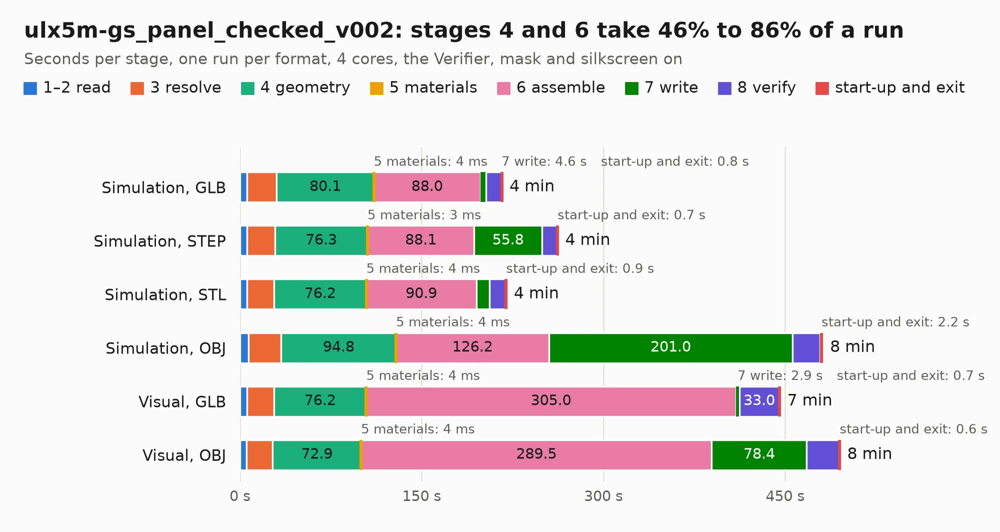

# 1277. ulx5m-gs_panel_checked_v002

Board 1,277 of the 3,130 of [Corpus Testing](../Corpus-Testing.md), on [Corpus Page 12](../CorpusTestingPages/Corpus-Testing-12.md#1277-ulx5m-gs_panel_checked_v002).

| Mode and format | 1–2 read | 3 resolve | 4 geometry | 5 materials | 6 assemble | 7 write | 8 verify | start-up and exit | Total |
|---|---:|---:|---:|---:|---:|---:|---:|---:|---:|
| Simulation, GLB | 5.7 | 24.6 | 80.1 | 4&nbsp;ms | 88.0 | 4.6 | 12.7 | 0.8 | 216.5 |
| Simulation, STEP | 5.9 | 23.0 | 76.3 | 3&nbsp;ms | 88.1 | 55.8 | 12.6 | 0.7 | 262.5 |
| Simulation, STL | 5.9 | 22.2 | 76.2 | 4&nbsp;ms | 90.9 | 10.7 | 13.4 | 0.9 | 220.1 |
| Simulation, OBJ | 7.1 | 27.0 | 94.8 | 4&nbsp;ms | 126.2 | 201.0 | 22.9 | 2.2 | 481.1 |
| Visual, GLB | 5.8 | 22.3 | 76.2 | 4&nbsp;ms | 305.0 | 2.9 | 33.0 | 0.7 | 445.8 |
| Visual, OBJ | 5.5 | 21.5 | 72.9 | 4&nbsp;ms | 289.5 | 78.4 | 26.9 | 0.6 | 495.3 |

<table align="center"><tr><td valign="top">

| Board | Repo: [intergalaktik/ulx5m-gs](https://github.com/intergalaktik/ulx5m-gs) Board: `ulx5m-gs_panel_checked_v002.kicad_pcb` |
|---|---|
| Folder | hardware / panel |
| Complexity | 501&nbsp;/&nbsp;1000 (size&nbsp;361, features&nbsp;140) |
| KESE&nbsp;features | through vias, slotted holes, custom pads, rounded, trapezoid or chamfered pads, arc tracks, filled zones, copper drawings, stack-up, dielectric εr and tanδ, copper finish |
| Tested | 9th November 2026 to 11th November 2026 |
| Copper&nbsp;layers | 6 |
| File&nbsp;format | KiCad 9 (20241229) |
| Parts,&nbsp;tracks,&nbsp;vias | 1,148, 30,512, 3,416 |
| Triangles,&nbsp;simulation | 25,478,436 in 1392 parts |
| Note | panel |
| Verifier | PASS in all six runs |
| Run&nbsp;again | Simulation, OBJ: failed in the corpus run, run again with no memory cap and no time limit (swap added to a 16 GB machine), and passed |

</td><td valign="top">

<table>
<tr><th>File type</th><th>File size</th><th>Peak memory used</th></tr>
<tr><th colspan="3" align="left">Simulation</th></tr>
<tr><td>GLB</td><td align="right">822&nbsp;MB</td><td align="right">6.0&nbsp;GB</td></tr>
<tr><td>STEP</td><td align="right">3.5&nbsp;GB</td><td align="right">7.6&nbsp;GB</td></tr>
<tr><td>STL</td><td align="right">1.3&nbsp;GB</td><td align="right">6.1&nbsp;GB</td></tr>
<tr><td>OBJ</td><td align="right">2.8&nbsp;GB</td><td align="right">16&nbsp;GB</td></tr>
<tr><th colspan="3" align="left">Visual</th></tr>
<tr><td>GLB</td><td align="right">507&nbsp;MB</td><td align="right">8.0&nbsp;GB</td></tr>
<tr><td>OBJ</td><td align="right">1.7&nbsp;GB</td><td align="right">11&nbsp;GB</td></tr>
</table>

</td></tr></table>

| Previous | Next |
|:---|---:|
| [1276. ULX4M_GPDI](b1276b_ULX4M-documents_ULX4M-GPDI.md) | [1278. ulx5m-gs](b1278b_ulx5m-gs_ulx5m-gs.md) |
