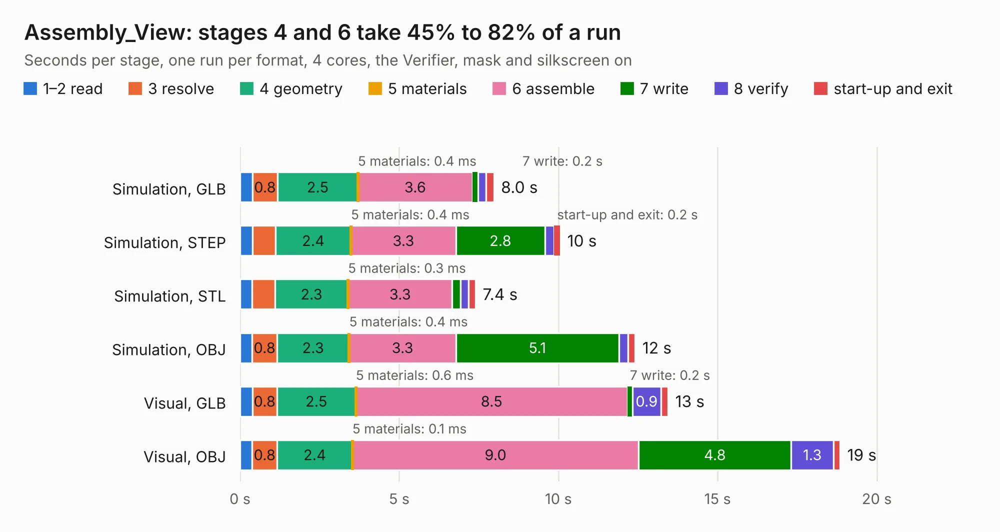

# 1278. Assembly_View

Board 1,278 of the 3,101 of [Corpus Testing](../Corpus-Testing.md), on [Corpus Page 12](../CorpusTestingPages/Corpus-Testing-12.md#1278-assembly_view).

| Mode and format | 1–2 read | 3 resolve | 4 geometry | 5 materials | 6 assemble | 7 write | 8 verify | start-up and exit | Total |
|---|---:|---:|---:|---:|---:|---:|---:|---:|---:|
| Simulation, GLB | 0.4 | 0.8 | 2.5 | 0.4&nbsp;ms | 3.6 | 0.2 | 0.3 | 0.2 | 8.0 |
| Simulation, STEP | 0.4 | 0.7 | 2.4 | 0.4&nbsp;ms | 3.3 | 2.8 | 0.3 | 0.2 | 10.1 |
| Simulation, STL | 0.4 | 0.7 | 2.3 | 0.3&nbsp;ms | 3.3 | 0.3 | 0.3 | 0.2 | 7.4 |
| Simulation, OBJ | 0.4 | 0.8 | 2.3 | 0.4&nbsp;ms | 3.3 | 5.1 | 0.3 | 0.2 | 12.4 |
| Visual, GLB | 0.4 | 0.8 | 2.5 | 0.6&nbsp;ms | 8.5 | 0.2 | 0.9 | 0.2 | 13.4 |
| Visual, OBJ | 0.4 | 0.8 | 2.4 | 0.1&nbsp;ms | 9.0 | 4.8 | 1.3 | 0.2 | 18.8 |

<table align="center"><tr><td valign="top">

| Board | Repo: [isarmg/pcie-switch-2](https://github.com/isarmg/pcie-switch-2) Board: `Assembly_View.kicad_pcb` |
|---|---|
| Folder | outputs / PCIe_3board_RevI / Assembly_View |
| Complexity | 140&nbsp;/&nbsp;1000 (size&nbsp;130, features&nbsp;10) |
| KESE&nbsp;features | rounded, trapezoid or chamfered pads |
| Tested | 9th November 2026 |
| Copper&nbsp;layers | 2 |
| File&nbsp;format | KiCad 10 (20260206) |
| Parts,&nbsp;tracks,&nbsp;vias | 292, 0, 0 |
| Triangles,&nbsp;simulation | 929,848 in 9 parts |
| Note | mostly unrouted |
| Verifier | PASS in all six runs |

</td><td valign="top">

<table>
<tr><th>File type</th><th>File size</th><th>Peak memory used</th></tr>
<tr><th colspan="3" align="left">Simulation</th></tr>
<tr><td>GLB</td><td align="right">35&nbsp;MB</td><td align="right">548&nbsp;MB</td></tr>
<tr><td>STEP</td><td align="right">149&nbsp;MB</td><td align="right">592&nbsp;MB</td></tr>
<tr><td>STL</td><td align="right">46&nbsp;MB</td><td align="right">533&nbsp;MB</td></tr>
<tr><td>OBJ</td><td align="right">100&nbsp;MB</td><td align="right">680&nbsp;MB</td></tr>
<tr><th colspan="3" align="left">Visual</th></tr>
<tr><td>GLB</td><td align="right">32&nbsp;MB</td><td align="right">736&nbsp;MB</td></tr>
<tr><td>OBJ</td><td align="right">95&nbsp;MB</td><td align="right">814&nbsp;MB</td></tr>
</table>

</td></tr></table>

| Previous | Next |
|:---|---:|
| [1277. E1S_10slot_80x45_12V](b1277b_pcie-switch-2_E1S-10slot-80x45-12V.md) | [1279. Left_2M2_Vertical](b1279b_pcie-switch-2_outputs-PCIe-3board-RevI-Left-2M2-Vertical_Left-2M2-Vertical.md) |
