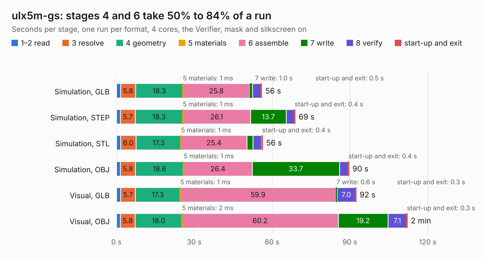

# 1278. ulx5m-gs

Board 1,278 of the 3,127 of [Corpus Testing](../Corpus-Testing.md), on [Corpus Page 12](../CorpusTestingPages/Corpus-Testing-12.md#1278-ulx5m-gs).

| Mode and format | 1–2 read | 3 resolve | 4 geometry | 5 materials | 6 assemble | 7 write | 8 verify | start-up and exit | Total |
|---|---:|---:|---:|---:|---:|---:|---:|---:|---:|
| Simulation, GLB | 1.5 | 5.8 | 18.3 | 1&nbsp;ms | 25.8 | 1.0 | 3.1 | 0.5 | 56.0 |
| Simulation, STEP | 1.5 | 5.7 | 18.3 | 1&nbsp;ms | 26.1 | 13.7 | 3.1 | 0.4 | 68.9 |
| Simulation, STL | 1.6 | 6.0 | 17.3 | 1&nbsp;ms | 25.4 | 2.3 | 3.3 | 0.4 | 56.3 |
| Simulation, OBJ | 1.5 | 5.8 | 18.6 | 1&nbsp;ms | 26.4 | 33.7 | 3.2 | 0.4 | 89.6 |
| Visual, GLB | 1.6 | 5.7 | 17.3 | 1&nbsp;ms | 59.9 | 0.6 | 7.0 | 0.3 | 92.4 |
| Visual, OBJ | 1.5 | 5.8 | 18.0 | 2&nbsp;ms | 60.2 | 19.2 | 7.1 | 0.3 | 112.2 |

<table align="center"><tr><td valign="top">

| Board | Repo: [intergalaktik/ulx5m-gs](https://github.com/intergalaktik/ulx5m-gs) Board: `ulx5m-gs.kicad_pcb` |
|---|---|
| Folder | hardware |
| Complexity | 460&nbsp;/&nbsp;1000 (size&nbsp;310, features&nbsp;150) |
| KESE&nbsp;features | through vias, slotted holes, custom pads, rounded, trapezoid or chamfered pads, arc tracks, filled zones, copper drawings, curved board outline, stack-up, dielectric εr and tanδ, copper finish |
| Tested | 9th November 2026 |
| Copper&nbsp;layers | 6 |
| File&nbsp;format | KiCad 9 (20241229) |
| Parts,&nbsp;tracks,&nbsp;vias | 287, 7,628, 854 |
| Triangles,&nbsp;simulation | 6,349,706 in 360 parts |
| Verifier | PASS in all six runs |

</td><td valign="top">

<table>
<tr><th>File type</th><th>File size</th><th>Peak memory used</th></tr>
<tr><th colspan="3" align="left">Simulation</th></tr>
<tr><td>GLB</td><td align="right">212&nbsp;MB</td><td align="right">1.5&nbsp;GB</td></tr>
<tr><td>STEP</td><td align="right">844&nbsp;MB</td><td align="right">2.2&nbsp;GB</td></tr>
<tr><td>STL</td><td align="right">318&nbsp;MB</td><td align="right">1.6&nbsp;GB</td></tr>
<tr><td>OBJ</td><td align="right">677&nbsp;MB</td><td align="right">4.0&nbsp;GB</td></tr>
<tr><th colspan="3" align="left">Visual</th></tr>
<tr><td>GLB</td><td align="right">127&nbsp;MB</td><td align="right">2.1&nbsp;GB</td></tr>
<tr><td>OBJ</td><td align="right">409&nbsp;MB</td><td align="right">2.6&nbsp;GB</td></tr>
</table>

</td></tr></table>

| Previous | Next |
|:---|---:|
| [1277. ulx5m-gs_panel_checked_v002](b1277b_ulx5m-gs_ulx5m-gs-panel-checked-v002.md) | [1279. ulx5m-m2](b1279b_ulx5m-m2_ulx5m-m2.md) |
