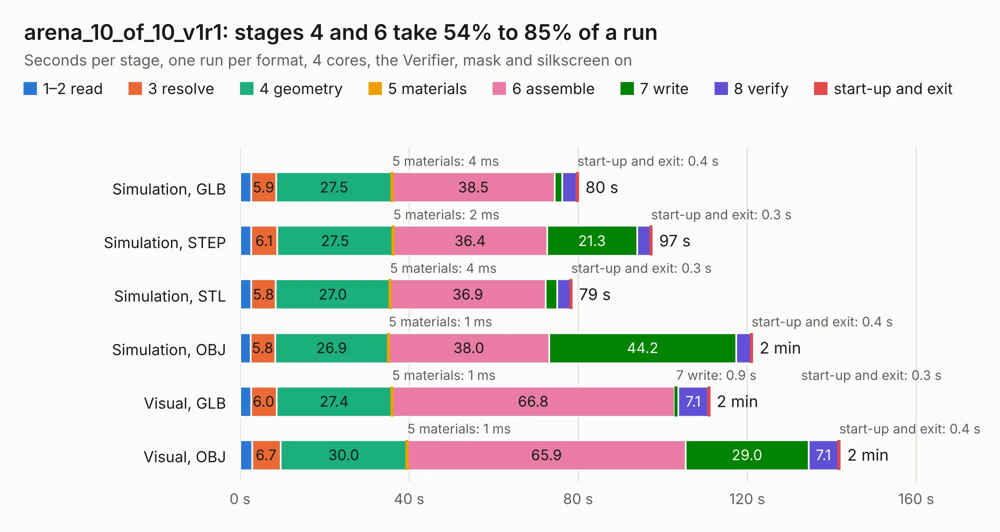

# 1280. arena_10_of_10_v1r1

Board 1,280 of the 3,123 of [Corpus Testing](../Corpus-Testing.md), on [Corpus Page 12](../CorpusTestingPages/Corpus-Testing-12.md#1280-arena_10_of_10_v1r1).

| Mode and format | 1–2 read | 3 resolve | 4 geometry | 5 materials | 6 assemble | 7 write | 8 verify | start-up and exit | Total |
|---|---:|---:|---:|---:|---:|---:|---:|---:|---:|
| Simulation, GLB | 2.6 | 5.9 | 27.5 | 4&nbsp;ms | 38.5 | 1.7 | 3.5 | 0.4 | 80.0 |
| Simulation, STEP | 2.7 | 6.1 | 27.5 | 2&nbsp;ms | 36.4 | 21.3 | 3.2 | 0.3 | 97.5 |
| Simulation, STL | 2.7 | 5.8 | 27.0 | 4&nbsp;ms | 36.9 | 2.7 | 3.1 | 0.3 | 78.5 |
| Simulation, OBJ | 2.4 | 5.8 | 26.9 | 1&nbsp;ms | 38.0 | 44.2 | 3.5 | 0.4 | 121.3 |
| Visual, GLB | 2.6 | 6.0 | 27.4 | 1&nbsp;ms | 66.8 | 0.9 | 7.1 | 0.3 | 111.1 |
| Visual, OBJ | 2.8 | 6.7 | 30.0 | 1&nbsp;ms | 65.9 | 29.0 | 7.1 | 0.4 | 142.0 |

<table align="center"><tr><td valign="top">

| Board | Repo: [iorodeo/led-display_g6_hardware_arena](https://github.com/iorodeo/led-display_g6_hardware_arena) Board: `arena_10_of_10_v1r1.kicad_pcb` |
|---|---|
| Folder | arena_10-10 / arena_10-10_v1 |
| Complexity | 402&nbsp;/&nbsp;1000 (size&nbsp;262, features&nbsp;140) |
| KESE&nbsp;features | through vias, slotted holes, rounded, trapezoid or chamfered pads, arc tracks, filled zones, curved board outline, tracks bare of mask, stack-up, dielectric εr and tanδ, copper finish |
| Tested | 9th November 2026 |
| Copper&nbsp;layers | 6 |
| File&nbsp;format | KiCad 9 (20241229) |
| Parts,&nbsp;tracks,&nbsp;vias | 509, 8,133, 666 |
| Triangles,&nbsp;simulation | 7,355,260 in 516 parts |
| Verifier | PASS in all six runs |

</td><td valign="top">

<table>
<tr><th>File type</th><th>File size</th><th>Peak memory used</th></tr>
<tr><th colspan="3" align="left">Simulation</th></tr>
<tr><td>GLB</td><td align="right">244&nbsp;MB</td><td align="right">2.2&nbsp;GB</td></tr>
<tr><td>STEP</td><td align="right">1.0&nbsp;GB</td><td align="right">2.7&nbsp;GB</td></tr>
<tr><td>STL</td><td align="right">368&nbsp;MB</td><td align="right">2.1&nbsp;GB</td></tr>
<tr><td>OBJ</td><td align="right">773&nbsp;MB</td><td align="right">4.6&nbsp;GB</td></tr>
<tr><th colspan="3" align="left">Visual</th></tr>
<tr><td>GLB</td><td align="right">168&nbsp;MB</td><td align="right">2.7&nbsp;GB</td></tr>
<tr><td>OBJ</td><td align="right">541&nbsp;MB</td><td align="right">3.5&nbsp;GB</td></tr>
</table>

</td></tr></table>

| Previous | Next |
|:---|---:|
| [1279. ulx5m-m2](b1279b_ulx5m-m2_ulx5m-m2.md) | [1281. arena_10_of_10_v1r1](b1281b_led-display-g6-hardware-arena_arena-10-10-arena-10-10-v1-layout-tool_arena-10-of-10-v1r1.md) |
