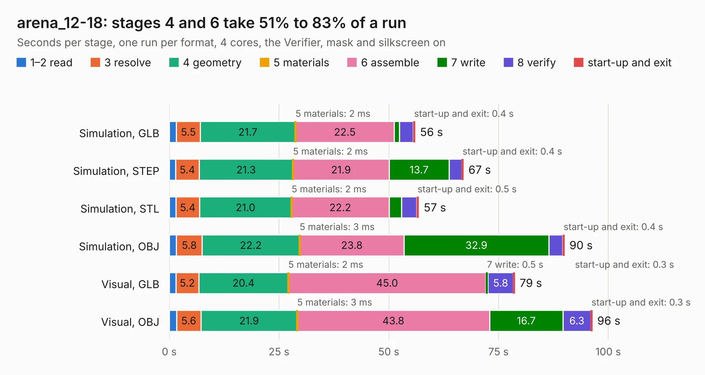

# 1282. arena_12-18

Board 1,282 of the 3,107 of [Corpus Testing](../Corpus-Testing.md), on [Corpus Page 12](../CorpusTestingPages/Corpus-Testing-12.md#1282-arena_12-18).

| Mode and format | 1–2 read | 3 resolve | 4 geometry | 5 materials | 6 assemble | 7 write | 8 verify | start-up and exit | Total |
|---|---:|---:|---:|---:|---:|---:|---:|---:|---:|
| Simulation, GLB | 1.6 | 5.5 | 21.7 | 2&nbsp;ms | 22.5 | 1.2 | 3.1 | 0.4 | 56.0 |
| Simulation, STEP | 1.4 | 5.4 | 21.3 | 2&nbsp;ms | 21.9 | 13.7 | 2.9 | 0.4 | 67.0 |
| Simulation, STL | 1.5 | 5.4 | 21.0 | 2&nbsp;ms | 22.2 | 2.8 | 3.4 | 0.5 | 56.8 |
| Simulation, OBJ | 1.6 | 5.8 | 22.2 | 3&nbsp;ms | 23.8 | 32.9 | 3.2 | 0.4 | 90.0 |
| Visual, GLB | 1.5 | 5.2 | 20.4 | 2&nbsp;ms | 45.0 | 0.5 | 5.8 | 0.3 | 78.7 |
| Visual, OBJ | 1.7 | 5.6 | 21.9 | 3&nbsp;ms | 43.8 | 16.7 | 6.3 | 0.3 | 96.4 |

<table align="center"><tr><td valign="top">

| Board | Repo: [iorodeo/led-display_g6_hardware_arena](https://github.com/iorodeo/led-display_g6_hardware_arena) Board: `arena_12-18.kicad_pcb` |
|---|---|
| Folder | arena_12-18 / manual_route / v2 / routed |
| Complexity | 363&nbsp;/&nbsp;1000 (size&nbsp;253, features&nbsp;110) |
| KESE&nbsp;features | through vias, slotted holes, rounded, trapezoid or chamfered pads, filled zones, curved board outline, tracks bare of mask, stack-up, dielectric εr and tanδ |
| Tested | 9th November 2026 |
| Copper&nbsp;layers | 6 |
| File&nbsp;format | KiCad 9 (20241229) |
| Parts,&nbsp;tracks,&nbsp;vias | 505, 4,129, 652 |
| Triangles,&nbsp;simulation | 7,323,260 in 516 parts |
| Verifier | PASS in all six runs |

</td><td valign="top">

<table>
<tr><th>File type</th><th>File size</th><th>Peak memory used</th></tr>
<tr><th colspan="3" align="left">Simulation</th></tr>
<tr><td>GLB</td><td align="right">244&nbsp;MB</td><td align="right">1.8&nbsp;GB</td></tr>
<tr><td>STEP</td><td align="right">805&nbsp;MB</td><td align="right">2.5&nbsp;GB</td></tr>
<tr><td>STL</td><td align="right">366&nbsp;MB</td><td align="right">1.9&nbsp;GB</td></tr>
<tr><td>OBJ</td><td align="right">772&nbsp;MB</td><td align="right">4.6&nbsp;GB</td></tr>
<tr><th colspan="3" align="left">Visual</th></tr>
<tr><td>GLB</td><td align="right">126&nbsp;MB</td><td align="right">2.2&nbsp;GB</td></tr>
<tr><td>OBJ</td><td align="right">406&nbsp;MB</td><td align="right">2.6&nbsp;GB</td></tr>
</table>

</td></tr></table>

| Previous | Next |
|:---|---:|
| [1281. arena_12-18](b1281b_led-display-g6-hardware-arena_arena-12-18-manual-route-v2_arena-12-18.md) | [1283. E1S_10slot_80x45_12V](b1283b_pcie-switch-2_E1S-10slot-80x45-12V.md) |
