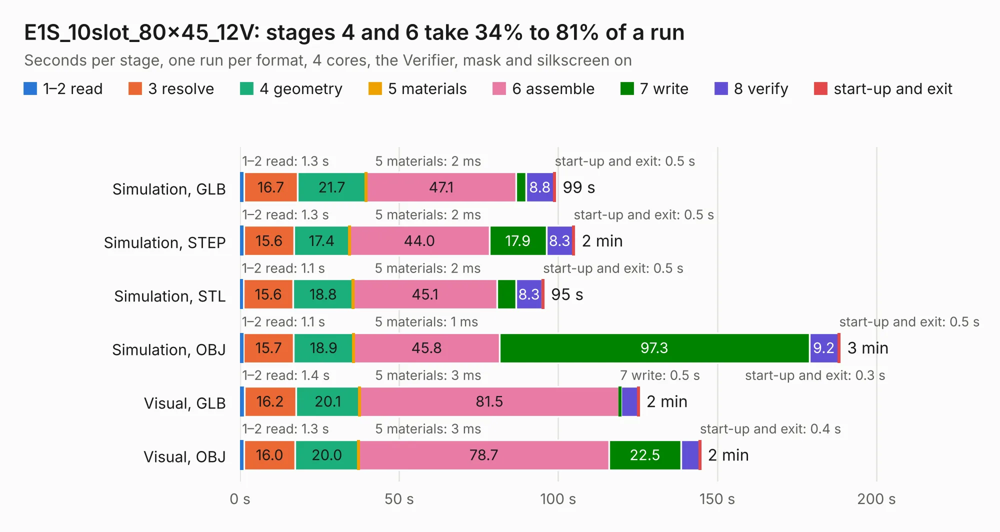

# 1284. E1S_10slot_80x45_12V

Board 1,284 of the 3,108 of [Corpus Testing](../Corpus-Testing.md), on [Corpus Page 12](../CorpusTestingPages/Corpus-Testing-12.md#1284-e1s_10slot_80x45_12v).

| Mode and format | 1–2 read | 3 resolve | 4 geometry | 5 materials | 6 assemble | 7 write | 8 verify | start-up and exit | Total |
|---|---:|---:|---:|---:|---:|---:|---:|---:|---:|
| Simulation, GLB | 1.3 | 16.7 | 21.7 | 2&nbsp;ms | 47.1 | 3.1 | 8.8 | 0.5 | 99.1 |
| Simulation, STEP | 1.3 | 15.6 | 17.4 | 2&nbsp;ms | 44.0 | 17.9 | 8.3 | 0.5 | 105.1 |
| Simulation, STL | 1.1 | 15.6 | 18.8 | 2&nbsp;ms | 45.1 | 6.0 | 8.3 | 0.5 | 95.5 |
| Simulation, OBJ | 1.1 | 15.7 | 18.9 | 1&nbsp;ms | 45.8 | 97.3 | 9.2 | 0.5 | 188.5 |
| Visual, GLB | 1.4 | 16.2 | 20.1 | 3&nbsp;ms | 81.5 | 0.5 | 5.4 | 0.3 | 125.4 |
| Visual, OBJ | 1.3 | 16.0 | 20.0 | 3&nbsp;ms | 78.7 | 22.5 | 5.8 | 0.4 | 144.7 |

<table align="center"><tr><td valign="top">

| Board | Repo: [isarmg/pcie-switch-2](https://github.com/isarmg/pcie-switch-2) Board: `E1S_10slot_80x45_12V.kicad_pcb` |
|---|---|
| Folder | outputs / E1S_10slot_80x45_12V |
| Complexity | 406&nbsp;/&nbsp;1000 (size&nbsp;321, features&nbsp;85) |
| KESE&nbsp;features | through vias, blind and buried vias, rounded, trapezoid or chamfered pads, filled zones |
| Tested | 9th November 2026 |
| Copper&nbsp;layers | 20 |
| File&nbsp;format | KiCad 10 (20260206) |
| Parts,&nbsp;tracks,&nbsp;vias | 124, 3,688, 1,081 |
| Triangles,&nbsp;simulation | 13,560,038 in 502 parts |
| Verifier | PASS in all six runs |

</td><td valign="top">

<table>
<tr><th>File type</th><th>File size</th><th>Peak memory used</th></tr>
<tr><th colspan="3" align="left">Simulation</th></tr>
<tr><td>GLB</td><td align="right">455&nbsp;MB</td><td align="right">2.3&nbsp;GB</td></tr>
<tr><td>STEP</td><td align="right">679&nbsp;MB</td><td align="right">3.1&nbsp;GB</td></tr>
<tr><td>STL</td><td align="right">678&nbsp;MB</td><td align="right">2.5&nbsp;GB</td></tr>
<tr><td>OBJ</td><td align="right">1.5&nbsp;GB</td><td align="right">8.3&nbsp;GB</td></tr>
<tr><th colspan="3" align="left">Visual</th></tr>
<tr><td>GLB</td><td align="right">96&nbsp;MB</td><td align="right">2.2&nbsp;GB</td></tr>
<tr><td>OBJ</td><td align="right">366&nbsp;MB</td><td align="right">2.5&nbsp;GB</td></tr>
</table>

</td></tr></table>

| Previous | Next |
|:---|---:|
| [1283. arena_12-18](b1283b_led-display-g6-hardware-arena_arena-12-18-manual-route-v2-routed_arena-12-18.md) | [1285. Assembly_View](b1285b_pcie-switch-2_outputs-PCIe-3board-RevI-Assembly-View_Assembly-View.md) |
