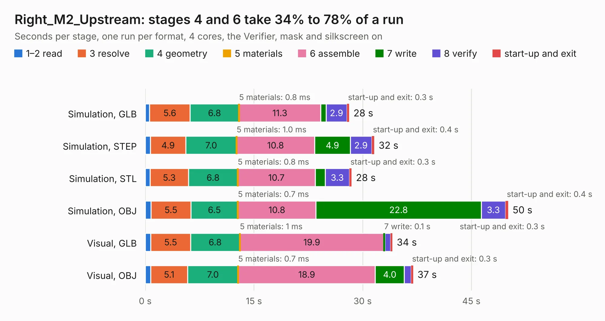

# 1284. Right_M2_Upstream

Board 1,284 of the 3,100 of [Corpus Testing](../Corpus-Testing.md), on [Corpus Page 12](../CorpusTestingPages/Corpus-Testing-12.md#1284-right_m2_upstream).

| Mode and format | 1–2 read | 3 resolve | 4 geometry | 5 materials | 6 assemble | 7 write | 8 verify | start-up and exit | Total |
|---|---:|---:|---:|---:|---:|---:|---:|---:|---:|
| Simulation, GLB | 0.6 | 5.6 | 6.8 | 0.8&nbsp;ms | 11.3 | 0.7 | 2.9 | 0.3 | 28.1 |
| Simulation, STEP | 0.7 | 4.9 | 7.0 | 1.0&nbsp;ms | 10.8 | 4.9 | 2.9 | 0.4 | 31.6 |
| Simulation, STL | 0.7 | 5.3 | 6.8 | 0.8&nbsp;ms | 10.7 | 1.4 | 3.3 | 0.3 | 28.5 |
| Simulation, OBJ | 0.8 | 5.5 | 6.5 | 0.7&nbsp;ms | 10.8 | 22.8 | 3.3 | 0.4 | 50.1 |
| Visual, GLB | 0.8 | 5.5 | 6.8 | 1&nbsp;ms | 19.9 | 0.1 | 0.8 | 0.3 | 34.1 |
| Visual, OBJ | 0.7 | 5.1 | 7.0 | 0.7&nbsp;ms | 18.9 | 4.0 | 1.0 | 0.3 | 37.0 |

<table align="center"><tr><td valign="top">

| Board | Repo: [isarmg/pcie-switch-2](https://github.com/isarmg/pcie-switch-2) Board: `Right_M2_Upstream.kicad_pcb` |
|---|---|
| Folder | outputs / PCIe_3board_RevJ / Right_M2_Upstream |
| Complexity | 342&nbsp;/&nbsp;1000 (size&nbsp;257, features&nbsp;85) |
| KESE&nbsp;features | through vias, blind and buried vias, rounded, trapezoid or chamfered pads, filled zones |
| Tested | 9th November 2026 |
| Copper&nbsp;layers | 32 |
| File&nbsp;format | KiCad 10 (20260206) |
| Parts,&nbsp;tracks,&nbsp;vias | 80, 866, 424 |
| Triangles,&nbsp;simulation | 4,790,716 in 212 parts |
| Verifier | PASS in all six runs |

</td><td valign="top">

<table>
<tr><th>File type</th><th>File size</th><th>Peak memory used</th></tr>
<tr><th colspan="3" align="left">Simulation</th></tr>
<tr><td>GLB</td><td align="right">162&nbsp;MB</td><td align="right">874&nbsp;MB</td></tr>
<tr><td>STEP</td><td align="right">208&nbsp;MB</td><td align="right">1.1&nbsp;GB</td></tr>
<tr><td>STL</td><td align="right">240&nbsp;MB</td><td align="right">1.0&nbsp;GB</td></tr>
<tr><td>OBJ</td><td align="right">531&nbsp;MB</td><td align="right">3.0&nbsp;GB</td></tr>
<tr><th colspan="3" align="left">Visual</th></tr>
<tr><td>GLB</td><td align="right">25&nbsp;MB</td><td align="right">759&nbsp;MB</td></tr>
<tr><td>OBJ</td><td align="right">86&nbsp;MB</td><td align="right">764&nbsp;MB</td></tr>
</table>

</td></tr></table>

| Previous | Next |
|:---|---:|
| [1283. Main_10E1S](b1283b_pcie-switch-2_outputs-PCIe-3board-RevJ-Main-10E1S_Main-10E1S.md) | [1285. Assembly_View](b1285b_pcie-switch-2_outputs-PCIe-3board-RevK-Assembly-View_Assembly-View.md) |
