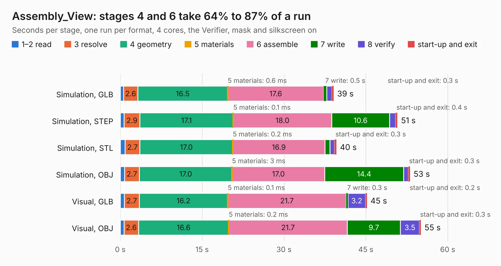

# 1285. Assembly_View

Board 1,285 of the 3,100 of [Corpus Testing](../Corpus-Testing.md), on [Corpus Page 12](../CorpusTestingPages/Corpus-Testing-12.md#1285-assembly_view).

| Mode and format | 1–2 read | 3 resolve | 4 geometry | 5 materials | 6 assemble | 7 write | 8 verify | start-up and exit | Total |
|---|---:|---:|---:|---:|---:|---:|---:|---:|---:|
| Simulation, GLB | 0.6 | 2.6 | 16.5 | 0.6&nbsp;ms | 17.6 | 0.5 | 1.0 | 0.3 | 39.1 |
| Simulation, STEP | 0.7 | 2.9 | 17.1 | 0.1&nbsp;ms | 18.0 | 10.6 | 1.1 | 0.4 | 50.8 |
| Simulation, STL | 0.9 | 2.7 | 17.0 | 0.2&nbsp;ms | 16.9 | 0.9 | 0.9 | 0.3 | 39.6 |
| Simulation, OBJ | 0.8 | 2.7 | 17.0 | 3&nbsp;ms | 17.0 | 14.4 | 0.9 | 0.3 | 53.1 |
| Visual, GLB | 0.7 | 2.7 | 16.2 | 0.1&nbsp;ms | 21.7 | 0.3 | 3.2 | 0.2 | 45.2 |
| Visual, OBJ | 0.7 | 2.6 | 16.6 | 0.2&nbsp;ms | 21.7 | 9.7 | 3.5 | 0.3 | 55.1 |

<table align="center"><tr><td valign="top">

| Board | Repo: [isarmg/pcie-switch-2](https://github.com/isarmg/pcie-switch-2) Board: `Assembly_View.kicad_pcb` |
|---|---|
| Folder | outputs / PCIe_3board_RevK / Assembly_View |
| Complexity | 153&nbsp;/&nbsp;1000 (size&nbsp;133, features&nbsp;20) |
| KESE&nbsp;features | slotted holes, rounded, trapezoid or chamfered pads |
| Tested | 9th November 2026 |
| Copper&nbsp;layers | 2 |
| File&nbsp;format | KiCad 10 (20260206) |
| Parts,&nbsp;tracks,&nbsp;vias | 381, 0, 0 |
| Triangles,&nbsp;simulation | 2,771,572 in 11 parts |
| Note | mostly unrouted |
| Verifier | PASS in all six runs |

</td><td valign="top">

<table>
<tr><th>File type</th><th>File size</th><th>Peak memory used</th></tr>
<tr><th colspan="3" align="left">Simulation</th></tr>
<tr><td>GLB</td><td align="right">99&nbsp;MB</td><td align="right">1.1&nbsp;GB</td></tr>
<tr><td>STEP</td><td align="right">555&nbsp;MB</td><td align="right">1.5&nbsp;GB</td></tr>
<tr><td>STL</td><td align="right">139&nbsp;MB</td><td align="right">1.1&nbsp;GB</td></tr>
<tr><td>OBJ</td><td align="right">305&nbsp;MB</td><td align="right">1.9&nbsp;GB</td></tr>
<tr><th colspan="3" align="left">Visual</th></tr>
<tr><td>GLB</td><td align="right">65&nbsp;MB</td><td align="right">1.3&nbsp;GB</td></tr>
<tr><td>OBJ</td><td align="right">202&nbsp;MB</td><td align="right">1.4&nbsp;GB</td></tr>
</table>

</td></tr></table>

| Previous | Next |
|:---|---:|
| [1284. Right_M2_Upstream](b1284b_pcie-switch-2_outputs-PCIe-3board-RevJ-Right-M2-Upstream_Right-M2-Upstream.md) | [1286. Main_10E1S](b1286b_pcie-switch-2_outputs-PCIe-3board-RevK-Main-10E1S_Main-10E1S.md) |
