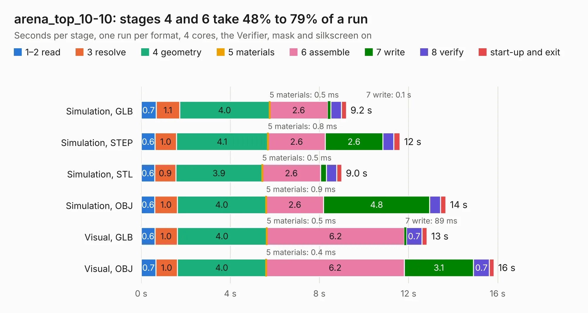

# 1287. arena_top_10-10

Board 1,287 of the 3,128 of [Corpus Testing](../Corpus-Testing.md), on [Corpus Page 12](../CorpusTestingPages/Corpus-Testing-12.md#1287-arena_top_10-10).

| Mode and format | 1–2 read | 3 resolve | 4 geometry | 5 materials | 6 assemble | 7 write | 8 verify | start-up and exit | Total |
|---|---:|---:|---:|---:|---:|---:|---:|---:|---:|
| Simulation, GLB | 0.7 | 1.1 | 4.0 | 0.5&nbsp;ms | 2.6 | 0.1 | 0.5 | 0.2 | 9.2 |
| Simulation, STEP | 0.6 | 1.0 | 4.1 | 0.8&nbsp;ms | 2.6 | 2.6 | 0.5 | 0.3 | 11.6 |
| Simulation, STL | 0.6 | 0.9 | 3.9 | 0.5&nbsp;ms | 2.6 | 0.3 | 0.5 | 0.2 | 9.0 |
| Simulation, OBJ | 0.6 | 1.0 | 4.0 | 0.9&nbsp;ms | 2.6 | 4.8 | 0.5 | 0.2 | 13.7 |
| Visual, GLB | 0.6 | 1.0 | 4.0 | 0.5&nbsp;ms | 6.2 | 89&nbsp;ms | 0.7 | 0.2 | 12.8 |
| Visual, OBJ | 0.7 | 1.0 | 4.0 | 0.4&nbsp;ms | 6.2 | 3.1 | 0.7 | 0.2 | 15.8 |

<table align="center"><tr><td valign="top">

| Board | Repo: [iorodeo/led-display_g6_hardware_arena](https://github.com/iorodeo/led-display_g6_hardware_arena) Board: `arena_top_10-10.kicad_pcb` |
|---|---|
| Folder | arena_10-10 / arena_top_10-10 |
| Complexity | 266&nbsp;/&nbsp;1000 (size&nbsp;136, features&nbsp;130) |
| KESE&nbsp;features | through vias, slotted holes, rounded, trapezoid or chamfered pads, filled zones, curved board outline, knockout text, stack-up, dielectric εr and tanδ, copper finish, mask and silkscreen colours |
| Tested | 9th November 2026 |
| Copper&nbsp;layers | 2 |
| File&nbsp;format | KiCad 10 (20260206) |
| Parts,&nbsp;tracks,&nbsp;vias | 32, 54, 30 |
| Triangles,&nbsp;simulation | 857,574 in 96 parts |
| Verifier | PASS in all six runs |

</td><td valign="top">

<table>
<tr><th>File type</th><th>File size</th><th>Peak memory used</th></tr>
<tr><th colspan="3" align="left">Simulation</th></tr>
<tr><td>GLB</td><td align="right">29&nbsp;MB</td><td align="right">467&nbsp;MB</td></tr>
<tr><td>STEP</td><td align="right">116&nbsp;MB</td><td align="right">483&nbsp;MB</td></tr>
<tr><td>STL</td><td align="right">43&nbsp;MB</td><td align="right">453&nbsp;MB</td></tr>
<tr><td>OBJ</td><td align="right">86&nbsp;MB</td><td align="right">617&nbsp;MB</td></tr>
<tr><th colspan="3" align="left">Visual</th></tr>
<tr><td>GLB</td><td align="right">19&nbsp;MB</td><td align="right">476&nbsp;MB</td></tr>
<tr><td>OBJ</td><td align="right">57&nbsp;MB</td><td align="right">489&nbsp;MB</td></tr>
</table>

</td></tr></table>

| Previous | Next |
|:---|---:|
| [1286. arena_10_of_10_v1r1](b1286b_led-display-g6-hardware-arena_arena-10-10-arena-10-10-v1-manual-route-v2-routed_arena-10-of-10-v1r1.md) | [1288. arena_10-10_v2r1](b1288b_led-display-g6-hardware-arena_arena-10-10-develop-with-reg-arena-10-10-v2r1_arena-10-10-v2r1.md) |
