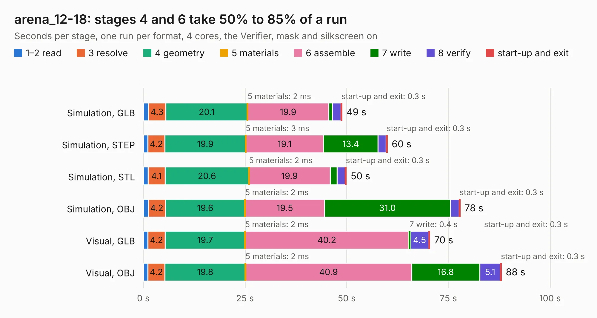

# 1288. arena_12-18

Board 1,288 of the 3,117 of [Corpus Testing](../Corpus-Testing.md), on [Corpus Page 12](../CorpusTestingPages/Corpus-Testing-12.md#1288-arena_12-18).

| Mode and format | 1–2 read | 3 resolve | 4 geometry | 5 materials | 6 assemble | 7 write | 8 verify | start-up and exit | Total |
|---|---:|---:|---:|---:|---:|---:|---:|---:|---:|
| Simulation, GLB | 1.2 | 4.3 | 20.1 | 2&nbsp;ms | 19.9 | 0.9 | 2.1 | 0.3 | 48.9 |
| Simulation, STEP | 1.1 | 4.2 | 19.9 | 3&nbsp;ms | 19.1 | 13.4 | 2.0 | 0.3 | 60.0 |
| Simulation, STL | 1.2 | 4.1 | 20.6 | 2&nbsp;ms | 19.9 | 1.7 | 2.0 | 0.3 | 49.9 |
| Simulation, OBJ | 1.2 | 4.2 | 19.6 | 2&nbsp;ms | 19.5 | 31.0 | 2.1 | 0.3 | 77.9 |
| Visual, GLB | 1.1 | 4.2 | 19.7 | 2&nbsp;ms | 40.2 | 0.4 | 4.5 | 0.3 | 70.5 |
| Visual, OBJ | 1.1 | 4.2 | 19.8 | 2&nbsp;ms | 40.9 | 16.8 | 5.1 | 0.3 | 88.1 |

<table align="center"><tr><td valign="top">

| Board | Repo: [iorodeo/led-display_g6_hardware_arena](https://github.com/iorodeo/led-display_g6_hardware_arena) Board: `arena_12-18.kicad_pcb` |
|---|---|
| Folder | arena_12-18 / manual_route / v1 |
| Complexity | 387&nbsp;/&nbsp;1000 (size&nbsp;242, features&nbsp;145) |
| KESE&nbsp;features | through vias, blind and buried vias, slotted holes, rounded, trapezoid or chamfered pads, arc tracks, curved board outline, tracks bare of mask, stack-up, dielectric εr and tanδ |
| Tested | 9th November 2026 |
| Copper&nbsp;layers | 6 |
| File&nbsp;format | KiCad 9 (20241229) |
| Parts,&nbsp;tracks,&nbsp;vias | 505, 1,743, 403 |
| Triangles,&nbsp;simulation | 5,647,298 in 516 parts |
| Verifier | PASS in all six runs |

</td><td valign="top">

<table>
<tr><th>File type</th><th>File size</th><th>Peak memory used</th></tr>
<tr><th colspan="3" align="left">Simulation</th></tr>
<tr><td>GLB</td><td align="right">186&nbsp;MB</td><td align="right">1.5&nbsp;GB</td></tr>
<tr><td>STEP</td><td align="right">659&nbsp;MB</td><td align="right">2.0&nbsp;GB</td></tr>
<tr><td>STL</td><td align="right">282&nbsp;MB</td><td align="right">1.5&nbsp;GB</td></tr>
<tr><td>OBJ</td><td align="right">591&nbsp;MB</td><td align="right">3.5&nbsp;GB</td></tr>
<tr><th colspan="3" align="left">Visual</th></tr>
<tr><td>GLB</td><td align="right">103&nbsp;MB</td><td align="right">2.0&nbsp;GB</td></tr>
<tr><td>OBJ</td><td align="right">327&nbsp;MB</td><td align="right">2.1&nbsp;GB</td></tr>
</table>

</td></tr></table>

| Previous | Next |
|:---|---:|
| [1287. modified_arena_10_of_10_v1r1](b1287b_led-display-g6-hardware-arena_arena-12-18-layout-tool_modified-arena-10-of-10-v1r1.md) | [1289. arena_12-18](b1289b_led-display-g6-hardware-arena_arena-12-18-manual-route-v1-routed_arena-12-18.md) |
