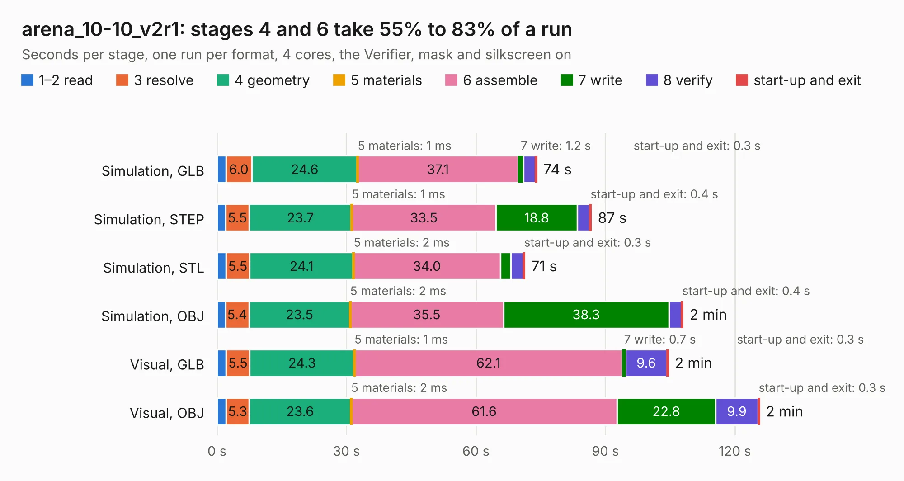

# 1290. arena_10-10_v2r1

Board 1,290 of the 3,132 of [Corpus Testing](../Corpus-Testing.md), on [Corpus Page 12](../CorpusTestingPages/Corpus-Testing-12.md#1290-arena_10-10_v2r1).

| Mode and format | 1–2 read | 3 resolve | 4 geometry | 5 materials | 6 assemble | 7 write | 8 verify | start-up and exit | Total |
|---|---:|---:|---:|---:|---:|---:|---:|---:|---:|
| Simulation, GLB | 2.1 | 6.0 | 24.6 | 1&nbsp;ms | 37.1 | 1.2 | 2.8 | 0.3 | 74.1 |
| Simulation, STEP | 2.0 | 5.5 | 23.7 | 1&nbsp;ms | 33.5 | 18.8 | 2.9 | 0.4 | 86.8 |
| Simulation, STL | 2.1 | 5.5 | 24.1 | 2&nbsp;ms | 34.0 | 2.5 | 2.9 | 0.3 | 71.3 |
| Simulation, OBJ | 1.9 | 5.4 | 23.5 | 2&nbsp;ms | 35.5 | 38.3 | 2.9 | 0.4 | 108.0 |
| Visual, GLB | 2.1 | 5.5 | 24.3 | 1&nbsp;ms | 62.1 | 0.7 | 9.6 | 0.3 | 104.6 |
| Visual, OBJ | 2.1 | 5.3 | 23.6 | 2&nbsp;ms | 61.6 | 22.8 | 9.9 | 0.3 | 125.7 |

<table align="center"><tr><td valign="top">

| Board | Repo: [iorodeo/led-display_g6_hardware_arena](https://github.com/iorodeo/led-display_g6_hardware_arena) Board: `arena_10-10_v2r1.kicad_pcb` |
|---|---|
| Folder | arena_10-10 / develop / without_reg / arena_10-10_v2r1 |
| Complexity | 388&nbsp;/&nbsp;1000 (size&nbsp;263, features&nbsp;125) |
| KESE&nbsp;features | through vias, slotted holes, rounded, trapezoid or chamfered pads, arc tracks, filled zones, curved board outline, stack-up, dielectric εr and tanδ, copper finish |
| Tested | 9th November 2026 |
| Copper&nbsp;layers | 6 |
| File&nbsp;format | KiCad 10 (20260206) |
| Parts,&nbsp;tracks,&nbsp;vias | 543, 8,276, 744 |
| Triangles,&nbsp;simulation | 8,057,822 in 539 parts |
| Verifier | PASS in all six runs |

</td><td valign="top">

<table>
<tr><th>File type</th><th>File size</th><th>Peak memory used</th></tr>
<tr><th colspan="3" align="left">Simulation</th></tr>
<tr><td>GLB</td><td align="right">264&nbsp;MB</td><td align="right">2.2&nbsp;GB</td></tr>
<tr><td>STEP</td><td align="right">1.1&nbsp;GB</td><td align="right">2.8&nbsp;GB</td></tr>
<tr><td>STL</td><td align="right">403&nbsp;MB</td><td align="right">2.3&nbsp;GB</td></tr>
<tr><td>OBJ</td><td align="right">840&nbsp;MB</td><td align="right">5.0&nbsp;GB</td></tr>
<tr><th colspan="3" align="left">Visual</th></tr>
<tr><td>GLB</td><td align="right">176&nbsp;MB</td><td align="right">2.8&nbsp;GB</td></tr>
<tr><td>OBJ</td><td align="right">566&nbsp;MB</td><td align="right">3.5&nbsp;GB</td></tr>
</table>

</td></tr></table>

| Previous | Next |
|:---|---:|
| [1289. arena_10-10_v2r1](b1289b_led-display-g6-hardware-arena_arena-10-10-develop-with-reg-arena-10-10-v2r1_arena-10-10-v2r1.md) | [1291. arena_12-18](b1291b_led-display-g6-hardware-arena_arena-12-18_arena-12-18.md) |
