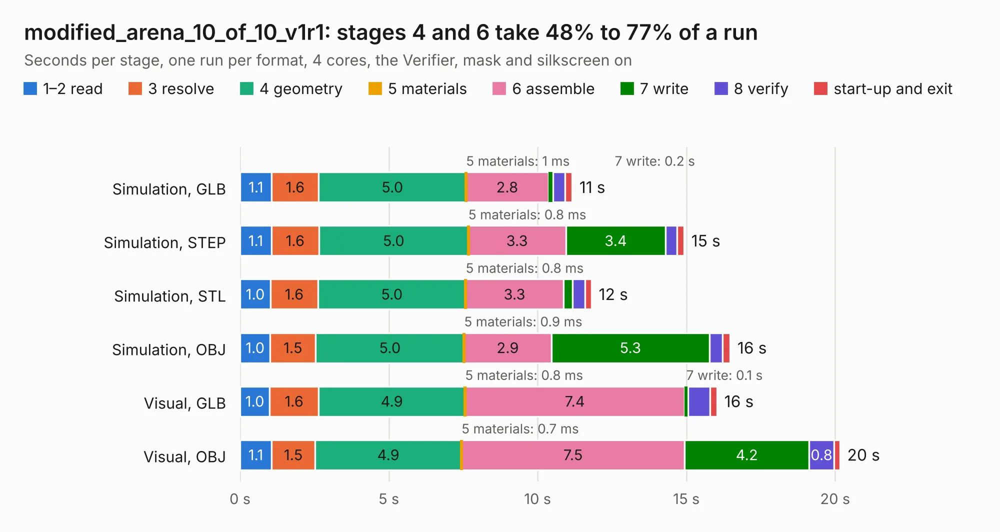

# 1290. modified_arena_10_of_10_v1r1

Board 1,290 of the 3,120 of [Corpus Testing](../Corpus-Testing.md), on [Corpus Page 12](../CorpusTestingPages/Corpus-Testing-12.md#1290-modified_arena_10_of_10_v1r1).

| Mode and format | 1–2 read | 3 resolve | 4 geometry | 5 materials | 6 assemble | 7 write | 8 verify | start-up and exit | Total |
|---|---:|---:|---:|---:|---:|---:|---:|---:|---:|
| Simulation, GLB | 1.1 | 1.6 | 5.0 | 1&nbsp;ms | 2.8 | 0.2 | 0.4 | 0.2 | 11.2 |
| Simulation, STEP | 1.1 | 1.6 | 5.0 | 0.8&nbsp;ms | 3.3 | 3.4 | 0.4 | 0.2 | 14.9 |
| Simulation, STL | 1.0 | 1.6 | 5.0 | 0.8&nbsp;ms | 3.3 | 0.3 | 0.4 | 0.2 | 11.8 |
| Simulation, OBJ | 1.0 | 1.5 | 5.0 | 0.9&nbsp;ms | 2.9 | 5.3 | 0.4 | 0.3 | 16.5 |
| Visual, GLB | 1.0 | 1.6 | 4.9 | 0.8&nbsp;ms | 7.4 | 0.1 | 0.7 | 0.2 | 16.0 |
| Visual, OBJ | 1.1 | 1.5 | 4.9 | 0.7&nbsp;ms | 7.5 | 4.2 | 0.8 | 0.2 | 20.2 |

<table align="center"><tr><td valign="top">

| Board | Repo: [iorodeo/led-display_g6_hardware_arena](https://github.com/iorodeo/led-display_g6_hardware_arena) Board: `modified_arena_10_of_10_v1r1.kicad_pcb` |
|---|---|
| Folder | arena_12-18 / layout_tool |
| Complexity | 104&nbsp;/&nbsp;1000 (size&nbsp;84, features&nbsp;20) |
| KESE&nbsp;features | rounded, trapezoid or chamfered pads, curved board outline |
| Tested | 9th November 2026 |
| Copper&nbsp;layers | 2 |
| File&nbsp;format | KiCad 9 (20241229) |
| Parts,&nbsp;tracks,&nbsp;vias | 495, 0, 0 |
| Triangles,&nbsp;simulation | 990,208 in 253 parts |
| Note | mostly unrouted |
| Verifier | PASS in all six runs |

</td><td valign="top">

<table>
<tr><th>File type</th><th>File size</th><th>Peak memory used</th></tr>
<tr><th colspan="3" align="left">Simulation</th></tr>
<tr><td>GLB</td><td align="right">34&nbsp;MB</td><td align="right">496&nbsp;MB</td></tr>
<tr><td>STEP</td><td align="right">139&nbsp;MB</td><td align="right">550&nbsp;MB</td></tr>
<tr><td>STL</td><td align="right">50&nbsp;MB</td><td align="right">489&nbsp;MB</td></tr>
<tr><td>OBJ</td><td align="right">102&nbsp;MB</td><td align="right">712&nbsp;MB</td></tr>
<tr><th colspan="3" align="left">Visual</th></tr>
<tr><td>GLB</td><td align="right">26&nbsp;MB</td><td align="right">737&nbsp;MB</td></tr>
<tr><td>OBJ</td><td align="right">79&nbsp;MB</td><td align="right">671&nbsp;MB</td></tr>
</table>

</td></tr></table>

| Previous | Next |
|:---|---:|
| [1289. arena_12-18](b1289b_led-display-g6-hardware-arena_arena-12-18-layout-tool_arena-12-18.md) | [1291. arena_12-18](b1291b_led-display-g6-hardware-arena_arena-12-18-manual-route-v1_arena-12-18.md) |
