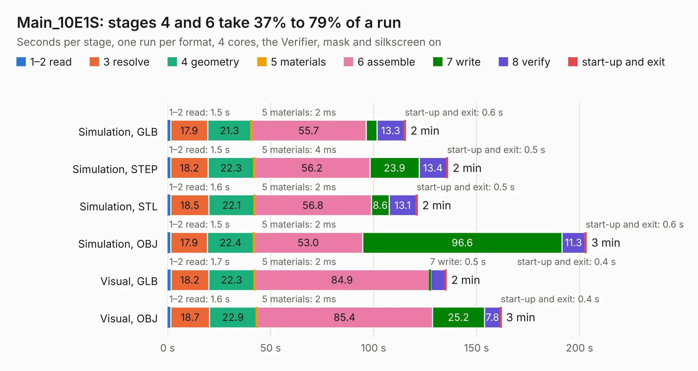

# 1290. Main_10E1S

Board 1,290 of the 3,111 of [Corpus Testing](../Corpus-Testing.md), on [Corpus Page 12](../CorpusTestingPages/Corpus-Testing-12.md#1290-main_10e1s).

| Mode and format | 1–2 read | 3 resolve | 4 geometry | 5 materials | 6 assemble | 7 write | 8 verify | start-up and exit | Total |
|---|---:|---:|---:|---:|---:|---:|---:|---:|---:|
| Simulation, GLB | 1.5 | 17.9 | 21.3 | 2&nbsp;ms | 55.7 | 5.4 | 13.3 | 0.6 | 115.5 |
| Simulation, STEP | 1.5 | 18.2 | 22.3 | 4&nbsp;ms | 56.2 | 23.9 | 13.4 | 0.5 | 136.0 |
| Simulation, STL | 1.6 | 18.5 | 22.1 | 2&nbsp;ms | 56.8 | 8.6 | 13.1 | 0.5 | 121.2 |
| Simulation, OBJ | 1.5 | 17.9 | 22.4 | 2&nbsp;ms | 53.0 | 96.6 | 11.3 | 0.6 | 203.3 |
| Visual, GLB | 1.7 | 18.2 | 22.3 | 2&nbsp;ms | 84.9 | 0.5 | 7.2 | 0.4 | 135.3 |
| Visual, OBJ | 1.6 | 18.7 | 22.9 | 2&nbsp;ms | 85.4 | 25.2 | 7.8 | 0.4 | 162.0 |

<table align="center"><tr><td valign="top">

| Board | Repo: [isarmg/pcie-switch-2](https://github.com/isarmg/pcie-switch-2) Board: `Main_10E1S.kicad_pcb` |
|---|---|
| Folder | outputs / PCIe_3board_RevI / Main_10E1S |
| Complexity | 425&nbsp;/&nbsp;1000 (size&nbsp;340, features&nbsp;85) |
| KESE&nbsp;features | through vias, blind and buried vias, rounded, trapezoid or chamfered pads, filled zones |
| Tested | 9th November 2026 to 10th November 2026 |
| Copper&nbsp;layers | 32 |
| File&nbsp;format | KiCad 10 (20260206) |
| Parts,&nbsp;tracks,&nbsp;vias | 180, 4,374, 1,354 |
| Triangles,&nbsp;simulation | 20,050,560 in 674 parts |
| Verifier | PASS in all six runs |
| Run&nbsp;again | Simulation, OBJ: failed in the corpus run, run again with the memory cap raised from 11 GB to 14.5 GB, and passed |

</td><td valign="top">

<table>
<tr><th>File type</th><th>File size</th><th>Peak memory used</th></tr>
<tr><th colspan="3" align="left">Simulation</th></tr>
<tr><td>GLB</td><td align="right">659&nbsp;MB</td><td align="right">3.4&nbsp;GB</td></tr>
<tr><td>STEP</td><td align="right">946&nbsp;MB</td><td align="right">4.1&nbsp;GB</td></tr>
<tr><td>STL</td><td align="right">1.0&nbsp;GB</td><td align="right">3.9&nbsp;GB</td></tr>
<tr><td>OBJ</td><td align="right">2.3&nbsp;GB</td><td align="right">12&nbsp;GB</td></tr>
<tr><th colspan="3" align="left">Visual</th></tr>
<tr><td>GLB</td><td align="right">123&nbsp;MB</td><td align="right">2.9&nbsp;GB</td></tr>
<tr><td>OBJ</td><td align="right">483&nbsp;MB</td><td align="right">3.2&nbsp;GB</td></tr>
</table>

</td></tr></table>

| Previous | Next |
|:---|---:|
| [1289. Left_2M2_Vertical](b1289b_pcie-switch-2_outputs-PCIe-3board-RevI-Left-2M2-Vertical_Left-2M2-Vertical.md) | [1291. Right_M2_Upstream](b1291b_pcie-switch-2_outputs-PCIe-3board-RevI-Right-M2-Upstream_Right-M2-Upstream.md) |
