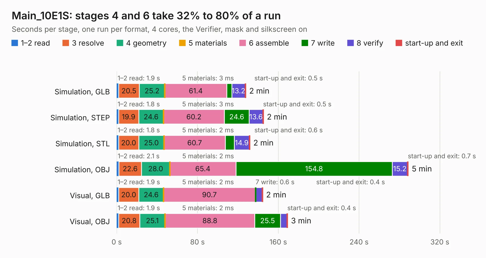

# 1292. Main_10E1S

Board 1,292 of the 3,109 of [Corpus Testing](../Corpus-Testing.md), on [Corpus Page 12](../CorpusTestingPages/Corpus-Testing-12.md#1292-main_10e1s).

| Mode and format | 1–2 read | 3 resolve | 4 geometry | 5 materials | 6 assemble | 7 write | 8 verify | start-up and exit | Total |
|---|---:|---:|---:|---:|---:|---:|---:|---:|---:|
| Simulation, GLB | 1.9 | 20.5 | 25.2 | 3&nbsp;ms | 61.4 | 5.0 | 13.2 | 0.5 | 127.8 |
| Simulation, STEP | 1.8 | 19.9 | 24.6 | 3&nbsp;ms | 60.2 | 24.6 | 13.6 | 0.5 | 145.3 |
| Simulation, STL | 1.8 | 20.0 | 25.0 | 2&nbsp;ms | 60.7 | 8.9 | 14.9 | 0.6 | 131.9 |
| Simulation, OBJ | 2.1 | 22.6 | 28.0 | 2&nbsp;ms | 65.4 | 154.8 | 15.2 | 0.7 | 288.7 |
| Visual, GLB | 1.9 | 20.0 | 24.6 | 2&nbsp;ms | 90.7 | 0.6 | 6.3 | 0.4 | 144.5 |
| Visual, OBJ | 1.9 | 20.8 | 25.1 | 2&nbsp;ms | 88.8 | 25.5 | 6.7 | 0.4 | 169.2 |

<table align="center"><tr><td valign="top">

| Board | Repo: [isarmg/pcie-switch-2](https://github.com/isarmg/pcie-switch-2) Board: `Main_10E1S.kicad_pcb` |
|---|---|
| Folder | outputs / PCIe_3board_RevJ / Main_10E1S |
| Complexity | 428&nbsp;/&nbsp;1000 (size&nbsp;343, features&nbsp;85) |
| KESE&nbsp;features | through vias, blind and buried vias, rounded, trapezoid or chamfered pads, filled zones |
| Tested | 9th November 2026 to 10th November 2026 |
| Copper&nbsp;layers | 32 |
| File&nbsp;format | KiCad 10 (20260206) |
| Parts,&nbsp;tracks,&nbsp;vias | 198, 5,142, 1,511 |
| Triangles,&nbsp;simulation | 21,580,684 in 674 parts |
| Verifier | PASS in all six runs |
| Run&nbsp;again | Simulation, OBJ: failed in the corpus run, run again with the memory cap raised from 11 GB to 14.5 GB, and passed |

</td><td valign="top">

<table>
<tr><th>File type</th><th>File size</th><th>Peak memory used</th></tr>
<tr><th colspan="3" align="left">Simulation</th></tr>
<tr><td>GLB</td><td align="right">708&nbsp;MB</td><td align="right">3.7&nbsp;GB</td></tr>
<tr><td>STEP</td><td align="right">1.0&nbsp;GB</td><td align="right">4.3&nbsp;GB</td></tr>
<tr><td>STL</td><td align="right">1.1&nbsp;GB</td><td align="right">4.2&nbsp;GB</td></tr>
<tr><td>OBJ</td><td align="right">2.5&nbsp;GB</td><td align="right">13&nbsp;GB</td></tr>
<tr><th colspan="3" align="left">Visual</th></tr>
<tr><td>GLB</td><td align="right">132&nbsp;MB</td><td align="right">3.0&nbsp;GB</td></tr>
<tr><td>OBJ</td><td align="right">518&nbsp;MB</td><td align="right">3.3&nbsp;GB</td></tr>
</table>

</td></tr></table>

| Previous | Next |
|:---|---:|
| [1291. Left_2M2_Vertical](b1291b_pcie-switch-2_outputs-PCIe-3board-RevJ-Left-2M2-Vertical_Left-2M2-Vertical.md) | [1293. Right_M2_Upstream](b1293b_pcie-switch-2_outputs-PCIe-3board-RevJ-Right-M2-Upstream_Right-M2-Upstream.md) |
