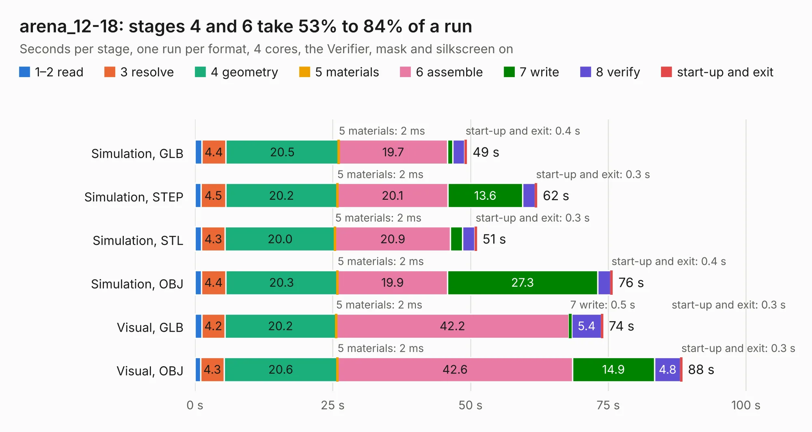

# 1299 arena_12-18

Board 1,299 of the 3,138 of [Corpus Testing](../Corpus-Testing.md), on [Corpus Page 13](../CorpusTestingPages/Corpus-Testing-13.md#1299-arena_12-18).

| Mode and format | 1–2 read | 3 resolve | 4 geometry | 5 materials | 6 assemble | 7 write | 8 verify | start-up and exit | Total |
|---|---:|---:|---:|---:|---:|---:|---:|---:|---:|
| Simulation, GLB | 1.2 | 4.4 | 20.5 | 2&nbsp;ms | 19.7 | 0.9 | 2.1 | 0.4 | 49.3 |
| Simulation, STEP | 1.1 | 4.5 | 20.2 | 2&nbsp;ms | 20.1 | 13.6 | 2.2 | 0.3 | 62.1 |
| Simulation, STL | 1.2 | 4.3 | 20.0 | 2&nbsp;ms | 20.9 | 2.2 | 2.2 | 0.3 | 51.1 |
| Simulation, OBJ | 1.2 | 4.4 | 20.3 | 2&nbsp;ms | 19.9 | 27.3 | 2.3 | 0.4 | 75.8 |
| Visual, GLB | 1.2 | 4.2 | 20.2 | 2&nbsp;ms | 42.2 | 0.5 | 5.4 | 0.3 | 74.1 |
| Visual, OBJ | 1.0 | 4.3 | 20.6 | 2&nbsp;ms | 42.6 | 14.9 | 4.8 | 0.3 | 88.4 |

<table align="center"><tr><td valign="top">

| Board | Repo: [iorodeo/led-display_g6_hardware_arena](https://github.com/iorodeo/led-display_g6_hardware_arena) Board: `arena_12-18.kicad_pcb` |
|---|---|
| Folder | arena_12-18 / manual_route / v2 |
| Complexity | 387&nbsp;/&nbsp;1000 (size&nbsp;242, features&nbsp;145) |
| KESE&nbsp;features | through vias, blind and buried vias, slotted holes, rounded, trapezoid or chamfered pads, arc tracks, curved board outline, tracks bare of mask, stack-up, dielectric εr and tanδ |
| Tested | 9th November 2026 |
| Copper&nbsp;layers | 6 |
| File&nbsp;format | KiCad 9 (20241229) |
| Parts,&nbsp;tracks,&nbsp;vias | 505, 1,744, 405 |
| Triangles,&nbsp;simulation | 5,657,426 in 516 parts |
| Verifier | PASS in all six runs |

</td><td valign="top">

<table>
<tr><th>File type</th><th>File size</th><th>Peak memory used</th></tr>
<tr><th colspan="3" align="left">Simulation</th></tr>
<tr><td>GLB</td><td align="right">186&nbsp;MB</td><td align="right">1.5&nbsp;GB</td></tr>
<tr><td>STEP</td><td align="right">660&nbsp;MB</td><td align="right">2.0&nbsp;GB</td></tr>
<tr><td>STL</td><td align="right">283&nbsp;MB</td><td align="right">1.5&nbsp;GB</td></tr>
<tr><td>OBJ</td><td align="right">592&nbsp;MB</td><td align="right">3.5&nbsp;GB</td></tr>
<tr><th colspan="3" align="left">Visual</th></tr>
<tr><td>GLB</td><td align="right">104&nbsp;MB</td><td align="right">1.9&nbsp;GB</td></tr>
<tr><td>OBJ</td><td align="right">327&nbsp;MB</td><td align="right">2.1&nbsp;GB</td></tr>
</table>

</td></tr></table>

| Previous | Next |
|:---|---:|
| [1298 arena_12-18](b1298b_led-display-g6-hardware-arena_arena-12-18-manual-route-v1-routed_arena-12-18.md) | [1300 arena_12-18](b1300b_led-display-g6-hardware-arena_arena-12-18-manual-route-v2-routed_arena-12-18.md) |
