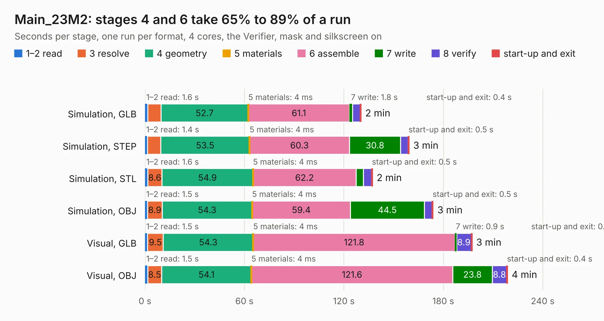

# 1299. Main_23M2

Board 1,299 of the 3,109 of [Corpus Testing](../Corpus-Testing.md), on [Corpus Page 13](../CorpusTestingPages/Corpus-Testing-13.md#1299-main_23m2).

| Mode and format | 1–2 read | 3 resolve | 4 geometry | 5 materials | 6 assemble | 7 write | 8 verify | start-up and exit | Total |
|---|---:|---:|---:|---:|---:|---:|---:|---:|---:|
| Simulation, GLB | 1.6 | 8.0 | 52.7 | 4&nbsp;ms | 61.1 | 1.8 | 4.7 | 0.4 | 130.3 |
| Simulation, STEP | 1.4 | 8.1 | 53.5 | 4&nbsp;ms | 60.3 | 30.8 | 4.6 | 0.5 | 159.3 |
| Simulation, STL | 1.6 | 8.6 | 54.9 | 4&nbsp;ms | 62.2 | 4.3 | 5.0 | 0.5 | 137.2 |
| Simulation, OBJ | 1.5 | 8.9 | 54.3 | 4&nbsp;ms | 59.4 | 44.5 | 4.8 | 0.5 | 173.8 |
| Visual, GLB | 1.5 | 9.5 | 54.3 | 4&nbsp;ms | 121.8 | 0.9 | 8.9 | 0.4 | 197.3 |
| Visual, OBJ | 1.5 | 8.5 | 54.1 | 4&nbsp;ms | 121.6 | 23.8 | 8.8 | 0.4 | 218.7 |

<table align="center"><tr><td valign="top">

| Board | Repo: [isarmg/pcie-switch-2](https://github.com/isarmg/pcie-switch-2) Board: `Main_23M2.kicad_pcb` |
|---|---|
| Folder | outputs / PCIe_AllM2_RevN / Main_23M2 |
| Complexity | 415&nbsp;/&nbsp;1000 (size&nbsp;320, features&nbsp;95) |
| KESE&nbsp;features | blind and buried vias, custom pads, rounded, trapezoid or chamfered pads, filled zones, copper drawings |
| Tested | 9th November 2026 |
| Copper&nbsp;layers | 32 |
| File&nbsp;format | KiCad 10 (20260206) |
| Parts,&nbsp;tracks,&nbsp;vias | 696, 432, 78 |
| Triangles,&nbsp;simulation | 8,133,244 in 2246 parts |
| Verifier | PASS in all six runs |

</td><td valign="top">

<table>
<tr><th>File type</th><th>File size</th><th>Peak memory used</th></tr>
<tr><th colspan="3" align="left">Simulation</th></tr>
<tr><td>GLB</td><td align="right">283&nbsp;MB</td><td align="right">3.0&nbsp;GB</td></tr>
<tr><td>STEP</td><td align="right">1.5&nbsp;GB</td><td align="right">3.8&nbsp;GB</td></tr>
<tr><td>STL</td><td align="right">407&nbsp;MB</td><td align="right">3.2&nbsp;GB</td></tr>
<tr><td>OBJ</td><td align="right">899&nbsp;MB</td><td align="right">5.4&nbsp;GB</td></tr>
<tr><th colspan="3" align="left">Visual</th></tr>
<tr><td>GLB</td><td align="right">162&nbsp;MB</td><td align="right">2.7&nbsp;GB</td></tr>
<tr><td>OBJ</td><td align="right">518&nbsp;MB</td><td align="right">3.4&nbsp;GB</td></tr>
</table>

</td></tr></table>

| Previous | Next |
|:---|---:|
| [1298. Assembly_View](b1298b_pcie-switch-2_outputs-PCIe-AllM2-RevN-Assembly-View_Assembly-View.md) | [1300. Main_27M2](b1300b_pcie-switch-2_Main-27M2.md) |
