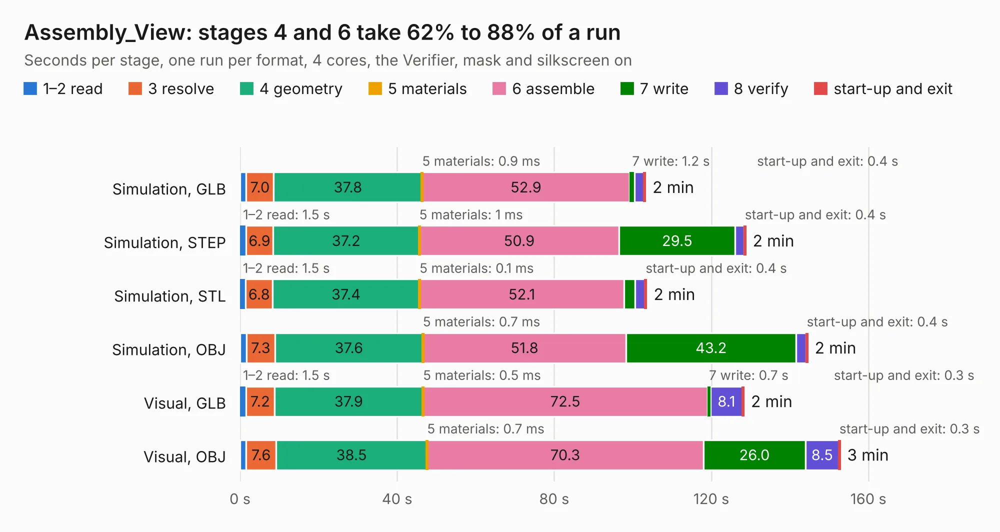

# 1300. Assembly_View

Board 1,300 of the 3,111 of [Corpus Testing](../Corpus-Testing.md), on [Corpus Page 13](../CorpusTestingPages/Corpus-Testing-13.md#1300-assembly_view).

| Mode and format | 1–2 read | 3 resolve | 4 geometry | 5 materials | 6 assemble | 7 write | 8 verify | start-up and exit | Total |
|---|---:|---:|---:|---:|---:|---:|---:|---:|---:|
| Simulation, GLB | 1.6 | 7.0 | 37.8 | 0.9&nbsp;ms | 52.9 | 1.2 | 2.3 | 0.4 | 103.2 |
| Simulation, STEP | 1.5 | 6.9 | 37.2 | 1&nbsp;ms | 50.9 | 29.5 | 2.3 | 0.4 | 128.7 |
| Simulation, STL | 1.5 | 6.8 | 37.4 | 0.1&nbsp;ms | 52.1 | 2.8 | 2.5 | 0.4 | 103.5 |
| Simulation, OBJ | 1.6 | 7.3 | 37.6 | 0.7&nbsp;ms | 51.8 | 43.2 | 2.5 | 0.4 | 144.5 |
| Visual, GLB | 1.5 | 7.2 | 37.9 | 0.5&nbsp;ms | 72.5 | 0.7 | 8.1 | 0.3 | 128.3 |
| Visual, OBJ | 1.6 | 7.6 | 38.5 | 0.7&nbsp;ms | 70.3 | 26.0 | 8.5 | 0.3 | 152.8 |

<table align="center"><tr><td valign="top">

| Board | Repo: [isarmg/pcie-switch-2](https://github.com/isarmg/pcie-switch-2) Board: `Assembly_View.kicad_pcb` |
|---|---|
| Folder | outputs / PCIe_AllM2_RevN / Assembly_View |
| Complexity | 181&nbsp;/&nbsp;1000 (size&nbsp;146, features&nbsp;35) |
| KESE&nbsp;features | custom pads, rounded, trapezoid or chamfered pads, copper drawings |
| Tested | 9th November 2026 |
| Copper&nbsp;layers | 2 |
| File&nbsp;format | KiCad 10 (20260206) |
| Parts,&nbsp;tracks,&nbsp;vias | 696, 0, 0 |
| Triangles,&nbsp;simulation | 7,509,700 in 8 parts |
| Note | mostly unrouted |
| Verifier | PASS in all six runs |

</td><td valign="top">

<table>
<tr><th>File type</th><th>File size</th><th>Peak memory used</th></tr>
<tr><th colspan="3" align="left">Simulation</th></tr>
<tr><td>GLB</td><td align="right">266&nbsp;MB</td><td align="right">3.0&nbsp;GB</td></tr>
<tr><td>STEP</td><td align="right">1.5&nbsp;GB</td><td align="right">3.9&nbsp;GB</td></tr>
<tr><td>STL</td><td align="right">375&nbsp;MB</td><td align="right">3.3&nbsp;GB</td></tr>
<tr><td>OBJ</td><td align="right">830&nbsp;MB</td><td align="right">5.0&nbsp;GB</td></tr>
<tr><th colspan="3" align="left">Visual</th></tr>
<tr><td>GLB</td><td align="right">160&nbsp;MB</td><td align="right">2.7&nbsp;GB</td></tr>
<tr><td>OBJ</td><td align="right">506&nbsp;MB</td><td align="right">3.3&nbsp;GB</td></tr>
</table>

</td></tr></table>

| Previous | Next |
|:---|---:|
| [1299. Main_10E1S](b1299b_pcie-switch-2_outputs-PCIe-3board-RevL-Main-10E1S_Main-10E1S.md) | [1301. Main_23M2](b1301b_pcie-switch-2_Main-23M2.md) |
