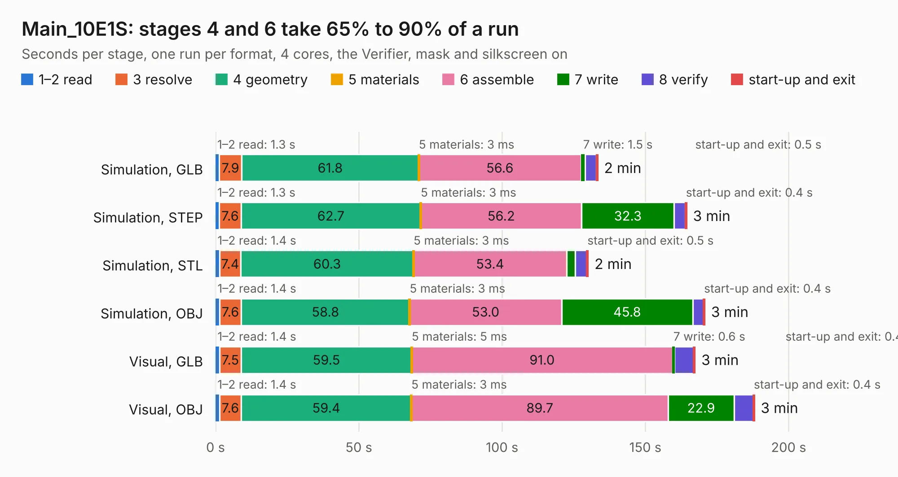

# 1300. Main_10E1S

Board 1,300 of the 3,105 of [Corpus Testing](../Corpus-Testing.md), on [Corpus Page 13](../CorpusTestingPages/Corpus-Testing-13.md#1300-main_10e1s).

| Mode and format | 1–2 read | 3 resolve | 4 geometry | 5 materials | 6 assemble | 7 write | 8 verify | start-up and exit | Total |
|---|---:|---:|---:|---:|---:|---:|---:|---:|---:|
| Simulation, GLB | 1.3 | 7.9 | 61.8 | 3&nbsp;ms | 56.6 | 1.5 | 3.9 | 0.5 | 133.3 |
| Simulation, STEP | 1.3 | 7.6 | 62.7 | 3&nbsp;ms | 56.2 | 32.3 | 3.9 | 0.4 | 164.4 |
| Simulation, STL | 1.4 | 7.4 | 60.3 | 3&nbsp;ms | 53.4 | 3.0 | 4.0 | 0.5 | 130.0 |
| Simulation, OBJ | 1.4 | 7.6 | 58.8 | 3&nbsp;ms | 53.0 | 45.8 | 3.8 | 0.4 | 170.7 |
| Visual, GLB | 1.4 | 7.5 | 59.5 | 5&nbsp;ms | 91.0 | 0.6 | 6.8 | 0.4 | 167.3 |
| Visual, OBJ | 1.4 | 7.6 | 59.4 | 3&nbsp;ms | 89.7 | 22.9 | 6.8 | 0.4 | 188.0 |

<table align="center"><tr><td valign="top">

| Board | Repo: [isarmg/pcie-switch-2](https://github.com/isarmg/pcie-switch-2) Board: `Main_10E1S.kicad_pcb` |
|---|---|
| Folder | outputs / PCIe_E1S_82x45_RevR / Main_10E1S |
| Complexity | 386&nbsp;/&nbsp;1000 (size&nbsp;316, features&nbsp;70) |
| KESE&nbsp;features | blind and buried vias, rounded, trapezoid or chamfered pads, filled zones |
| Tested | 9th November 2026 |
| Copper&nbsp;layers | 32 |
| File&nbsp;format | KiCad 10 (20260206) |
| Parts,&nbsp;tracks,&nbsp;vias | 264, 770, 78 |
| Triangles,&nbsp;simulation | 6,917,600 in 1546 parts |
| Verifier | PASS in all six runs |

</td><td valign="top">

<table>
<tr><th>File type</th><th>File size</th><th>Peak memory used</th></tr>
<tr><th colspan="3" align="left">Simulation</th></tr>
<tr><td>GLB</td><td align="right">240&nbsp;MB</td><td align="right">2.9&nbsp;GB</td></tr>
<tr><td>STEP</td><td align="right">1.3&nbsp;GB</td><td align="right">3.4&nbsp;GB</td></tr>
<tr><td>STL</td><td align="right">346&nbsp;MB</td><td align="right">2.7&nbsp;GB</td></tr>
<tr><td>OBJ</td><td align="right">761&nbsp;MB</td><td align="right">4.7&nbsp;GB</td></tr>
<tr><th colspan="3" align="left">Visual</th></tr>
<tr><td>GLB</td><td align="right">126&nbsp;MB</td><td align="right">2.6&nbsp;GB</td></tr>
<tr><td>OBJ</td><td align="right">402&nbsp;MB</td><td align="right">2.7&nbsp;GB</td></tr>
</table>

</td></tr></table>

| Previous | Next |
|:---|---:|
| [1299. Main_10E1S](b1299b_pcie-switch-2_outputs-PCIe-E1S-82x45-FakePEX90064-RevS-Main-10E1S_Main-10E1S.md) | [1301. Main_10E1S](b1301b_pcie-switch-2_outputs-PCIe-E1S-82x45-TB3Host-RevT-Main-10E1S_Main-10E1S.md) |
