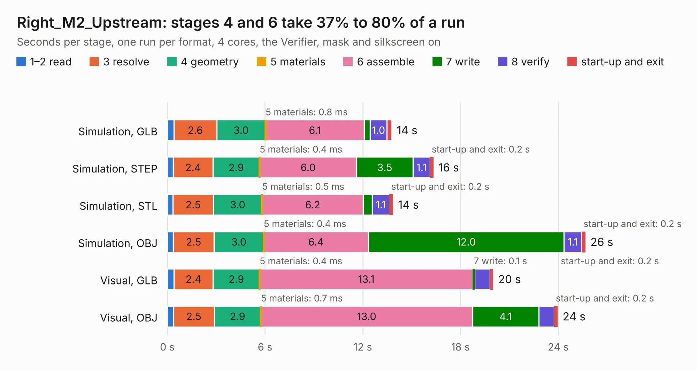

# 1301. Right_M2_Upstream

Board 1,301 of the 3,129 of [Corpus Testing](../Corpus-Testing.md), on [Corpus Page 13](../CorpusTestingPages/Corpus-Testing-13.md#1301-right_m2_upstream).

| Mode and format | 1–2 read | 3 resolve | 4 geometry | 5 materials | 6 assemble | 7 write | 8 verify | start-up and exit | Total |
|---|---:|---:|---:|---:|---:|---:|---:|---:|---:|
| Simulation, GLB | 0.4 | 2.6 | 3.0 | 0.8&nbsp;ms | 6.1 | 0.4 | 1.0 | 0.3 | 13.8 |
| Simulation, STEP | 0.4 | 2.4 | 2.9 | 0.4&nbsp;ms | 6.0 | 3.5 | 1.1 | 0.2 | 16.3 |
| Simulation, STL | 0.3 | 2.5 | 3.0 | 0.5&nbsp;ms | 6.2 | 0.5 | 1.1 | 0.2 | 13.9 |
| Simulation, OBJ | 0.4 | 2.5 | 3.0 | 0.4&nbsp;ms | 6.4 | 12.0 | 1.1 | 0.2 | 25.7 |
| Visual, GLB | 0.4 | 2.4 | 2.9 | 0.4&nbsp;ms | 13.1 | 0.1 | 0.9 | 0.2 | 20.0 |
| Visual, OBJ | 0.4 | 2.5 | 2.9 | 0.7&nbsp;ms | 13.0 | 4.1 | 0.9 | 0.2 | 24.0 |

<table align="center"><tr><td valign="top">

| Board | Repo: [isarmg/pcie-switch-2](https://github.com/isarmg/pcie-switch-2) Board: `Right_M2_Upstream.kicad_pcb` |
|---|---|
| Folder | outputs / PCIe_3board_RevI / Right_M2_Upstream |
| Complexity | 265&nbsp;/&nbsp;1000 (size&nbsp;220, features&nbsp;45) |
| KESE&nbsp;features | through vias, rounded, trapezoid or chamfered pads, filled zones |
| Tested | 9th November 2026 |
| Copper&nbsp;layers | 12 |
| File&nbsp;format | KiCad 10 (20260206) |
| Parts,&nbsp;tracks,&nbsp;vias | 50, 665, 225 |
| Triangles,&nbsp;simulation | 2,311,570 in 138 parts |
| Verifier | PASS in all six runs |

</td><td valign="top">

<table>
<tr><th>File type</th><th>File size</th><th>Peak memory used</th></tr>
<tr><th colspan="3" align="left">Simulation</th></tr>
<tr><td>GLB</td><td align="right">75&nbsp;MB</td><td align="right">673&nbsp;MB</td></tr>
<tr><td>STEP</td><td align="right">152&nbsp;MB</td><td align="right">773&nbsp;MB</td></tr>
<tr><td>STL</td><td align="right">116&nbsp;MB</td><td align="right">690&nbsp;MB</td></tr>
<tr><td>OBJ</td><td align="right">248&nbsp;MB</td><td align="right">1.5&nbsp;GB</td></tr>
<tr><th colspan="3" align="left">Visual</th></tr>
<tr><td>GLB</td><td align="right">24&nbsp;MB</td><td align="right">607&nbsp;MB</td></tr>
<tr><td>OBJ</td><td align="right">78&nbsp;MB</td><td align="right">643&nbsp;MB</td></tr>
</table>

</td></tr></table>

| Previous | Next |
|:---|---:|
| [1300. Main_10E1S](b1300b_pcie-switch-2_outputs-PCIe-3board-RevI-Main-10E1S_Main-10E1S.md) | [1302. Assembly_View](b1302b_pcie-switch-2_outputs-PCIe-3board-RevJ-Assembly-View_Assembly-View.md) |
